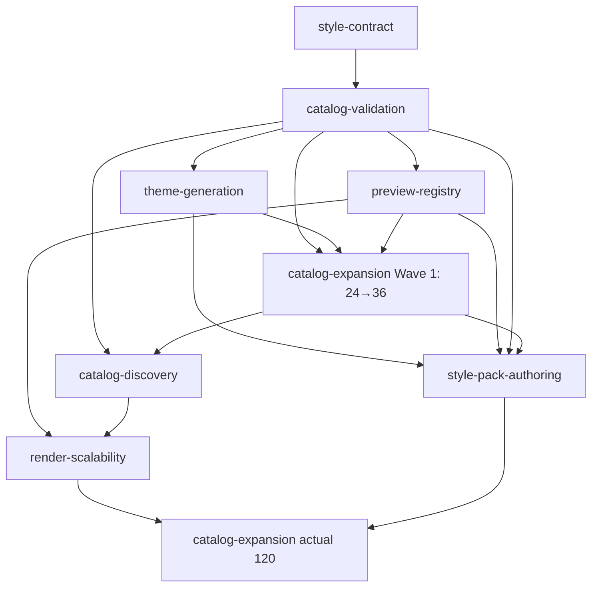

# Capability Map: 확장형 디자인 시안 라이브러리

**Project Name:** Web Design Sample Selector (`design_sample_selector`)

**Initiative ID:** `scalable-style-library`

**Document Status:** 승인·현행 (`ACCEPTED / CURRENT`)

**작성일:** 2026-08-30

**승인일:** 2026-08-30

**최근 검증일:** 2026-08-31

**근거:** 현재 `spec.md` v2.3.0, `SPEC-catalog-expansion-120.md`, actual 120 구현·검증

---

## 1. 목표와 전제

Wave 0의 24종과 Wave 1의 36종 호환 기준을 유지하면서 실제 공개 catalog를 120종까지 확장했다. 다음 조건은 현재 운영 계약이다.

- 기존 24개 정규 ID, 로컬 저장 데이터, 8대 화면 아키타입 및 내보내기 계약을 보존한다.
- 새 스타일은 단순 팔레트 변형이 아니라 고유 토큰, 썸네일, 모션, 목업, 설명, 근거 출처를 갖춘다.
- 상위 카테고리는 탐색용 기본 축으로 유지하고 시대, 계보, 매체, 질감, 밀도, 분위기, 모션 강도 등의 다중 facet을 추가한다.
- Vanilla HTML/CSS/JavaScript와 클라이언트 전용 실행 구조를 유지한다.
- 저작권이 있는 특정 작품이나 상용 사이트를 복제하지 않고 디자인 사조의 일반적 시각 문법을 재해석한다.
- 성능 목표는 추측으로 보장하지 않고 Chrome 실측 예산과 회귀 테스트로 관리한다.

## 2. 역량 모듈

모듈 ID는 승인 후 변경하지 않는다. 각 모듈은 독립적으로 사양화하고 검증할 수 있는 경계다.

| Module ID | 책임 | 주요 산출물 | Depends on |
| --- | --- | --- | --- |
| `style-contract` | 스타일·카테고리·facet·출처·호환 ID의 단일 데이터 계약 정의 | 정규 스키마, ID 정책, 호환 규칙, 타입/예시 | — |
| `catalog-validation` | 누락·중복·잘못된 참조·접근성 위험을 빌드 전에 차단 | 스키마 검증기, 레지스트리 불변조건 테스트, 오류 리포트 | `style-contract` |
| `theme-generation` | 런타임 CSS와 CSS/Markdown/DTCG 내보내기의 토큰 원천 통합 | 단일 토큰 원천, 생성 파이프라인, 기존 출력 호환 어댑터 | `style-contract`, `catalog-validation` |
| `preview-registry` | 목업·썸네일·모션 디스패치를 명시적 레지스트리로 전환 | 렌더러 레지스트리, 썸네일/모션 계약, 누락 시 명시적 실패 | `style-contract`, `catalog-validation` |
| `catalog-discovery` | 60~120종에서도 원하는 스타일을 찾을 수 있는 탐색 체계 제공 | 동적 개수, facet 필터, 검색, 시대 데이터 기반 Spectrum, URL/상태 계약 | `style-contract`, `catalog-validation` |
| `render-scalability` | 대형 카탈로그의 DOM·메모리·모션 비용을 제한 | 지연 렌더링, 스플릿 피커 가상화/검색, 성능 측정 시나리오와 예산 | `preview-registry`, `catalog-discovery` |
| `style-pack-authoring` | 새 스타일 팩을 반복 가능하고 일관되게 제작 | 21문법 authoring 계약, 7개 팩, 출처/접근성 기록, 시각 QA 매트릭스 | `theme-generation`, `preview-registry`, `catalog-validation` |
| `catalog-expansion` | 검증된 팩 단위로 실제 카탈로그를 actual 120으로 확장 | 84개 스타일 데이터·렌더·문서·회귀 결과 | `style-pack-authoring`, `catalog-discovery`, `render-scalability` |

## 3. 의존성 방향과 빌드 순서

구현 순서는 다음과 같다.

1. `style-contract`, `catalog-validation`, `theme-generation`, `preview-registry` 기반 계약
2. `catalog-expansion` Wave 1의 24→36종 저작 증명
3. `catalog-discovery`, `render-scalability` 운영화
4. 사용자의 일괄 전환 승인에 따라 21문법 authoring 계약과 7개 팩을 같은 작업 단위에서 구현해 actual 120 완료

기존 계획의 60→100~120 순차 출시는 사용자의 2026-08-31 일괄 구현 요청으로 대체되었다. 내부 체크포인트는 유지했지만 사용자 인계는 actual 120 전체로 한 번에 수행했다. 기존 24·36 호환 어댑터와 subset 지문은 각 단계에서 계속 실행 가능한 안전망으로 유지한다.

## 4. 모듈 경계

### `style-contract`

- 포함: 정규 ID, 별칭, 카테고리, facet, 시대, 출처, 토큰, 프리뷰 참조의 데이터 형태
- 제외: 구체적인 UI 배치, 개별 스타일의 시각 구현
- 제공 계약: 다른 모든 모듈이 읽는 유일한 스타일 레코드 형식

### `catalog-validation`

- 포함: 유일한 ID, 별칭 충돌, 필수 필드, 색상 형식, 렌더러·토큰 참조, 출처와 라이선스 메타데이터 검증
- 제외: 런타임 자동 복구
- 핵심 원칙: 누락된 스타일을 Swiss로 조용히 대체하지 않고 개발·빌드 단계에서 실패시킨다.

### `theme-generation`

- 포함: 현재 이중 관리되는 런타임 CSS 토큰과 내보내기 토큰의 단일 원천화
- 제외: 아키타입 HTML 구조 변경
- 호환 조건: 기존 CSS/Markdown/DTCG 2025.10 출력과 24개 ID의 결과를 보존한다.
- 완료 근거: 정규 theme projection, 생성·추적 CSS, write/check CLI, prebuild stale 게이트, 984개 내보내기 조합 해시와 Crostini Chrome 151 회귀 검증

### `preview-registry`

- 포함: `StyleRecord.preview`의 renderer/thumbnail/motion ID에 연결되는 정적 definition, 불변 registry, 기능 탐지, 동기 render와 파생 `ReferenceInventory`
- 제외: 카탈로그 필터 UX, 런타임 등록, 원격 HTML, dynamic import와 지연 로딩
- 제공 계약: `src/preview/index.js`의 9개 공개 export, 조회 `false`/`null` 대 실제 render/hydration `PreviewRegistryError`, 독립 `thumbnailId`, 근거 기반 motion descriptor
- 호환 조건: 기존 24종의 120-output hash, 4개 Web 컴포넌트 탭, 8대 아키타입 테마·상태와 Desktop/Mobile 동작을 보존한다.
- 완료 근거: 24/24/24/0 derived inventory, UI 공개 API 직접 소비, 표적 30개·전체 93개 테스트, Chrome 151의 Web 96개·device 384개·reduced-motion·diagnostics 0

### `catalog-discovery`

- 포함: 상위 카테고리와 독립 북마크, 10개 facet, 한국어·영어·metadata 검색, 네 정렬, 시대 기반 Spectrum, 동적 결과 수, URL/상태 복원
- 제외: 대량 DOM 최적화의 구체적 구현
- 핵심 원칙: 카테고리를 12개 이상 계속 늘리는 대신 교차 facet으로 긴 꼬리 스타일을 찾게 한다.
- 제공 계약: `src/catalog/discovery.js`의 순수 AND/OR 질의, `discoveryUrl.js`의 `q/category/f/sort/view/saved` canonical 직렬화, `galleryModel.js`의 세 보기 공통 결과 집합
- 완료 근거: 탐색 집중 15/15·전체 121/121 테스트, catalog 오류 0/legacy 경고 56, 현재 theme CSS와 build, 격리 Chrome 151의 9개 시나리오·6개 폭·세 보기·88개 입력·diagnostics/issue 0

### `render-scalability`

- 포함: 갤러리·상세 칩·스플릿 비교 선택기의 렌더 비용과 모션 생명주기
- 제외: 스타일 콘텐츠 제작
- 핵심 원칙: 120종 데이터를 모두 한 번에 시각 DOM으로 만들지 않는다.
- 제공 계약: Gallery 36개 window, Detail 24개 bounded category picker, Split 12개/slot visual picker + 전체 native select, thumbnail/motion/component 종류별 entry와 실패 복구 가능한 lazy loader
- 완료 근거: 전체 152개 테스트, 초기 JS/CSS `83.46/32.86kB` gzip, Chrome 151 actual 120 + synthetic 60/120 도달성·상한·interaction·observer·reduced-motion·diagnostics/issue 0

### `style-pack-authoring`

- 포함: 12종 단위 내부 팩, 21개 문법, 조사 근거, 시각적 차별성, 접근성, 반응형, 라이선스 검토 절차
- 제외: 120종 이후 원격 팩·사용자 업로드
- 핵심 원칙: 색상만 다른 변형은 별도 정규 스타일로 계산하지 않는다.
- 완료 근거: `src/catalog/packs/expansion/authoring.js`, 7개 명시 팩, 신규 ready 84종 품질 0/0, Chrome 84/84 Desktop/Mobile grid 변화

### `catalog-expansion`

- 포함: 승인된 스타일 팩의 실제 구현과 Wave별 출시 게이트
- 제외: 기반 계약을 우회하는 일회성 스타일 추가
- 핵심 원칙: 실제 총량과 페이지 DOM 상한을 분리하고 기존 subset 계약을 보존한다.
- Wave 1 완료 근거: legacy 24 + ready 12의 Core 36, preview `36/36/36/0`, 전체 106개 Node 테스트, 기존 subset 해시 보존, Crostini Chrome 151의 세 갤러리 모드·6개 viewport·Core 36 × 8 × 2 = 576상태·신규 12종 집중 Detail·Split·reduced-motion·diagnostics 0
- Actual 120 완료 근거: Core 36 + ready 84, preview `120/120/120/0`, 전체 152개 테스트, actual 120×8×2 = 1,920상태·Web 480탭·신규 84/84 device 변화·진단 0

## 5. 완료된 확장 경로

이 절은 세부 로드맵이 아니라 `catalog-expansion` 모듈의 범위를 확인하기 위한 목표선이다.

| Wave | 누적 목표 | 목적 | 예시 구성 |
| --- | ---: | --- | --- |
| Wave 0 | 24종 | 구조 전환 및 결과 동등성 확보 | 기존 카탈로그를 새 계약으로 무손실 이전 |
| Wave 1 | 36종 | 새 구조의 실제 저작 흐름 검증 | 역사적 장식, 모더니스트 아방가르드, 인쇄·언더그라운드, 기존 카테고리 보강 |
| Capacity gate | synthetic 60/120 | facet 탐색·bounded DOM·지연 렌더 검증 | production 변경 없이 용량·재시도·observer 검증 |
| Actual 120 | 120종 | 실제 디자인 시안 장기 카탈로그 완성 | 7팩·21문법·ready 84종을 일괄 추가 |

정확한 신규 84종 명단과 출처는 `SPEC-catalog-expansion-120.md`에 확정돼 있다. 120종 이후 확장은 새 사양에서 별도로 결정한다.

## 6. 전체 완료 조건

- 120종 데이터로 갤러리, 상세 보기, 스플릿 비교, 검색과 필터가 기능적으로 동작한다.
- 기존 24종의 정규 ID, 저장 데이터와 내보내기 결과가 호환된다.
- 모든 정규 스타일은 토큰, 렌더러, 썸네일, 모션 정책, 설명, 출처와 접근성 메모를 갖는다.
- 레지스트리 누락과 중복은 런타임 폴백이 아니라 자동 검증에서 실패한다.
- Desktop/Mobile × 8대 아키타입 검증 매트릭스가 각 Wave의 완료 게이트에 포함된다.
- ChromeOS Crostini의 Linux Chrome을 포함한 실제 브라우저에서 각 Wave별 성능 예산을 측정하고 기록한다.
- `spec.md`, `designs.md`, `DESIGN_DECISIONS.md`, README, 감사 기준과 작업 목록이 구현 상태와 동기화된다.

## 7. 승인된 결정

다음 항목은 2026-08-30 사용자 승인으로 고정되었다. 모듈별 사양, ADR, `tasks/plan.md`, `tasks/todo.md`는 이 지도에 맞춰 작성한다.

1. 장기 설계 용량을 최소 120종으로 잡는다.
2. 8대 아키타입과 클라이언트 전용 Vanilla 기술 스택을 유지한다.
3. 단일 정규 레지스트리와 엄격한 빌드 검증을 기반 구조로 채택한다.
4. 상위 카테고리와 다중 facet을 함께 사용한다.
5. 기반 구조를 먼저 무손실 이전한 뒤 36→60→100~120종 순으로 확장한다.
6. 2026-08-31 사용자는 중간 사용자 인계 없이 총 120종을 일괄 구현하도록 5번의 순차 출시 계획을 대체 승인했다.

## 8. 운영 기본값과 후속 확정 항목

- actual 120의 모든 스타일을 검색·열람할 수 있게 제공하되 무거운 프리뷰 구현은 필요할 때 지연 로딩한다. 120종 이후의 선택형 팩은 새 사양에서 결정한다.
- CSS/HTML 생성 그래픽을 우선한다. 고유성 확보에 꼭 필요한 경우 출처와 라이선스가 확인된 프로젝트 로컬 에셋을 허용한다.
- 성능 기준 기기는 사용자의 ChromeOS Crostini Linux Chrome으로 한다. 구체적인 시간·메모리 예산은 Wave 0 기준선 실측 후 `SPEC-render-scalability.md`에서 고정한다.
- 지역·문화 기반 디자인은 먼저 facet으로 제공한다. 독립적으로 검증된 스타일이 3종 이상 모일 때 상위 카테고리 승격을 검토한다.

## 9. 구현 상태

| Module ID | Status | Evidence / Next gate |
| --- | --- | --- |
| `style-contract` | **COMPLETE** | `src/catalog/`, `SPEC-style-contract.md`, `tests/styleContract.test.js`; 25개 테스트·Vite 빌드·Crostini Chrome 회귀 통과 |
| `catalog-validation` | **COMPLETE** | `src/catalog/validation/`, `scripts/validateCatalog.js`, `tests/catalogValidation.test.js`; 오류 0·경고 56 기준선, 전체 49개 테스트·prebuild·Crostini Chrome 151 회귀 통과 |
| `theme-generation` | **COMPLETE** | `src/theme/`, 생성 CSS/CLI, `tests/themeGeneration.test.js`; 전체 63개 테스트·984개 출력 조합 해시·Chrome 151 회귀 통과 |
| `preview-registry` | **COMPLETE** | `src/preview/`, `SPEC-preview-registry.md`, preview/runtime/integration 테스트; Tasks 1–12와 Final Checkpoint, 24/24/24/0 inventory, 120-output hash, 전체 93개 테스트와 Chrome 151의 thumbnail 72개 뷰·Web 96개·Desktop/Mobile 384개·diagnostics 0 통과 |
| `catalog-discovery` | **COMPLETE** | `src/catalog/discovery.js`, URL/state adapter, 접근 가능한 controls, 공통 gallery model; 집중 15개·전체 121개 테스트와 Chrome 151의 9개 시나리오·6개 폭·diagnostics 0 통과 |
| `render-scalability` | **COMPLETE** | bounded gallery/detail/split, lazy preview, bundle analyzer와 Chrome QA; 초기 JS/CSS `83.46/32.86kB` gzip, actual/synthetic 120, 전체 152개 테스트 통과 |
| `style-pack-authoring` | **COMPLETE — INTEGRATED** | `authoring.js` 21문법, 7개 팩, 출처·접근성·ready 품질 계약, 신규 84종 Chrome device 변화 통과 |
| `catalog-expansion` | **COMPLETE — ACTUAL 120** | `SPEC-catalog-expansion-120.md`; 120종·category별 15, inventory 120/120/120/0, Chrome 1,920상태·Web 480탭·diagnostics 0 |

2026-08-31 actual 120 구현과 검증을 완료했다. 다음 고정 수량의 미구현 Wave는 없다. 후속 작업은 사용자 피드백에 따른 개별 시안 특화, 기존 legacy 24의 출처·접근성 경고 정리 또는 120종 이후 새 확장 사양 중 하나로 시작한다.
