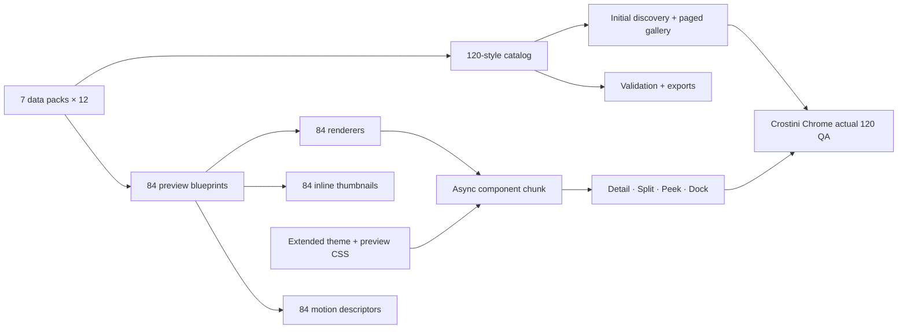

# Spec: Catalog Expansion — Actual 120

**Project:** Web Design Sample Selector (`design_sample_selector`)

**Initiative:** `scalable-style-library`

**Module:** `catalog-expansion`

**Supersedes for current work:** `SPEC-catalog-expansion.md`의 Wave 1 전용 범위

**Document Status:** 구현 완료 (`COMPLETE`)

**승인일:** 2026-08-31

**완료일:** 2026-08-31

**조사 기준일:** 2026-08-31

---

## 1. Objective

현재 실제 Core 36종에 신규 84종을 한 번에 추가해 사용자 카탈로그를 정확히 **120종**으로 확장한다. 사용자는 Grid, Bento, Spectrum, 검색·facet, Detail, Peek, 선택 도크와 Split Compare에서 120종 모두를 실제 디자인 시안으로 열람하고 비교할 수 있어야 한다.

이번 요청은 기존의 36→60→100~120 순차 출시와 별도 `style-pack-authoring` 승인 게이트를 대체한다. 내부 구현은 회귀 원인 추적을 위해 작은 체크포인트로 나누지만, 사용자 인계는 120종 전체가 완성된 뒤 한 번에 수행한다.

## 2. Approved Assumptions

1. “120개 추가까지”는 기존 대화의 장기 목표대로 **총 120종**, 즉 신규 84종을 뜻한다. 총 156종으로 해석하지 않는다.
2. 기존 8개 상위 카테고리는 유지하고 각 카테고리를 정확히 15종으로 맞춘다.
3. 기존 36종의 정규 ID·alias·저장 데이터·테마·프리뷰·내보내기 결과는 바꾸지 않는다.
4. 신규 84종은 모두 `ready`이며 토큰, 프리뷰 세 참조, 편집 설명, 신뢰 출처와 구체적 접근성 메모를 갖는다.
5. 외부 이미지·폰트·오디오와 런타임 dependency를 추가하지 않는다. 특정 작품·브랜드 화면·로고를 복제하지 않고 원칙만 재해석한다.
6. 신규 상세 테마·프리뷰 CSS는 async Detail/component 경계로 전달해 초기 CSS `33.00kB` gzip 예산을 유지한다.
7. 현재 요청은 사양·계획·작업 목록 갱신 뒤 별도 중간 승인 대기 없이 전체 구현과 검증을 진행하는 승인이다.

## 3. Scope

### Included

- 신규 7개 내부 팩 × 12종 = 84개의 정규 `StyleRecord`
- 실제 공개 카탈로그 120종과 카테고리별 15종 균형
- 신규 renderer·thumbnail·motion ID 각 84개
- 네 Web 탭과 8개 아키타입의 Desktop/Mobile 표현
- 팩 공통 21개 시각 문법과 시안별 이름·팔레트·카피·변형
- 신규 팩 테마 CSS와 상세 프리뷰 CSS의 async 전달
- 현재 카탈로그 120종 기준 검색·facet·페이지·Detail·Split·URL·저장 호환
- 정적 검증, 초기 번들 예산, Crostini Chrome 실제 120종 QA
- 제품·설계·ADR·운영·감사·인수인계 문서 동기화

### Excluded

- 120종을 넘는 플러그인 마켓·원격 팩·사용자 업로드
- 상위 카테고리 ID 변경 또는 새 카테고리 생성
- 외부 API, 서버, 데이터베이스, 인증, 배포
- 라이선스가 필요한 상용 에셋이나 브랜드 로고 복제
- Git commit·push·tag·release

## 4. Roster — New 84

각 내부 팩은 3개 시각 문법군 × 4개 시안으로 구성한다. 팩은 구현·검증 단위일 뿐 사용자는 한 카탈로그로 본다.

### Pack A — `modern-foundations`

| # | Category | Canonical ID | 표시명 |
| ---: | --- | --- | --- |
| 1 | swiss | `ulm-rationalism` | 울름 합리주의 / Ulm Rationalism |
| 2 | swiss | `swiss-poster` | 스위스 포스터 / Swiss Poster |
| 3 | swiss | `dutch-total-design` | 더치 토털 디자인 / Dutch Total Design |
| 4 | swiss | `new-wave-typography` | 뉴웨이브 타이포그래피 / New Wave Typography |
| 5 | swiss | `modular-grid-system` | 모듈러 그리드 시스템 / Modular Grid System |
| 6 | swiss | `functional-wayfinding` | 기능주의 웨이파인딩 / Functional Wayfinding |
| 7 | swiss | `japanese-ma-minimal` | 일본식 마 미니멀 / Japanese Ma Minimal |
| 8 | swiss | `scandinavian-functional` | 스칸디나비아 기능주의 / Scandinavian Functional |
| 9 | swiss | `information-isotype` | 아이소타입 정보 디자인 / Isotype Information Design |
| 10 | brutalism | `web-brutalism` | 웹 브루탈리즘 / Web Brutalism |
| 11 | brutalism | `anti-design` | 안티 디자인 / Anti-Design |
| 12 | brutalism | `dada-collage` | 다다 콜라주 / Dada Collage |

### Pack B — `raw-materials`

| # | Category | Canonical ID | 표시명 |
| ---: | --- | --- | --- |
| 13 | brutalism | `grunge-typography` | 그런지 타이포그래피 / Grunge Typography |
| 14 | brutalism | `industrial-stencil` | 인더스트리얼 스텐실 / Industrial Stencil |
| 15 | brutalism | `monochrome-xerox` | 모노크롬 제록스 / Monochrome Xerox |
| 16 | brutalism | `glitch-brutalism` | 글리치 브루탈리즘 / Glitch Brutalism |
| 17 | brutalism | `maximalist-chaos` | 맥시멀리스트 카오스 / Maximalist Chaos |
| 18 | brutalism | `black-metal-editorial` | 블랙 메탈 에디토리얼 / Black Metal Editorial |
| 19 | brutalism | `concrete-interface` | 콘크리트 인터페이스 / Concrete Interface |
| 20 | depth | `paper-cut-layers` | 페이퍼컷 레이어 / Paper-cut Layers |
| 21 | depth | `acrylic-ui` | 아크릴릭 UI / Acrylic UI |
| 22 | depth | `mica-surface` | 마이카 서피스 / Mica Surface |
| 23 | depth | `holographic-foil` | 홀로그래픽 포일 / Holographic Foil |
| 24 | depth | `chrome-metal-ui` | 크롬 메탈 UI / Chrome Metal UI |

### Pack C — `dimensional-pop`

| # | Category | Canonical ID | 표시명 |
| ---: | --- | --- | --- |
| 25 | depth | `iridescent-mesh` | 이리데슨트 메시 / Iridescent Mesh |
| 26 | depth | `isometric-depth` | 아이소메트릭 뎁스 / Isometric Depth |
| 27 | depth | `low-poly-interface` | 로우 폴리 인터페이스 / Low-poly Interface |
| 28 | depth | `soft-plastic` | 소프트 플라스틱 / Soft Plastic |
| 29 | depth | `embossed-letterpress` | 엠보스드 레터프레스 / Embossed Letterpress |
| 30 | retro | `mid-century-modern` | 미드센추리 모던 / Mid-century Modern |
| 31 | retro | `atomic-age` | 아토믹 에이지 / Atomic Age |
| 32 | retro | `pop-art-halftone` | 팝아트 하프톤 / Pop Art Halftone |
| 33 | retro | `op-art` | 옵아트 / Op Art |
| 34 | retro | `space-age` | 스페이스 에이지 / Space Age |
| 35 | retro | `disco-glam` | 디스코 글램 / Disco Glam |
| 36 | retro | `seventies-groovy` | 세븐티스 그루비 / Seventies Groovy |

### Pack D — `retro-editorial`

| # | Category | Canonical ID | 표시명 |
| ---: | --- | --- | --- |
| 37 | retro | `eighties-new-wave` | 에이티스 뉴웨이브 / Eighties New Wave |
| 38 | retro | `retro-computing` | 레트로 컴퓨팅 / Retro Computing |
| 39 | retro | `pulp-comic` | 펄프 코믹 / Pulp Comic |
| 40 | editorial | `newspaper-broadsheet` | 뉴스페이퍼 브로드시트 / Newspaper Broadsheet |
| 41 | editorial | `literary-journal` | 리터러리 저널 / Literary Journal |
| 42 | editorial | `academic-modern` | 아카데믹 모던 / Academic Modern |
| 43 | editorial | `archival-museum` | 아카이벌 뮤지엄 / Archival Museum |
| 44 | editorial | `photobook-minimal` | 포토북 미니멀 / Photobook Minimal |
| 45 | editorial | `botanical-editorial` | 보태니컬 에디토리얼 / Botanical Editorial |
| 46 | editorial | `wabi-sabi-paper` | 와비사비 페이퍼 / Wabi-sabi Paper |
| 47 | editorial | `collage-magazine` | 콜라주 매거진 / Collage Magazine |
| 48 | editorial | `typographic-poster` | 타이포그래픽 포스터 / Typographic Poster |

### Pack E — `web-millennium`

| # | Category | Canonical ID | 표시명 |
| ---: | --- | --- | --- |
| 49 | editorial | `luxury-serif-minimal` | 럭셔리 세리프 미니멀 / Luxury Serif Minimal |
| 50 | y2k | `early-web` | 얼리 웹 / Early Web |
| 51 | y2k | `geocities-maximal` | 지오시티스 맥시멀 / GeoCities Maximal |
| 52 | y2k | `aqua-desktop` | 아쿠아 데스크톱 / Aqua Desktop |
| 53 | y2k | `luna-desktop` | 루나 데스크톱 / Luna Desktop |
| 54 | y2k | `web2-gloss` | 웹 2.0 글로스 / Web 2.0 Gloss |
| 55 | y2k | `flash-portal` | 플래시 포털 / Flash Portal |
| 56 | y2k | `blogspot-collage` | 블로그스팟 콜라주 / Blogspot Collage |
| 57 | y2k | `cyber-y2k` | 사이버 Y2K / Cyber Y2K |
| 58 | y2k | `kawaii-pixel-web` | 카와이 픽셀 웹 / Kawaii Pixel Web |
| 59 | y2k | `scene-core-web` | 신 코어 웹 / Scene-core Web |
| 60 | y2k | `mcbling-gloss` | 맥블링 글로스 / McBling Gloss |

### Pack F — `data-spatial`

| # | Category | Canonical ID | 표시명 |
| ---: | --- | --- | --- |
| 61 | y2k | `tech-optimism-2000` | 2000년대 테크 옵티미즘 / 2000s Tech Optimism |
| 62 | hypertech | `cyberpunk-tactical-hud` | 사이버펑크 HUD / Cyberpunk HUD |
| 63 | hypertech | `sci-fi-fui` | 사이파이 FUI / Sci-fi FUI |
| 64 | hypertech | `terminal-matrix` | 터미널 매트릭스 / Terminal Matrix |
| 65 | hypertech | `data-dense-dashboard` | 데이터 덴스 대시보드 / Data-dense Dashboard |
| 66 | hypertech | `real-time-monitor` | 리얼타임 모니터 / Real-time Monitor |
| 67 | hypertech | `chromatic-aberration` | 색수차 RGB 스플릿 / Chromatic Aberration |
| 68 | hypertech | `generative-grid` | 제너러티브 그리드 / Generative Grid |
| 69 | hypertech | `biometric-interface` | 바이오메트릭 인터페이스 / Biometric Interface |
| 70 | hypertech | `spatial-glass-ui` | 스페이셜 글래스 UI / Spatial Glass UI |
| 71 | hypertech | `ai-native-gradient` | AI 네이티브 그라디언트 / AI-native Gradient |
| 72 | hypertech | `quantum-control` | 퀀텀 컨트롤 / Quantum Control |

### Pack G — `soft-play`

| # | Category | Canonical ID | 표시명 |
| ---: | --- | --- | --- |
| 73 | soft3d | `inflatable-ui` | 인플레이터블 UI / Inflatable UI |
| 74 | soft3d | `toy-block-ui` | 토이 블록 UI / Toy-block UI |
| 75 | soft3d | `kawaii-pastel` | 카와이 파스텔 / Kawaii Pastel |
| 76 | soft3d | `sticker-book` | 스티커 북 / Sticker Book |
| 77 | soft3d | `doodle-interface` | 두들 인터페이스 / Doodle Interface |
| 78 | soft3d | `papercraft-ui` | 페이퍼크래프트 UI / Papercraft UI |
| 79 | soft3d | `cozy-knit` | 코지 니트 / Cozy Knit |
| 80 | soft3d | `dreamcore-cloud` | 드림코어 클라우드 / Dreamcore Cloud |
| 81 | soft3d | `kidcore-play` | 키드코어 플레이 / Kidcore Play |
| 82 | soft3d | `biomorphic-soft` | 바이오모픽 소프트 / Biomorphic Soft |
| 83 | soft3d | `pastel-gradient` | 파스텔 그라디언트 / Pastel Gradient |
| 84 | soft3d | `cartoon-dashboard` | 카툰 대시보드 / Cartoon Dashboard |

## 5. Category Totals

| Category | Current | Add | Final |
| --- | ---: | ---: | ---: |
| swiss | 6 | 9 | 15 |
| brutalism | 5 | 10 | 15 |
| depth | 5 | 10 | 15 |
| retro | 5 | 10 | 15 |
| editorial | 5 | 10 | 15 |
| y2k | 3 | 12 | 15 |
| hypertech | 4 | 11 | 15 |
| soft3d | 3 | 12 | 15 |
| **Total** | **36** | **84** | **120** |

## 6. Source Families

시안은 특정 작품을 복제하지 않고 아래 공식·기관 자료에서 확인한 원칙을 21개 문법군으로 재구성한다. 같은 문법군의 네 시안은 출처를 공유할 수 있지만 고유 데이터와 프리뷰 참조를 가진다.

| Grammar | Source |
| --- | --- |
| rational-grid | [What was Modernism? — V&A](https://www.vam.ac.uk/articles/what-was-modernism) |
| sparse-axis | [How Posters Work — Cooper Hewitt](https://www.cooperhewitt.org/wp-content/uploads/2015/02/Final-How-Posters-Work-Release-4-30-15.pdf) |
| symbol-collage | [The modern poster — MoMA](https://www.moma.org/documents/moma_catalogue_1804_300074240.pdf) |
| distressed-stack | [What is Postmodernism? — V&A](https://www.vam.ac.uk/articles/what-is-postmodernism) |
| fractured-panels | [Post-war design — V&A](https://www.vam.ac.uk/articles/post-war-design-an-introduction) |
| material-layers | [Material — Fluent 2](https://fluent2.microsoft.design/material) |
| dimensional-mesh | [Beauty—Design Triennial — Cooper Hewitt](https://www.cooperhewitt.org/exhibitions/beauty-cooper-hewitt-design-triennial/) |
| print-relief | [The modern poster — MoMA](https://www.moma.org/documents/moma_catalogue_1804_300074240.pdf) |
| optical-stage | [The maximal sixties — MoMA](https://www.moma.org/documents/moma_catalogue_231_300013697.pdf) |
| broadcast-grid | [Post-war design — V&A](https://www.vam.ac.uk/articles/post-war-design-an-introduction) |
| editorial-ledger | [How Posters Work — Cooper Hewitt](https://www.cooperhewitt.org/wp-content/uploads/2015/02/Final-How-Posters-Work-Release-4-30-15.pdf) |
| tactile-editorial | [Design 1900–Now — V&A](https://www.vam.ac.uk/articles/design-1900-now) |
| portal-frame | [Happy Birthday, Web! — Library of Congress](https://blogs.loc.gov/thesignal/2014/03/happy-birthday-web/) |
| glossy-window | [Digital Archaeology on Display — Library of Congress](https://blogs.loc.gov/thesignal/2011/06/digital-archaeology-on-display/) |
| chrome-pop | [Web Archives — Library of Congress](https://www.loc.gov/programs/web-archiving/web-archives?st=grid) |
| terminal-hud | [Fluent material](https://fluent2.microsoft.design/material) |
| data-stream | [Carbon data visualization](https://carbondesignsystem.com/data-visualization/getting-started/) |
| spatial-orbit | [Spatial layout — Apple HIG](https://developer.apple.com/design/human-interface-guidelines/spatial-layout/) |
| soft-toy | [Material Design 3](https://m3.material.io/) |
| crafted-soft | [Making Home — Cooper Hewitt](https://www.cooperhewitt.org/channel/making-home/) |
| playful-organic | [Material Design 3](https://m3.material.io/) |

## 7. Architecture



### Delivery boundary

- 초기 경로: 120종의 검색·분류·이름·팔레트와 CSS 없는 inline thumbnail만 포함한다.
- async 경로: 신규 상세 renderer, motion 효과, 84종 테마 selector와 21개 문법 CSS를 포함한다.
- Vite 6의 기본 CSS code splitting을 사용하며 `build.cssCodeSplit`을 비활성화하지 않는다.
- Gallery 36, Detail 24, Split 12/slot 상한과 전체 native select 120개를 유지한다.

## 8. Tech Stack, Structure and Code Style

- Vanilla HTML/CSS/JavaScript, ES2022 modules
- Vite `6.4.3`
- Node `^20 || >=22` 내장 테스트 러너
- `/usr/bin/google-chrome` 격리 profile CDP QA
- 신규 dependency·서버·원격 런타임 코드 없음

```text
src/catalog/packs/expansion/   # 7 pack data, manifest, authoring helpers
src/preview/                   # expansion renderer/thumbnail/motion definitions
src/styles/                    # async expansion theme and preview CSS
tests/                         # 120 contract, compatibility, integration tests
scripts/                       # generation and real-Chrome QA
```

반복 필드는 순수 factory로 만들되 각 blueprint는 명시적이다.

```js
defineExpansionStyle({
  id: 'ulm-rationalism',
  categoryId: 'swiss',
  grammar: 'rational-grid',
  name: ['울름 합리주의', 'Ulm Rationalism'],
  colors: ['#F4F1E8', '#D33A2C', '#174C6B', '#FFFFFF']
});
```

## 9. Testing Strategy and Commands

| Gate | Command |
| --- | --- |
| Focused 120 contract | `node --test tests/catalogExpansion120.test.js` |
| Catalog | `npm run validate:catalog` |
| Themes | `npm run check:themes` |
| Preview | `node --test tests/previewRegistry.test.js tests/previewIntegration.test.js` |
| Full | `npm run check` |
| Bundle | `npm run analyze:bundle` |
| Actual 120 Chrome | `npm run qa:catalog120:chrome` |
| Existing browser regression | `npm run qa:wave1:chrome && npm run qa:discovery:chrome && npm run qa:scalability:chrome` |

TDD 순서는 120 카운트·15/category·84 ready 품질·120/120/120 inventory·기존 36 지문·초기 번들 경계를 먼저 RED로 고정한 뒤 구현한다.

## 10. Boundaries

- **Always:** 기존 36 subset 지문과 저장 ID를 보존하고 각 내부 체크포인트에서 표적 테스트를 실행한다.
- **Always:** 신규 84종 단독 검증은 오류·경고 0이어야 하며 색상 외 구조·타이포·재질·모션 차이를 가져야 한다.
- **Always:** 375/768/1024/1440px, keyboard/focus, reduced-motion, Desktop/Mobile을 실제 Chrome에서 확인한다.
- **Ask first:** 외부 dependency·asset, 상위 category 변경, 서버, 배포, Git commit이 필요할 때만 묻는다.
- **Never:** 다른 스타일 fallback, 실제보다 큰 카탈로그 표기, 테스트 비활성화, 브랜드 화면 복제를 하지 않는다.

## 11. Success Criteria

1. `getAllStyles()`가 정확히 120개의 고유·동결 정규 스타일을 반환한다.
2. 8개 카테고리가 각각 15종이며 기존 36 ID와 alias가 그대로 해석된다.
3. 신규 84종은 모두 `ready`, 단독 검증 오류·경고 0, 전체 기준선은 legacy 경고 56만 유지한다.
4. preview inventory가 renderer/thumbnail/motion/asset `120/120/120/0`이다.
5. 신규 84종은 네 Web 탭과 8개 아키타입에서 fallback 없이 렌더된다.
6. 기존 24·36 subset의 승인 지문은 유지되고 120 전체 지문을 새로 고정한다.
7. 실제 120종의 검색·facet·세 보기·페이지·Detail·Split·Peek·Dock·URL·저장이 동작한다.
8. 초기 JS `88.98kB`, CSS `33.00kB` gzip 예산과 LCP `2.5s`, CLS `0.1`, interaction max `200ms`를 통과한다.
9. actual 120 × 8 × Desktop/Mobile = 1,920 상태의 구조 계약과 대표 시각 화면이 Crostini Chrome에서 통과한다.
10. 문서가 “actual 120”과 QA용 synthetic 수치를 명확히 구분하고 다음 미구현 수를 표시하지 않는다.

## 12. Open Questions

없음. 총 120종, 기존 8카테고리 유지, 한 번에 구현한다는 현재 사용자 요청으로 범위가 확정됐다.

## 13. Completion Evidence

2026-08-31 기준 성공 조건 10개를 모두 충족했다.

| 검증 항목 | 완료 증거 |
| --- | --- |
| 카탈로그 | 실제 120종, 8개 카테고리 각각 15종, 신규 84종 `ready` |
| 품질 | 신규 84종 오류·경고 0, 전체 오류 0·기존 24종에서 발생하는 legacy 경고 56만 유지 |
| 프리뷰 | renderer/thumbnail/motion/asset `120/120/120/0`, 신규 84종 fallback 0 |
| 자동 검사 | Node 테스트 152/152 통과, Vite 75 modules build 통과 |
| 초기 번들 | JS `83.46kB` gzip ≤ `88.98kB`, CSS `32.86kB` gzip ≤ `33.00kB` |
| 실제 Chrome | Grid/Bento/Spectrum 전 페이지와 Web 4탭에서 120종 도달, 1,920개 archetype Desktop/Mobile 상태 통과 |
| 반응형 | 375/768/1024/1440px 통과, 대표 `spatial-glass-ui` Desktop 2열·Mobile 1열 전환 확인 |
| 성능·진단 | LCP 최대 `732ms`, CLS `0`, interaction 최대 `142.8ms`, console/network diagnostics 0 |
| 호환성 | 기존 36종 지문과 alias 유지. `cyberpunk-hud` legacy alias는 `acid-techno`에 유지하고 신규 정규 ID는 `cyberpunk-tactical-hud`로 분리 |
| 결과물 | `.antigravity/archive/catalog120-chrome-qa/report.json`과 Desktop/Mobile/Split 스크린샷 보관 |

기존 브라우저 회귀 게이트인 `qa:wave1:chrome`, `qa:discovery:chrome`, `qa:scalability:chrome`도 모두 통과했다.
