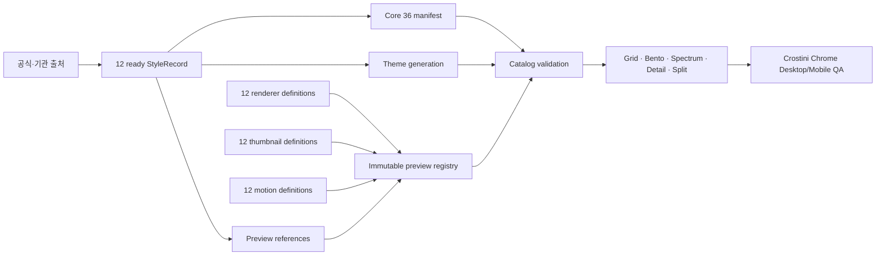

# Spec: Catalog Expansion — Wave 1 (24 → 36)

**Project Name:** Web Design Sample Selector (`design_sample_selector`)

**Initiative ID:** `scalable-style-library`

**Module ID:** `catalog-expansion`

**Delivery Slice:** Wave 1 — 저작 흐름 검증 (`24 → 36`)

**Depends on:** `style-contract` (`COMPLETE`), `catalog-validation` (`COMPLETE`), `theme-generation` (`COMPLETE`), `preview-registry` (`COMPLETE`)

**Document Status:** 구현·검증 완료 (`COMPLETE`)

**작성일:** 2026-08-30

**조사 기준일:** 2026-08-30

**승인일:** 2026-08-30

**완료일:** 2026-08-30

---

## 1. Objective

현재 실제 사용자 화면에 노출되는 24종을 36종으로 확장한다. Wave 1은 숫자만 늘리는 데이터 추가가 아니라, 새 구조에서 서로 다른 디자인 시안을 반복 가능하게 저작할 수 있음을 실제 결과로 증명하는 단계다.

완료된 Wave 1의 사용자는 다음을 얻는다.

- 갤러리, Bento, Spectrum, Peek, Detail, Draft Dock, Split Compare에서 선택 가능한 **실제 36종**
- 각 신규 스타일의 고유한 4개 Web 목업, 썸네일, 모션 정책, 13개 테마 토큰과 편집 설명
- Desktop/Mobile 전환에 따라 실제 폭과 레이아웃이 달라지는 8대 아키타입 시안
- 출처, 접근성 메모와 검증 상태가 포함된 `ready` 품질의 신규 12종
- 기존 24종의 ID, 별칭, 저장 데이터, HTML·테마·내보내기 결과 호환

Wave 1 완료 뒤에는 다음 Wave로 자동 진행하지 않는다. 36종 결과와 검증 증거를 사용자에게 인계하고 다음 승인을 기다린다.

## 2. Approved Assumptions

다음 전제는 2026-08-30 사용자의 구현 지시로 승인되었다.

1. Wave 1의 누적 목표는 정확히 36종이며 신규 스타일은 12종이다.
2. 상위 카테고리는 현재 8개를 유지하고, 신규 스타일을 기존 카테고리의 하위 시안으로 추가한다.
3. 후보 12종은 정전적 사조, 디지털 인터페이스 언어, 인쇄·언더그라운드 기법을 함께 포함한다.
4. 신규 12종은 모두 `publicationStatus: 'ready'`로 출시하며, 출처 또는 접근성 항목을 비워 둔 임시 레코드는 사용자 화면에 넣지 않는다.
5. 신규 이진 이미지·폰트·오디오를 추가하지 않고 HTML/CSS와 기존 폰트 스택만 사용한다. 특정 작품, 로고나 상용 화면을 복제하지 않는다.
6. 기존 `fluid-organic`의 호환 별칭 `bauhaus-geometric`은 그대로 보존한다. 신규 바우하우스의 정규 ID는 충돌하지 않는 `bauhaus-geometry`를 사용하며, 두 시안의 시각 문법을 명확히 분리한다.
7. Wave 1은 36종 저작 증명을 먼저 수행한다. 정식 facet 탐색 UI, 지연 렌더링과 가상화는 60종으로 가기 전 완료한다.
8. 구현은 TDD로 진행하며, 이 사양 승인 뒤 계획과 작업 목록을 별도로 검토받고 시작한다.

## 3. Scope

### Included

- 신규 정규 `StyleRecord` 12개와 core pack manifest 36종 갱신
- 필요한 lineage facet 값의 사전 확장
- 신규 renderer 12개 × `hero`, `widget`, `form`, `pricing` 네 탭
- 신규 독립 thumbnail definition 12개
- 실제 구현 채널을 가진 신규 motion definition 12개와 reduced-motion 억제
- 신규 스타일 전용 CSS, 반응형 규칙, 포커스·상태·모션 접근성
- 24 고정 문구를 실제 카탈로그 개수에서 파생하도록 변경
- 카탈로그·테마·프리뷰·통합·디자인 사양 생성 회귀 테스트 확장
- ChromeOS Crostini의 Linux Google Chrome 실제 런타임 검증
- `spec.md`, `CAPABILITY_MAP.md`, README, `designs.md`, CHANGELOG와 구현 인수인계 문서 동기화

### Excluded

- Wave 2의 60종 또는 Wave 3의 100~120종 콘텐츠
- 새 상위 카테고리 생성이나 기존 카테고리 ID 변경
- 전체 검색·facet 필터·URL 상태 UX
- 가상화, dynamic import, 원격 팩, 런타임 플러그인
- 외부 이미지·폰트·오디오 다운로드 또는 라이선스가 불명확한 에셋
- 기존 24종의 시각 재설계와 정규 ID·별칭 삭제
- 배포, 릴리스, Git commit 또는 push

### Boundaries

- **Always:** 신규 동작은 실패 테스트부터 시작하고, 기존 24종 subset 호환을 보존하며, 각 증분 뒤 표적 검증을 실행한다.
- **Always:** 신규 12종은 공식·기관 근거, 4.5:1 기본 텍스트 대비, 구체적 접근성 메모와 실제 reduced-motion 정책을 갖춘 `ready` 레코드로 완성한다.
- **Ask first:** 새 상위 카테고리, 외부 dependency·에셋, 공개 ID·alias 변경, Wave 2 범위, 배포 또는 Git commit이 필요하면 사용자 승인을 받는다.
- **Never:** 미등록 참조를 다른 스타일로 무음 대체하거나, 특정 작품·브랜드 화면을 복제하거나, 기존 테스트를 삭제·비활성화해 통과시키지 않는다.

## 4. Wave 1 Roster

### 4.1 Canonical styles and visual grammar

| # | Category | Canonical ID | 사용자 표시명 | Kind / Era | 반드시 드러나야 하는 시각 문법 |
| ---: | --- | --- | --- | --- | --- |
| 1 | `swiss` | `bauhaus-geometry` | 바우하우스 기하학 / Bauhaus Geometric Typography | historical-movement / 1920s–1930s | 원·삼각형·직사각형의 비대칭 구성, 적·청·황 원색, 축약된 기하 타이포 |
| 2 | `swiss` | `de-stijl` | 데 스틸 신조형주의 / De Stijl Neo-Plasticism | historical-movement / 1917–1930s | 수평·수직 검은 선, 직각, 비대칭 흰 면과 원색 평면; 곡선·대각선 금지 |
| 3 | `swiss` | `flat-design` | 플랫 디자인 2.0 / Flat Design 2.0 | interface-language / 2010s | 질감·광택 없는 면, 굵은 색 블록과 단순 아이콘, 상호작용 표지는 테두리·밑줄·상태색으로 복원 |
| 4 | `brutalism` | `constructivist` | 구성주의 애지트프로프 / Constructivist Agitprop | historical-movement / 1920s | 적·흑·크림, 강한 대각선, 포토몽타주를 추상 도형으로 재해석한 선전 포스터 계층 |
| 5 | `brutalism` | `punk-zine` | 펑크 제록스 진 / Punk Xerox Zine | revival / 1970s–1980s | 흑백 복사 질감, 찢긴 라벨, 잘라 붙인 활자, 하프톤과 의도적 비정렬 |
| 6 | `depth` | `material-design` | 머티리얼 페이퍼 시스템 / Material Paper System | interface-language / 2010s–2020s | 종이 면의 단계적 elevation, 상태 레이어, 명확한 FAB·카드·리플 피드백 |
| 7 | `depth` | `liquid-glass` | 리퀴드 글래스 인터페이스 / Liquid Glass Interface | interface-language / 2020s | 콘텐츠 위에 뜨는 기능성 제어 레이어, 제한된 굴절·렌즈·하이라이트와 견고한 대조 백플레이트 |
| 8 | `retro` | `art-deco` | 아르데코 머신 에이지 / Art Deco Machine Age | historical-movement / 1920s–1930s | 대칭 축, 계단형 기하, 선버스트·부채꼴, 검정·크림·금색의 기계 시대 럭셔리 |
| 9 | `retro` | `psychedelic-poster` | 사이키델릭 포스터 / Psychedelic Poster | revival / 1960s–1970s | 휘어진 전시 타이포, 강한 보색, 반복되는 광학 곡선과 카운터컬처 포스터 밀도 |
| 10 | `editorial` | `art-nouveau` | 아르누보 휩래시 / Art Nouveau Whiplash | historical-movement / 1890s–1910s | 식물 줄기형 S곡선, 세로형 장식 프레임, 비대칭 유기 패턴과 부드러운 파스텔 |
| 11 | `editorial` | `risograph` | 리소그래프 에디토리얼 / Risograph Editorial | technique / 1980s–현재 | 두세 개 별색, 잉크 중첩, 하프톤, 미세한 판 어긋남과 종이 바탕 |
| 12 | `hypertech` | `metro-interface` | 메트로 타일 인터페이스 / Metro Tile Interface | interface-language / 2000s–2010s | 화면 끝까지 이어지는 큰 타이포, 평면 타일, 굵은 색과 콘텐츠 중심의 수평 파노라마 모션 |

### 4.2 Preview reference IDs

각 참조 ID는 현재 registry와 충돌하지 않으며, renderer·thumbnail·motion은 서로 독립적으로 검증한다.

| Style ID | `rendererId` | `thumbnailId` | `motionId` |
| --- | --- | --- | --- |
| `bauhaus-geometry` | `bauhaus-geometry` | `primary-forms` | `shape-orbit` |
| `de-stijl` | `de-stijl` | `orthogonal-planes` | `plane-reveal` |
| `flat-design` | `flat-design` | `flat-signifiers` | `color-snap` |
| `constructivist` | `constructivist` | `agitprop-diagonal` | `diagonal-drive` |
| `punk-zine` | `punk-zine` | `xerox-ransom` | `xerox-jitter` |
| `material-design` | `material-design` | `paper-elevation` | `paper-lift` |
| `liquid-glass` | `liquid-glass` | `refractive-controls` | `lens-shift` |
| `art-deco` | `art-deco` | `deco-sunburst` | `fan-reveal` |
| `psychedelic-poster` | `psychedelic-poster` | `optical-waves` | `poster-warp` |
| `art-nouveau` | `art-nouveau` | `whiplash-frame` | `vine-trace` |
| `risograph` | `risograph` | `riso-overprint` | `ink-drift` |
| `metro-interface` | `metro-interface` | `typographic-tiles` | `tile-panorama` |

### 4.3 Category totals after Wave 1

| Category | Existing | Add | Wave 1 total |
| --- | ---: | ---: | ---: |
| `swiss` | 3 | 3 | 6 |
| `brutalism` | 3 | 2 | 5 |
| `depth` | 3 | 2 | 5 |
| `retro` | 3 | 2 | 5 |
| `editorial` | 3 | 2 | 5 |
| `y2k` | 3 | 0 | 3 |
| `hypertech` | 3 | 1 | 4 |
| `soft3d` | 3 | 0 | 3 |
| **Total** | **24** | **12** | **36** |

### 4.4 Grounding sources

각 신규 레코드는 아래 출처를 `provenance.sources`에 기록한다. `accessedAt`과 `reviewedAt`은 `2026-08-30`을 사용한다.

| Style ID | Source | Publisher | `sourceType` | 적용 근거 |
| --- | --- | --- | --- | --- |
| `bauhaus-geometry` | [Offers for students](https://bauhaus-dessau.de/en/visit/groups/offers-for-students/) | Stiftung Bauhaus Dessau | `institutional` | 바우하우스 타이포의 축약·기하학 원칙과 역사 |
| `de-stijl` | [De Stijl (The Style)](https://www.nationalgalleries.org/art-and-artists/glossary-terms/de-stijl-style) | National Galleries of Scotland | `institutional` | 수평·수직선, 직각, 원색 평면 |
| `flat-design` | [Flat Design: Its Origins, Its Problems, and Why Flat 2.0 Is Better for Users](https://www.nngroup.com/articles/flat-design/) | Nielsen Norman Group | `industry` | 3D 효과 부재, 클릭 가능성 표지의 접근성 위험과 Flat 2.0 보완 |
| `constructivist` | [Rodchenko — Graphic Design](https://www.moma.org/interactives/exhibitions/1998/rodchenko/texts/graphic_design.html) | The Museum of Modern Art | `institutional` | 대중 매체·광고·슬로건 중심의 구성주의 그래픽 맥락 |
| `punk-zine` | [Post-war design — an introduction](https://www.vam.ac.uk/articles/post-war-design-an-introduction) | Victoria and Albert Museum | `institutional` | 펑크의 도발적 anti-style과 반권위 그래픽 |
| `material-design` | [Elevation — Material Design 3](https://m3.material.io/styles/elevation/overview) | Google Material Design | `primary` | elevation과 계층적 표면 원칙 |
| `liquid-glass` | [Liquid Glass](https://developer.apple.com/documentation/TechnologyOverviews/liquid-glass) | Apple Developer | `primary` | 콘텐츠 위 기능성 제어 레이어와 가독성 중심 사용 원칙 |
| `art-deco` | [An introduction to Art Deco](https://www.vam.ac.uk/articles/an-introduction-to-art-deco) | Victoria and Albert Museum | `institutional` | 기계 시대, 아방가르드, 기하 형태와 럭셔리의 결합 |
| `psychedelic-poster` | [Art of Noise](https://www.cooperhewitt.org/2025/09/10/art-of-noise-exhibition-tracing-history-of-music-and-design-to-open-at-cooper-hewitt/) | Cooper Hewitt, Smithsonian Design Museum | `institutional` | 1960~70년대 사이키델릭 록 포스터와 카운터컬처 그래픽 |
| `art-nouveau` | [The Whiplash](https://www.vam.ac.uk/articles/the-whiplash) | Victoria and Albert Museum | `institutional` | 식물에서 파생된 S곡선, 장식 경계와 유기적 선 |
| `risograph` | [Digital Duplicator](https://www.riso.co.jp/english/product/digital_dup/index.html) | RISO KAGAKU CORPORATION | `primary` | 스텐실 master, 인쇄 drum, 1~2색 잉크 레이어의 물리 원리 |
| `metro-interface` | [Designing Metro style: principles and personality](https://learn.microsoft.com/en-us/shows/build-build2011/app-395t) | Microsoft Learn | `primary` | 굵은 색, 타이포그래피와 모션 중심의 Metro 원칙 |

## 5. Differentiation Guardrails

단순 팔레트 변형을 막기 위해 각 신규 시안은 가장 가까운 기존 또는 신규 시안과 다음 차이를 반드시 가져야 한다.

| New style | Nearest collision | Required distinction |
| --- | --- | --- |
| `bauhaus-geometry` | `fluid-organic` / `de-stijl` | 유기 blob 대신 원·삼각·직사각형; De Stijl과 달리 곡선·대각과 기하 타이포 허용 |
| `de-stijl` | `bauhaus-geometry` / `swiss-grid` | 검은 직교선과 평면 분할이 구조 자체이며 원·삼각형과 12열 정보 그리드는 사용하지 않음 |
| `flat-design` | `corporate-minimal` / `metro-interface` | 아이콘·표지·상태 중심의 소형 UI 문법; Metro의 파노라마와 대형 타일을 사용하지 않음 |
| `constructivist` | `raw-brutalism` / `cyber-brutalism` | 러시아 아방가르드식 대각 축과 선전 포스터 계층; raw HTML·네온 HUD 문법 금지 |
| `punk-zine` | `raw-brutalism` / `handcrafted-indie` | 흑백 Xerox, 하프톤, 잘라 붙인 활자; 따뜻한 kraft·테이프 공예 감성 금지 |
| `material-design` | `skeuomorphism` / `neumorphism` | 제한된 paper elevation과 상태 레이어; 현실 재질 모사나 같은 배경의 양각·음각 금지 |
| `liquid-glass` | `glassmorphism` / `dark-minimal-glass` | 전체 카드 장식이 아니라 제어·탐색 레이어에만 제한된 렌즈 효과 사용 |
| `art-deco` | `high-fashion` | 대칭 기하·선버스트·계단형 프레임이 핵심이며 사진 중심 잡지 spread에 의존하지 않음 |
| `psychedelic-poster` | `vaporwave` / `synthwave` | 광학 곡선과 왜곡 타이포 중심; VHS·그리스 조각·네온 그리드 문법 금지 |
| `art-nouveau` | `fluid-organic` | 식물형 선과 세로 장식 프레임 중심; 현대 blob 카드 레이아웃 금지 |
| `risograph` | `handcrafted-indie` | 별색 중첩·하프톤·판 어긋남이 핵심이며 콜라주 테이프·낙서 문법 금지 |
| `metro-interface` | `bento-grid` / `flat-design` | 모서리 없는 edge-to-edge 타일, 큰 타이포와 수평 파노라마; 둥근 Bento 카드 금지 |

검토 중 두 스타일이 색과 카피를 제거했을 때 같은 DOM 골격과 장식 규칙으로 보이면 별도 스타일로 승인하지 않는다.

## 6. Architecture and Data Flow



의존성 원칙은 다음과 같다.

1. 스타일 데이터는 렌더 함수나 HTML을 포함하지 않는다.
2. preview definition은 정규 스타일 배열을 순회해 암묵적으로 만들지 않고 명시적으로 등록한다.
3. UI의 개수 표시는 `getAllStyles()` 결과에서 파생하며 `24` 또는 `36`을 하드코딩하지 않는다.
4. 생성 테마 CSS는 StyleRecord의 13개 토큰을 유일한 원천으로 사용한다.
5. 알 수 없는 style 또는 preview ID는 다른 시안으로 폴백하지 않고 기존 구조화 오류 계약을 유지한다.

## 7. Tech Stack and Target Structure

기술 스택은 기존 Vanilla HTML/CSS/JavaScript, ES2022 정적 모듈, Vite 6, Node 내장 테스트 러너와 브라우저 표준 API를 유지한다. 신규 런타임 의존성은 추가하지 않는다.

승인 후 목표 구조는 다음과 같다.

```text
src/
├── catalog/
│   ├── facets.js                         # 필요한 lineage 값 추가
│   ├── index.js                          # Wave 1 레코드 조합
│   └── packs/core/
│       ├── manifest.js                   # Core 36 / pack 1.1.0
│       └── styles-wave-1.js              # 신규 ready StyleRecord 12개
├── preview/
│   ├── registry.js                       # 기존 + Wave 1 definition 조합
│   ├── renderers-wave-1.js               # 12 × 4 Web 목업
│   ├── thumbnails-wave-1.js              # 12개 경량 썸네일
│   └── motions-wave-1.js                 # 12개 실제 motion descriptor
└── styles/
    └── wave1-styles.css                  # 신규 시안 전용·반응형·reduced-motion CSS
```

기존 24종 파일을 대량 재작성하지 않고 Wave 1 파일을 별도로 조합한다. 향후 pack 저작 도구가 확정되기 전까지 이 경계가 수동 저작 단위다.

## 8. Data and Preview Contracts

### 8.1 New `StyleRecord` quality

신규 12개 레코드는 다음을 모두 만족해야 한다.

- kebab-case 정규 ID와 충돌 없는 별칭
- 기존 8개 category 중 하나와 정확히 하나의 core pack 소속
- 유효한 kind, era, lineage, media, materiality, density, tone, motion, region, maturity facet
- 13개 필수 theme token과 5개 `defaultTweaks`
- 독립 `rendererId`, `thumbnailId`, `motionId`
- 최소 3개 palette swatch, 특성·장점·단점과 하나 이상의 구체적 접근성 메모
- 유효한 신뢰 출처 한 개 이상, 프로젝트 에셋이 없음을 나타내는 빈 `assets`
- 기본 `background` 대비 `text`와 `textMuted` 모두 최소 4.5:1
- `ready` 레코드 단독 검증에서 오류와 경고 0건

출처 메타데이터 예시는 다음과 같다.

```js
provenance: {
  reviewedAt: '2026-08-30',
  sources: [{
    title: 'De Stijl (The Style)',
    publisher: 'National Galleries of Scotland',
    url: 'https://www.nationalgalleries.org/art-and-artists/glossary-terms/de-stijl-style',
    accessedAt: '2026-08-30',
    sourceType: 'institutional'
  }],
  assets: []
}
```

### 8.2 Renderer

- 네 탭을 모두 지원하고 각 결과는 비어 있지 않은 `.mockup-unit` root를 가진다.
- 탭마다 같은 장식만 반복하지 않고 실제 정보 구조가 달라야 한다.
- 버튼·탭·토글 등 보이는 상호작용은 기존 `data-mock-action` 계약으로 동작한다.
- 특정 브랜드명, 로고, 저작권 이미지와 기존 작품의 구체적 구도를 복제하지 않는다.
- 스타일별 root class 아래에 CSS를 격리해 기존 24종에 누출하지 않는다.

### 8.3 Thumbnail

- `thumbnailId`를 직접 디스패치하고 renderer ID를 대체 키로 사용하지 않는다.
- 경량 DOM과 CSS 도형만 사용하며 off-screen 갤러리에서도 외부 요청을 만들지 않는다.
- 각 썸네일은 색을 회색조로 보더라도 해당 스타일의 구조적 motif로 식별 가능해야 한다.
- Gallery·Detail·Split의 상위 버튼 내부에 삽입되므로 `button`, `a`, `input`, `select`, `textarea` 같은 상호작용 요소를 포함하지 않는다. 보이는 CTA는 장식용 요소로 표현한다.

### 8.4 Motion

- 신규 motion은 `metadata-only`를 허용하지 않는다.
- 최소 하나의 `effect-layer`, `unit-class`, `template-local`, `thumbnail-local`, `interaction-local` 구현 채널을 실제로 가진다.
- transform·opacity 중심의 150~300ms 상호작용을 기본값으로 사용한다. 표현적 포스터 모션도 연속 장식 애니메이션을 최소화한다.
- `prefers-reduced-motion: reduce`에서는 기능을 잃지 않고 변형·이동·깜박임을 억제한다.

## 9. Responsive and Accessibility Requirements

- 실제 mockup sandbox의 Desktop/Mobile class와 너비가 달라야 하며, 텍스트만 바뀌는 가짜 토글은 허용하지 않는다.
- 320, 375, 414, 768, 1024, 1440px에서 문서 수준 가로 스크롤과 잘린 핵심 CTA가 없어야 한다.
- 키보드 포커스가 명확하고, 실제 클릭 대상은 가능한 경우 44×44px 이상을 유지한다.
- 색만으로 선택·상태·오류를 전달하지 않는다.
- 장식용 왜곡 타이포와 작은 대문자 레이블을 본문 또는 핵심 조작 설명으로 사용하지 않는다.
- Liquid Glass는 가독성 백플레이트를 제공하고 투명도·blur가 없어도 계층이 유지되어야 한다.
- Flat Design은 클릭 가능한 요소에 테두리, 밑줄, 형태 또는 일관된 상태 변화를 제공한다.
- Punk·Risograph의 질감은 CSS 장식 레이어에 한정해 실제 텍스트의 선명도를 낮추지 않는다.
- Psychedelic·Xerox jitter·lens motion은 reduced-motion에서 정지하고 빠른 깜박임을 만들지 않는다.

## 10. Compatibility Invariants

1. 기존 24개 정규 ID와 모든 alias는 같은 canonical ID로 해석된다.
2. 기존 24종의 `hero`, `widget`, `form`, `pricing`, `thumb` 길이 프레이밍 SHA-256 `4b0ccbb887d83676464dc523ece67fdd7ed5ee43d4941d741a992a5354c9d4d9`를 **legacy subset** 기준으로 유지한다.
3. 기존 24종의 theme runtime CSS와 CSS/Markdown/DTCG 내보내기 기준 해시는 유지한다.
4. 신규 총량 해시는 구현 완료 때 별도 fixture로 고정하며 기존 해시를 36종 총량 의미로 재해석하지 않는다.
5. `getMockupHTML()`은 호환 위임 경계로 남고 새 UI 소비자는 공개 preview API를 사용한다.
6. 알 수 없는 ID의 조회 `false`/`null`과 render/hydration `PreviewRegistryError` 계약은 변하지 않는다.
7. `bauhaus-geometric`은 계속 `fluid-organic`으로 해석되고 `bauhaus-geometry`는 신규 정규 ID로만 해석된다.

## 11. Test Strategy and Commands

구현은 실패 테스트를 먼저 추가한 뒤 최소 코드로 통과시킨다. 주요 검증 행렬은 다음과 같다.

| Layer | Wave 1 gate |
| --- | --- |
| Catalog | visible/all 36, category 합계 36, pack membership 1회, ID·alias 충돌 0 |
| Quality | 신규 ready 12종 오류 0·경고 0, 전체 catalog 오류 0, 기존 legacy 경고 기준선 56 유지 |
| Preview registry | renderer/thumbnail/motion/asset `36/36/36/0`, 미등록·중복 참조 실패 |
| Renderer | 36 × 4 = 144 Web component 결과, 빈 출력·Swiss 폴백 0 |
| Thumbnail | Grid/Bento/Spectrum의 36종 × 3 = 108개 식별 가능한 썸네일 |
| Total preview | 36 × 5 = 180개 결정론적 결과, 기존 24 × 5 subset hash 유지 |
| Archetype | 36 × 8 = 288개 Node HTML 조합의 root/theme/selector 유효성 |
| Device | 36 × 8 × Desktop/Mobile = 576개 실제 sandbox 상태 |
| Theme/export | 생성 CSS 최신, 36개 token theme, 기존 24종 export hash 유지 |
| Browser | Chrome 151 console/page/network 오류 0, keyboard, reduced-motion, Split·상태·토글 검증 |

기본 명령은 다음을 사용한다.

```bash
npm test
npm run validate:catalog
npm run check:themes
npm run build
npm run check
npm run qa:wave1:chrome -- --artifacts=.antigravity/archive/wave1-chrome-qa
```

실제 브라우저 검증은 사용자의 기본 Chrome 프로필을 건드리지 않는 격리 프로필과 임시 개발 서버를 사용한다. 종료 때 에이전트가 만든 프로필·서버·listener만 정리한다.

## 12. Success Criteria

- [x] 사용자에게 보이는 실제 카탈로그가 36종이며 24 또는 120으로 잘못 표시되는 곳이 없다.
- [x] 승인된 12개 canonical ID와 category 배치가 구현된다.
- [x] 신규 12종 각각이 13개 토큰, 4개 Web 목업, 독립 썸네일, 실제 motion, 편집 설명, 출처와 접근성 메모를 가진다.
- [x] 신규 12종은 단독 품질 검증에서 오류와 경고가 0건이다.
- [x] 전체 catalog validation 오류는 0건이고 기존 24종의 legacy 경고 56건만 남는다.
- [x] preview inventory가 정확히 `36/36/36/0`이다.
- [x] 기존 24종의 ID·alias·프리뷰·테마·내보내기 회귀 기준이 유지된다.
- [x] 모든 신규 renderer가 네 탭에서 고유 구조를 반환하고 보이는 조작이 작동한다.
- [x] Desktop/Mobile이 실제 너비·레이아웃 차이를 보이며 576개 상태 행렬에서 빈 화면과 폴백이 없다.
- [x] 320~1440px, 키보드 포커스, reduced-motion, 대비와 가로 스크롤 기준을 통과한다.
- [x] 전체 자동 검사와 Vite production build가 통과한다.
- [x] Crostini Linux Google Chrome 실제 검증에서 console·page·network 진단 오류가 0건이다.
- [x] 관련 사용자·설계·운영 문서가 36종 실제 상태와 동기화된다.
- [x] Wave 1 결과를 인계한 뒤 Wave 2로 자동 진행하지 않는다.

## 13. Risks and Controls

| Risk | Impact | Control |
| --- | --- | --- |
| 12종을 한 번에 추가해 시각 문법이 얕아짐 | High | 스타일별 차별화 표와 4탭 QA를 완료 게이트로 사용 |
| Bauhaus alias 의미 혼동 | High | 기존 alias 보존, 신규 canonical ID 분리, 회귀 테스트와 UI 명칭 명시 |
| renderer/CSS 단일 파일 비대화 | Medium | Wave 1 전용 모듈과 CSS 파일로 분리 후 registry에서 조합 |
| 36종에서 초기 렌더 비용 증가 | Medium | 실제 Chrome 기준선·bundle delta 기록, 60종 전 scalability 모듈 완료 |
| Flat/Glass 장식 때문에 조작성·대비 저하 | High | ready 대비 4.5:1, signifier·backplate·reduced-transparency 대체 규칙 |
| 역사적 작품·브랜드를 그대로 복제 | High | 일반화한 CSS 도형·가상 카피만 사용하고 외부 에셋 0 유지 |
| 기존 24 고정 테스트를 총 36 기준으로 덮어써 회귀 근거 손실 | High | legacy subset fixture와 신규 total fixture를 분리 |

## 14. Implementation Authorization

2026-08-30 사용자의 “구현요” 지시를 다음 항목에 대한 승인과 구현 권한으로 기록한다.

1. 4.1절의 신규 12종 명단
2. 카테고리 배치와 Wave 1 완료 후 합계 36종
3. 36종까지는 기존 탐색 UI를 유지하고, 60종 전 `catalog-discovery`·`render-scalability`를 완료하는 단계 순서
4. 완료된 Preview Registry 계획을 archive로 보존하고 Wave 1 `tasks/plan.md`와 `tasks/todo.md`를 만들어 순차 구현하는 절차

Wave 1 완료 뒤에는 실제 36종과 검증 증거를 인계하고 Wave 2로 자동 진행하지 않는다.

## 15. Completion Evidence

2026-08-30 Wave 1을 다음 증거로 완료 판정했다.

- 카탈로그는 8개 카테고리, Core 36(legacy 24 + ready 12), 10개 facet과 core pack 1개로 조립된다. 신규 ready 12종의 품질 진단은 오류·경고 0이고 전체 카탈로그는 오류 0·기존 legacy 경고 56이다.
- preview inventory는 renderer/thumbnail/motion/asset `36/36/36/0`이다. 전체 Web 출력은 144개, 전체 preview 출력은 180개, 아키타입 Node 출력은 288개이며 기존 24종의 120-output 및 theme/export 해시는 변하지 않았다.
- Node 자동 게이트는 106/106 테스트, 생성 theme CSS 최신성 검사와 45-module Vite production build를 통과했다. 전체 36종 thumbnail의 interactive tag 금지와 DTCG shadow 구조화를 회귀 테스트로 고정했다.
- Crostini Google Chrome `151.0.7922.173` 격리 실행에서 Grid/Bento/Spectrum 각 36개, 320/375/414/768/1024/1440px overflow 0, Core 36 × 8 × Desktop/Mobile 576상태(Desktop outer root `735–745px`, Mobile `380px`)와 신규 12종 Detail의 실제 inner 폭·grid 차이·control 경계 이탈 0, Split Bauhaus/Swiss, reduced-motion을 확인했다.
- 브라우저 application console warning/error, page exception, 실패 same-origin request와 HTTP error는 0건이다. 증거는 `.antigravity/archive/wave1-chrome-qa/report.json`과 대표 스크린샷 5장에 보존한다.
- QA 중 Flat Design thumbnail의 중첩 `button`이 HTML parser에 의해 Detail/Split control DOM을 끊는 문제를 발견해 장식 `span`으로 수정하고 재검증했다.
- Wave 2 콘텐츠, 새 상위 카테고리, dependency, 외부 asset, 배포·릴리스·Git commit/push는 수행하지 않았다.
