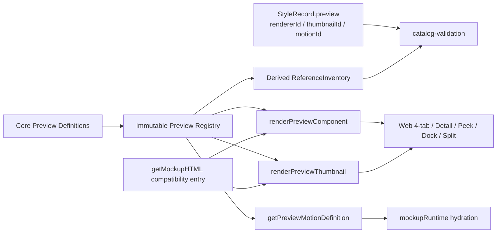

# Spec: Preview Registry

**Project Name:** Web Design Sample Selector (`design_sample_selector`)

**Initiative ID:** `scalable-style-library`

**Module ID:** `preview-registry`

**Depends on:** `style-contract` (`COMPLETE`), `catalog-validation` (`COMPLETE`)

**Document Status:** 구현·검증 완료 (`COMPLETE`)

**작성일:** 2026-08-30

**승인일:** 2026-08-30

**구현 상태:** 완료 — Tasks 1–12, Checkpoints A–C와 Final Checkpoint, Crostini Chrome 런타임 검증과 최종 감사 완료

---

## 1. Objective

24종에서 120종 이상으로 디자인 카탈로그를 확장할 때 목업, 썸네일, 모션 참조를 `switch`, 객체 리터럴, CSS 클래스 문자열과 임시 검증 목록에 따로 추가하지 않도록 한다. `StyleRecord.preview`가 가진 `rendererId`, `thumbnailId`, `motionId`를 명시적이고 검증 가능한 레지스트리에 연결하고, 등록되지 않은 내부 참조는 Swiss 또는 일반 썸네일로 조용히 대체하지 않는다.

이 모듈의 사용자는 다음과 같다.

- 새 스타일 팩의 목업, 썸네일, 모션 구현을 등록하는 개발자와 에이전트
- 갤러리, 상단 선택기, Draft Dock, Peek, Detail, Split Compare에서 프리뷰를 렌더하는 UI
- 4개 Web 컴포넌트 탭과 8대 아키타입을 조립하는 템플릿·런타임 계층
- renderer/thumbnail/motion/asset 참조를 빌드 전에 검사하는 `catalog-validation`
- 후속 `render-scalability`, `style-pack-authoring`, `catalog-expansion` 모듈

완료 상태에서는 새 프리뷰 구현을 등록할 때 정규 레지스트리 항목 하나가 렌더 디스패치, 기능 조회와 검증 인벤토리의 원천이 된다. 현재 24종의 정상 입력 결과는 유지하지만, 누락·오타·잘못된 탭은 구조화된 오류로 즉시 드러난다.

## 2. Approved Assumptions

다음 항목은 2026-08-30 사용자 승인으로 확정되었다.

1. 현재 24개 정규 스타일 ID, 24개 renderer ID, 24개 thumbnail ID, 24개 motion ID와 8대 아키타입은 유지한다.
2. 현재 스타일의 `hero`, `widget`, `form`, `pricing`, `thumb` HTML 결과는 공백을 포함해 보존한다. 기준선 120개 출력의 승인 해시는 5.1절에 고정한다.
3. 외부 조회·기능 탐지는 알 수 없는 ID에 `false` 또는 `null`을 반환한다. 실제 렌더·내부 적용 경계는 같은 상황에서 `PreviewRegistryError`를 던진다.
4. 레지스트리는 Wave 0에서 정적 ES Module 조합과 동기 렌더를 사용한다. 런타임 등록, 원격 플러그인, 동적 코드 실행은 제공하지 않는다.
5. 현재 `brutalism` renderer 별칭은 `raw-brutal`의 명시적 호환 별칭으로 유지하되 정규 참조 인벤토리에는 포함하지 않는다.
6. 썸네일 디스패치는 더 이상 renderer ID를 키로 사용하지 않고 `thumbnailId`를 직접 사용한다. 기존 CSS class와 `data-motif` 결과는 호환 어댑터가 보존한다.
7. 모션 레지스트리는 현재 CSS 효과 레이어, unit class, 템플릿·썸네일 로컬 애니메이션과 상호작용 효과의 소유 관계를 기술한다. 이 모듈에서 새 애니메이션을 추가하거나 기존 강도를 바꾸지 않는다.
8. 기존 legacy 모션 중 ID 전용 CSS가 없는 항목은 숨기지 않고 `metadata-only` 채널로 표시할 수 있다. 새 `ready` 스타일에서 이를 허용할지는 후속 `style-pack-authoring` 품질 게이트가 결정한다.
9. 현재 모든 모션 프로필의 effect layer DOM 삽입과 `prefers-reduced-motion` 억제 동작은 보존한다.
10. 기존 UI import를 한 번에 깨지 않도록 `src/components/mockupTemplates.js`의 `getMockupHTML()`은 얇은 호환 진입점으로 유지한다.
11. 신규 외부 런타임·스키마·DOM 라이브러리는 추가하지 않는다.

## 3. Scope

### Included

- renderer, thumbnail, motion 정적 정의와 불변 레지스트리
- 정규 ID, 별칭, 중복, 지원 탭, 구현 함수, 모션 채널과 asset 경로의 초기화 시 검증
- `rendererId` 기반 4개 Web 컴포넌트 렌더 API
- `thumbnailId` 기반 경량 썸네일 렌더 API
- `motionId` 기반 unit/effect class 및 구현 채널 조회
- 참조 존재 여부를 확인하는 부작용 없는 기능 탐지 API
- 레지스트리에서 결정론적으로 파생한 `ReferenceInventory`
- `legacyReferenceInventory.js` 제거와 catalog validation 입력 전환
- `getMockupHTML()` 정상 입력 호환 어댑터와 `brutalism` renderer 별칭
- 알 수 없는 renderer/thumbnail/motion 및 지원하지 않는 탭의 무음 폴백 제거
- 기존 프리뷰 소비자와 hydration 런타임의 단계적 이전
- Node 회귀 테스트, 전체 빌드 게이트와 Crostini Chrome 151 런타임 검증
- 레지스트리 작성·복구 절차와 기술 결정 문서 동기화

### Excluded

- 신규 디자인, 카테고리, facet, renderer, thumbnail 또는 motion 시각 효과 추가
- 기존 24종의 카피, 팔레트, HTML 구조, CSS 스타일 또는 애니메이션 강도 개선
- 카탈로그 검색·필터·정렬 UI
- 대형 목록 가상화, 지연 렌더링, dynamic import와 번들 분할
- 120종용 성능 예산 확정
- 스타일 팩 템플릿과 품질 심사 절차
- 8대 아키타입 자체 구조 또는 상호작용 로직 개편
- 알 수 없는 archetype ID의 기존 game 폴백 정책 변경
- 원격 HTML, 사용자 작성 HTML 또는 런타임 플러그인 실행

후속 `render-scalability`는 정규 ID와 오류 계약을 유지하면서 로딩 전략을 추가한다. 이 모듈은 비동기 로딩을 미리 흉내 내지 않는다.

## 4. Tech Stack

- JavaScript ES2022 정적 ES Module
- Node.js 20.x 또는 22 이상
- Vite 6의 기존 정적 import·prebuild 수명주기
- Node 내장 테스트 러너와 `crypto`
- 브라우저 표준 DOM, CSS class와 `prefers-reduced-motion`
- 외부 런타임 의존성 없음

레지스트리 구성과 HTML 렌더 함수는 DOM 없이 Node에서 실행 가능하게 유지한다. DOM 탐색·class 적용·effect layer 삽입은 기존 `mockupRuntime.js` 경계가 소유한다.

## 5. Pre-implementation Baseline and Duplication Inventory

### 5.1 Measured baseline

2026-08-30 현재 코드를 로컬 Node에서 실행해 확인한 기준선은 다음과 같다.

| 항목 | 현재 값 |
| --- | ---: |
| 정규 스타일 | 24 |
| 고유 renderer ID | 24 |
| 고유 thumbnail ID | 24 |
| 고유 motion ID | 24 |
| Web 컴포넌트 출력 | 24 × 4 = 96 |
| 썸네일 출력 | 24 |
| 전체 기준 출력 | 120 |
| 120개 길이 프레이밍 SHA-256 | `4b0ccbb887d83676464dc523ece67fdd7ed5ee43d4941d741a992a5354c9d4d9` |
| 알 수 없는 renderer | Swiss HTML을 반환함 — 제거 대상 |
| `brutalism` renderer 별칭 | `raw-brutal`과 동일 출력 |
| 등록 asset 경로 | 0 |

해시는 스타일의 현재 카탈로그 순서와 `hero`, `widget`, `form`, `pricing`, `thumb` 순서를 사용한다. 각 행은 key를 `${style.id}:${tab}`으로 만들고 `${key.length}:${key}${html.length}:${html}`을 순서대로 SHA-256에 입력한다. 구현 중 해시가 달라지면 자동 승인하지 않고 출력 diff로 원인을 확인한다.

### 5.2 Pre-implementation duplication and failure paths

- 이전 `src/components/mockupTemplates.js`의 24분기 `switch`가 목업 renderer 디스패치를 소유했다.
- 같은 파일의 별도 객체 리터럴이 renderer ID를 키로 썸네일 recipe를 선택했고, 정규 `thumbnailId`는 `data-motif`에만 사용됐다.
- 이전 `mockupRuntime.js`는 검증 없이 `motion-${id}`와 `fx-${id}` 문자열을 조합했다.
- 이전 `src/catalog/validation/legacyReferenceInventory.js`가 renderer/thumbnail/motion ID를 수동으로 한 번 더 나열했다.
- renderer 기본 분기는 Swiss, 썸네일 기본 분기는 일반 `Aa`, 런타임 기본값은 Swiss/`none`이었다.
- 이전에는 `getMockupHTML()`을 Main View, Detail, Peek, Dock, Split과 Web archetype에서 직접 호출했다. Tasks 7–8에서 이 소비자들을 공개 thumbnail/component API로 전환했고 compatibility entry는 parity 검증용으로만 남겼다.
- 현재 24개 motion 이름 중 일부는 effect-layer CSS를 직접 가지며, 일부는 템플릿·썸네일의 다른 class 애니메이션 또는 상호작용 효과로 구현되고, 일부는 legacy 메타데이터 역할만 한다.

따라서 단순히 현재 switch를 객체로 바꾸는 것만으로는 목표를 달성하지 못한다. 썸네일 키, 검증 인벤토리와 motion 기능 설명까지 같은 등록 원천에서 파생해야 한다.

### 5.3 Completed implementation snapshot

| 항목 | 완료 결과 |
| --- | --- |
| 공개 진입점 | `src/preview/index.js`의 9개 export |
| 정규 definition / asset | renderer 24 / thumbnail 24 / motion 24 / asset path 0 |
| renderer 별칭 | `brutalism → raw-brutal`; 정규 inventory에서는 제외 |
| compatibility | `getMockupHTML()` 얇은 위임만 유지, UI 소비자는 공개 옵션 API 직접 사용 |
| 정상 출력 | 120-output SHA-256 `4b0ccbb887d83676464dc523ece67fdd7ed5ee43d4941d741a992a5354c9d4d9` 유지 |
| 실패 경계 | 조회 `false`/`null`, render·hydration은 6개 안정 code의 `PreviewRegistryError` |
| 자동 검증 | preview 표적 30/30, 전체 93/93, catalog 0 errors/56 warnings, theme 최신, 40-module build |
| 실제 브라우저 | Chrome 151에서 Web 96개, style/archetype/device 384개, 6 motion channel, reduced-motion, Split·상태·접근성·diagnostics 통과 |

새 디자인·팩 저작 자동화·비동기 로딩은 추가하지 않았다. 이 완료 판정은 현재 24종의 Wave 0 구조와 호환 경계에 한정한다.

## 6. Architecture and Data Flow



의존성 규칙은 다음과 같다.

1. `src/catalog/packs/`는 구현 함수가 아니라 세 정규 참조 ID만 소유한다.
2. `src/preview/`는 `style-contract`의 ID·동결 유틸리티를 사용할 수 있지만 카탈로그 팩을 순회해 등록 항목을 만들지 않는다.
3. `src/catalog/validation/currentCatalog.js`는 preview registry가 파생한 인벤토리를 읽는다. 정규 catalog 조회 계층은 preview를 역으로 import하지 않는다.
4. UI는 레지스트리 구현 map을 직접 읽지 않고 공개 렌더·조회 함수만 사용한다.
5. 호환 파일은 새 레지스트리로 위임하며 별도의 switch나 fallback 구현을 유지하지 않는다.

## 7. Registry Contracts

### 7.1 Stable tabs and reference kinds

```js
const PREVIEW_COMPONENT_TABS = ['hero', 'widget', 'form', 'pricing'];
const PREVIEW_REFERENCE_KINDS = ['renderer', 'thumbnail', 'motion'];
```

- 두 배열은 정렬과 값이 안정된 재귀 동결 공개 상수다.
- `thumb`는 renderer 탭이 아니라 thumbnail 호환 라우팅 값이다.
- renderer는 선언한 탭만 처리한다. 현재 24개 core renderer는 네 탭 모두를 지원한다.

### 7.2 Internal renderer definition

```js
/**
 * @typedef {Object} PreviewRendererDefinition
 * @property {string} id
 * @property {readonly string[]} aliases
 * @property {readonly ('hero'|'widget'|'form'|'pricing')[]} tabs
 * @property {readonly string[]} assetPaths
 * @property {(tab: string, design?: object) => string} render
 */
```

- ID와 별칭은 kebab-case이며 같은 reference kind 안에서 정규 ID·별칭 충돌이 없어야 한다.
- 별칭은 조회·렌더 호환에만 쓰며 `rendererIds` 인벤토리에는 들어가지 않는다.
- renderer는 비어 있지 않은 HTML 문자열을 반환해야 한다.
- core renderer의 유일한 별칭은 현재 `brutalism → raw-brutal`이다.
- 구현 함수는 공개 capability 객체로 노출하지 않는다.

### 7.3 Internal thumbnail definition

```js
/**
 * @typedef {Object} PreviewThumbnailDefinition
 * @property {string} id
 * @property {readonly string[]} assetPaths
 * @property {(design?: object) => string} render
 */
```

- 디스패치 키는 `StyleRecord.preview.thumbnailId`다.
- thumbnail renderer는 비어 있지 않은 HTML 문자열을 반환한다.
- 현재 출력의 `thumb-${legacyRendererId}`, palette CSS 변수와 `data-motif`는 정상 24종 호환을 위해 보존한다.
- thumbnail ID가 누락되었다고 renderer ID를 대신 사용하지 않는다.

### 7.4 Motion definition

```js
/**
 * @typedef {Object} PreviewMotionDefinition
 * @property {string} id
 * @property {string} unitClass
 * @property {string} effectClass
 * @property {boolean} effectLayer
 * @property {readonly MotionChannel[]} channels
 * @property {'suppress'} reducedMotionPolicy
 * @property {readonly string[]} assetPaths
 */
```

`MotionChannel`은 다음 값 중 하나 이상이다.

- `effect-layer`: `fx-${id}`가 시각 CSS를 직접 가진다.
- `unit-class`: `motion-${id}`가 후손 스타일을 직접 제어한다.
- `template-local`: renderer HTML의 고유 class가 애니메이션을 가진다.
- `thumbnail-local`: thumbnail recipe의 고유 class가 애니메이션을 가진다.
- `interaction-local`: 클릭·입력 action이 일시 효과를 적용한다.
- `metadata-only`: 현재 legacy 구현에 ID 전용 동작이 없고 정책 표식만 유지한다.

`metadata-only`는 다른 채널과 함께 쓸 수 없다. 현재 hydrated DOM 호환을 위해 core motion 24개는 모두 `effectLayer: true`와 `fx-${id}`를 유지할 수 있지만, `effect-layer` 채널은 실제 CSS가 있을 때만 선언한다. `unitClass`, `effectClass`, reduced-motion 정책은 호출자가 임의 문자열로 조합하지 않고 definition에서 읽는다.

### 7.5 Derived reference inventory

```js
/**
 * @typedef {Object} ReferenceInventory
 * @property {readonly string[]} rendererIds
 * @property {readonly string[]} thumbnailIds
 * @property {readonly string[]} motionIds
 * @property {readonly string[]} assetPaths
 */
```

- 인벤토리는 등록된 정규 ID와 모든 definition의 asset 경로 합집합에서 파생한다.
- 별칭은 포함하지 않는다.
- 각 배열은 중복 제거 후 사전순 정렬하고 전체 객체를 재귀 동결한다.
- 별도 수동 ID 목록을 만들지 않는다.
- 현재 결과는 24/24/24/0이며 catalog의 세 참조 집합과 정확히 일치해야 한다.

## 8. Public Interface

`src/preview/index.js`만 공개 진입점으로 사용한다.

```js
export {
  PREVIEW_COMPONENT_TABS,
  PREVIEW_REFERENCE_KINDS,
  PreviewRegistryError,
  getPreviewReferenceInventory,
  hasPreviewReference,
  getPreviewRendererCapability,
  getPreviewMotionDefinition,
  renderPreviewComponent,
  renderPreviewThumbnail
};
```

실제 `src/preview/index.js`의 공개 export는 위 9개와 정확히 같다. `PREVIEW_MOTION_CHANNELS`와 `PREVIEW_ERROR_CODES`는 `contract.js`의 구성·테스트용 상수이며 공개 진입점에서 재export하지 않는다.

### 8.1 Query and feature detection

```js
getPreviewReferenceInventory();
hasPreviewReference(kind, id);
getPreviewRendererCapability(id);
getPreviewMotionDefinition(id);
```

- `hasPreviewReference()`는 잘못된 kind, 비문자열 또는 미등록 ID에 `false`를 반환한다.
- `getPreviewRendererCapability()`는 정규/별칭 renderer를 해석해 `{ id, requestedId, isAlias, tabs, assetPaths }`를 재귀 동결해 반환하고 실패하면 `null`이다.
- `getPreviewMotionDefinition()`은 정규 motion definition의 공개 descriptor를 반환하고 실패하면 `null`이다.
- 반환 객체에는 renderer·thumbnail 구현 함수나 내부 map이 포함되지 않는다.
- 조회 함수는 입력을 수정하거나 로그를 남기지 않는다.

### 8.2 Render functions

```js
renderPreviewComponent({ rendererId, tab, design });
renderPreviewThumbnail({ thumbnailId, design });
```

- 옵션 객체를 사용하여 후속 로딩·진단 메타데이터가 필요해도 위치 인자를 깨지 않는다.
- 정규 ID와 명시적 별칭만 해석한다.
- 미등록 ID, 미지원 탭, 잘못된 definition 또는 빈 구현 결과는 `PreviewRegistryError`다.
- `design`은 현재 legacy projection 또는 정규 레코드의 호환 view를 받을 수 있다. 이 모듈은 카탈로그를 다시 조회하지 않는다.
- component render 경계는 `design.motionProfile` 또는 `design.preview.motionId`를 정규화하고 등록된 `unitClass`를 root에 한 번 적용한다. 정상 24종은 motion 참조가 필수이며 누락·미등록 값은 fallback하지 않는다.
- HTML은 프로젝트가 소유한 신뢰된 구현 함수에서만 생성한다. registry는 원격·사용자 입력 HTML을 등록하거나 실행하지 않는다.

### 8.3 Error contract

```js
class PreviewRegistryError extends Error {
  name = 'PreviewRegistryError';
  code;
  referenceKind;
  referenceId;
  tab;
}
```

안정 코드의 최소 집합은 다음과 같다.

| Code | Condition |
| --- | --- |
| `PREVIEW_DEFINITION_INVALID` | ID, 함수, 탭, 채널 또는 asset 선언이 잘못됨 |
| `PREVIEW_DEFINITION_DUPLICATE` | 같은 kind의 정규 ID가 중복됨 |
| `PREVIEW_ALIAS_COLLISION` | 별칭이 정규 ID 또는 다른 별칭과 충돌함 |
| `PREVIEW_REFERENCE_UNKNOWN` | 렌더 경계에서 참조를 해석할 수 없음 |
| `PREVIEW_TAB_UNSUPPORTED` | renderer가 지원하지 않는 탭 요청 |
| `PREVIEW_RENDER_OUTPUT_INVALID` | 구현이 비어 있지 않은 문자열을 반환하지 않음 |

오류 message 문구와 stack은 기계 계약이 아니다. `code`, `referenceKind`, `referenceId`, `tab`만 테스트 가능한 진단 계약으로 고정한다. registry 구성 오류는 모듈 초기화·테스트·빌드를 실패시키며 Swiss 또는 일반 썸네일로 복구하지 않는다.

## 9. Compatibility and Migration Behavior

### 9.1 Valid current styles

- 24종 × 네 Web 탭의 HTML과 24개 썸네일 HTML은 5.1의 120-output hash를 유지한다.
- 갤러리 Grid/Bento/Spectrum, 상단 selector, Peek, Dock, Detail, Split의 썸네일 결과를 유지한다.
- 8대 아키타입의 `[data-theme]`, runtime state, action hydration과 Desktop/Mobile sandbox 전환을 유지한다.
- 기존 `getMockupHTML(previewType, tab, subDesign)`은 다음과 같이 위임한다.
  - `tab === 'thumb'`: `subDesign.thumbMotif`를 `renderPreviewThumbnail()`에 전달
  - 그 외: `previewType`과 tab을 `renderPreviewComponent()`에 전달
- `brutalism`은 renderer 호환 별칭으로만 허용한다.

### 9.2 Unknown and invalid references

- `getMockupHTML()`을 포함한 실제 렌더 경계는 미등록·빈 ID를 Swiss로 바꾸지 않는다.
- `thumb` 요청에 `subDesign.thumbMotif`가 없으면 renderer ID를 thumbnail ID로 추정하지 않고 오류를 던진다.
- `hydrateMockup()`은 motion ID가 없거나 미등록이면 `none` class를 임의 생성하지 않고 오류를 드러낸다.
- 정상 앱 데이터는 prebuild catalog validation을 통과하므로 사용자에게 이 오류가 노출되지 않아야 한다. 노출되면 데이터/등록 회귀로 취급한다.

### 9.3 Motion compatibility

- `motion-${id}`, `fx-${id}`, `motion-reduced`, `.fx-layer`의 현재 class·DOM 의미를 유지한다.
- IntersectionObserver 기반 thumbnail pause/resume와 `prefers-reduced-motion` CSS 억제 목록을 유지한다.
- profile 설명을 등록한다고 실제로 존재하지 않는 CSS 효과가 구현된 것으로 표시하지 않는다.
- 모션 시각 품질 보강은 별도 스타일 저작 작업으로 분리한다.

## 10. Implemented Project Structure

```text
src/preview/
├── contract.js                 # 탭/kind/channel, 오류, definition 검증
├── registry.js                 # 불변 map, alias 해석, 기능 조회, inventory 파생
├── renderers.js                # 현재 24개 Web renderer 구현과 definition
├── thumbnails.js               # 현재 24개 thumbnail recipe와 definition
├── motions.js                  # 현재 24개 motion descriptor
└── index.js                    # 유일한 공개 진입점

src/components/
├── mockupTemplates.js          # getMockupHTML 호환 위임만 유지
└── mockupRuntime.js            # motion descriptor 소비와 DOM hydration

src/catalog/validation/
└── currentCatalog.js           # registry-derived inventory 소비

tests/
├── previewRegistry.test.js     # definition/API/parity/error/inventory 계약
├── previewIntegration.test.js  # UI 경계와 24×8 archetype 통합 계약
└── mockupRuntime.test.js       # motion hydration/reduced-motion/observer 계약
```

기존 1,400줄 이상의 구현 이동은 기계적 이전과 디스패치 전환을 분리한다. 먼저 출력 parity 테스트를 고정하고, 함수 본문을 의미 변경 없이 옮긴 뒤 registry 경계를 연결한다. Tasks 1–6에서 새 인벤토리를 catalog validation에 연결하고 전체 검증을 통과한 뒤 `legacyReferenceInventory.js`를 제거했다. Tasks 7–8에서는 UI와 Web archetype 소비자를 공개 API로 전환하고 120-output 호환, 24종 × 8 archetype 192-output 행렬과 non-Web 구조 불변을 자동 검증했다.

## 11. Code Style and Boundaries

- 정의 배열은 읽기 쉬운 core 순서로 작성하되 공개 inventory는 사전순으로 결정화한다.
- 구현 함수 이름은 `render*`, 조회 함수는 `get*`/`has*`로 구분한다.
- 입력 객체를 수정하지 않고 공개 배열·descriptor는 재귀 동결한다.
- registry map, renderer 함수, 내부 alias map은 외부에 노출하지 않는다.
- 전역 mutable registration API, side-effect import registration과 문자열 `eval`을 사용하지 않는다.
- renderer가 catalog를 역조회하거나 다른 스타일로 fallback하지 않는다.
- 모션 class 이름은 UI 소비자가 직접 조합하지 않는다.
- HTML 구현 본문 이동 중 포매팅·문구·공백을 함께 정리하지 않는다.
- 새 설명 주석은 구현 의도와 호환 제약을 한국어로 기록한다.

## 12. Testing and Verification

### 12.1 Test-driven increments

1. registry definition 중복·별칭 충돌·잘못된 탭/채널의 실패 테스트를 먼저 작성한다.
2. 미등록 renderer/thumbnail/motion과 잘못된 탭이 현재 폴백하는 재현을 기록하고 목표 오류 테스트를 먼저 실패시킨다.
3. 현재 120개 HTML 출력의 기준 해시 테스트를 고정한 뒤 구현 함수를 이동한다.
4. thumbnail ID 직접 디스패치와 motion descriptor 소비 테스트를 추가한 뒤 소비자를 전환한다.
5. registry-derived inventory를 catalog validation에 연결한 뒤 임시 목록 제거 테스트를 통과시킨다.

### 12.2 Automated contract tests

- core 정의가 renderer 24, thumbnail 24, motion 24이고 각 정규 ID가 유일하다.
- ID·alias·탭·채널·asset validation과 모든 오류 code/property가 결정적이다.
- `brutalism`은 `raw-brutal` capability와 같은 정규 ID를 해석하고 inventory에는 없다.
- query API의 unknown/non-string 입력은 `false`/`null`이며 렌더 API의 같은 입력은 `PREVIEW_REFERENCE_UNKNOWN`이다.
- 모든 renderer가 네 탭에서 비어 있지 않은 `.mockup-unit` HTML을 반환한다.
- 모든 thumbnail이 `.style-thumb`, 정규 motif와 palette 변수를 가진다.
- 현재 120개 결과 hash가 `4b0ccbb887d83676464dc523ece67fdd7ed5ee43d4941d741a992a5354c9d4d9`다.
- motion descriptor의 class, channel, reduced-motion 정책과 effect-layer 호환 값이 유효하다.
- inventory가 사전순·재귀 동결이며 catalog의 참조 집합과 정확히 같다.
- catalog에 미등록 참조를 주입하면 기존 `PREVIEW_REFERENCE_UNKNOWN` 진단이 유지된다.
- Node import에서 `document`, `window` 접근이 발생하지 않는다.
- 기존 전체 테스트, catalog 오류 0/경고 56, theme stale 검사와 Vite build가 통과한다.

### 12.3 Runtime and visual verification

사용자의 `/usr/bin/google-chrome`을 사용하는 Crostini Chrome 151에서 다음을 검증한다.

- 24종 thumbnail이 Grid, Bento, Spectrum과 Detail/Split selector에서 모두 렌더된다.
- 24종 × 네 Web 탭 96개 전환에서 올바른 style-specific root가 나타나고 빈 화면·Swiss 대체·console 오류가 없다.
- 24종 × 8 archetype × Desktop/Mobile 384개 상태 조합에서 `data-theme`, archetype root와 sandbox 폭이 일치한다.
- 대표 motion 채널(`effect-layer`, `unit-class`, `template-local`, `thumbnail-local`, `interaction-local`, `metadata-only`)의 descriptor와 DOM class가 일치한다.
- reduced-motion 환경에서 effect layer와 반복 thumbnail/template animation이 억제된다.
- Detail과 Split에서 스타일·탭·기기 전환 후 클릭/입력 상호작용과 기존 state 보존이 유지된다.
- 앱 소유 `error`, `unhandledrejection`, 실패한 same-origin 요청이 0개다.

전체 조합은 자동 DOM·상태 검사로 수행하고, 육안 스크린샷 검토는 최소 8개 계열 대표 스타일의 Desktop/Mobile과 네 Web 탭을 사용한다. 픽셀 단위 동일성을 근거 없이 주장하지 않는다.

**Task 9 검증 결과 (2026-08-30):** Google Chrome 151.0.7922.173 격리 profile에서 Grid/Bento/Spectrum 각각 24개 thumbnail, Web 96개, 8 archetype × 24 styles × 2 devices 384개 조합이 통과했다. Desktop root는 705.33–714.93px, Mobile root는 364.8px였고 6개 motion channel 대표의 reduced-motion 억제, 네 browser breakpoint의 overflow 부재, Split dual render, 상호작용 상태 보존과 24장 육안 검토를 확인했다. 최초 실행이 드러낸 Web component 탭의 시각·ARIA 선택 상태 회귀와 favicon 404를 수정한 뒤 앱 console·exception·실패 same-origin 요청은 모두 0개였다. 검증 종료 후 Chrome/Vite·포트·임시 profile을 정리하고 93개 전체 테스트와 build를 재실행했다.

### 12.4 Standard commands

```bash
npm test -- tests/previewRegistry.test.js tests/previewIntegration.test.js tests/mockupRuntime.test.js
npm test
npm run validate:catalog
npm run check:themes
npm run build
npm run check
git diff --check
```

### 12.5 Definition of Done

- 승인된 사양의 API, 호환·오류·보안·접근성 조건이 코드와 테스트에 반영된다.
- 자동 테스트와 Crostini 실제 브라우저 검증이 모두 통과한다.
- `legacyReferenceInventory.js`와 기존 switch/thumbnail dispatch 중복이 남지 않는다.
- 정상 24종 HTML·UI 동작 회귀가 없고 미등록 참조는 명시적으로 실패한다.
- README, BUILD_GUIDE, CHANGELOG, designs, 구현 요약, ADR, master spec, capability map과 작업 문서가 실제 상태와 동기화된다.
- 비밀정보, 임시 Chrome profile, 임시 서버와 불필요한 생성물이 남지 않는다.

**완료 판정 (2026-08-30):** 위 조건은 Tasks 1–11에서 구현·검증됐고 Task 12에서 독립 재감사를 통과했다. 최종 재실행은 preview 30/30, 전체 93/93, catalog 0/56, theme 최신, 40-module build와 `npm run check`를 통과했다. 비밀정보·symlink·asset·임시 profile/server·중복 dispatch/inventory·Node 전용 browser import는 발견되지 않았으며 이 모듈의 구현 범위를 다시 열 필요가 있는 finding은 0건이었다.

## 13. Success Criteria

1. [x] renderer/thumbnail/motion 정규 구현과 inventory가 하나의 registry definition 집합에서 파생된다. — `registry.js`, `index.js`, 24/24/24/0 inventory 테스트
2. [x] `legacyReferenceInventory.js`가 제거되고 catalog validation 오류·경고 기준선이 유지된다. — `currentCatalog.js`, catalog 0/56
3. [x] 24개 thumbnail이 `thumbnailId`로 직접 디스패치된다. — `thumbnails.js`와 production thumbnail 24개 테스트
4. [x] motion ID가 검증된 descriptor로 해석되고 현재 구현 채널이 과장 없이 드러난다. — 24개 descriptor와 6 channel 대표 검증
5. [x] 미등록 참조와 미지원 탭이 Swiss/일반 썸네일/`none`으로 대체되지 않는다. — unknown renderer/thumbnail/motion/tab 실패 테스트
6. [x] query API와 render API의 실패 의미가 일관되고 구조화된 오류 속성이 안정적이다. — `false`/`null` 대 `PreviewRegistryError`의 6개 code/property 테스트
7. [x] 120개 정상 HTML 결과 hash가 기준선과 같다. — SHA-256 `4b0ccbb887d83676464dc523ece67fdd7ed5ee43d4941d741a992a5354c9d4d9`
8. [x] 4개 Web 탭, 8대 아키타입, Grid/Bento/Spectrum, Detail/Split과 Desktop/Mobile 동작이 유지된다. — Node 96/192와 Chrome 96/384 행렬
9. [x] reduced-motion과 off-screen thumbnail pause 정책이 유지된다. — runtime fixture와 Chrome motion channel 검증
10. [x] 공개 registry 값이 동결되고 내부 map·함수가 노출되지 않는다. — inventory/capability/descriptor 재귀 불변성과 공개 export 검사
11. [x] 외부 의존성과 런타임 등록·원격 코드 실행이 추가되지 않는다. — 정적 import composition, 기존 `package.json` 의존성 유지
12. [x] 전체 테스트·catalog/theme/build/check와 Crostini Chrome 151 검증이 통과한다. — 표적 30/30, 전체 93/93, 40-module build와 앱 diagnostics 0
13. [x] 후속 `render-scalability`와 `style-pack-authoring`이 정규 ID와 capability API를 재사용할 수 있다. — 공개 조회·inventory·오류 계약 고정; 후속 모듈 자체는 `NOT STARTED`

## 14. Risks and Mitigations

| Risk | Mitigation |
| --- | --- |
| 1,400줄 이상 템플릿 이동 중 공백·HTML 변경 | 120-output hash를 이동 전에 고정하고 본문 이동과 리팩터를 분리 |
| thumbnail ID 전환으로 기존 CSS class가 달라짐 | definition이 legacy class 의미를 명시하고 24개 전체 HTML parity 검사 |
| registry와 catalog validation 사이 import cycle | 정규 catalog는 preview를 import하지 않고 Node validation snapshot만 inventory 공개 API를 소비 |
| motion 이름과 실제 CSS 효과를 잘못 동일시 | 채널을 명시하고 ID 전용 구현이 없는 legacy 항목은 `metadata-only`로 공개 |
| 무음 fallback 제거가 정상 UI를 중단 | catalog prebuild, 24/24/24 집합 equality와 모든 소비자 runtime 행렬을 먼저 통과 |
| 미래 지연 로딩을 위해 과도한 async 구조 도입 | Wave 0은 정적 동기 registry로 제한하고 로딩 전략은 `render-scalability`에서 측정 후 추가 |
| registry 정의가 사용자 HTML 실행 경로가 됨 | 프로젝트 소유 정적 함수만 허용하고 원격 URL·동적 코드·catalog HTML 문자열 등록 금지 |
| reduced-motion 회귀 | CSS suppression 목록과 runtime class/effect layer를 자동·실제 브라우저에서 함께 검사 |

## 15. Rollback Strategy

각 구현 단계는 실행 가능한 상태로 끝낸다.

1. 새 contract/registry와 parity 테스트를 기존 UI와 병렬로 추가한다.
2. renderer와 thumbnail 구현 본문을 결과 변경 없이 새 소유 경계로 이동한다.
3. `getMockupHTML()`을 얇은 registry 어댑터로 전환하고 전체 소비자를 검증한다.
4. motion runtime을 descriptor 소비로 전환한다.
5. 마지막에 catalog validation을 derived inventory로 바꾸고 임시 인벤토리를 제거한다.

단계가 실패하면 해당 단계의 연결 변경만 되돌릴 수 있어야 한다. 사용자 데이터 migration, 공개 저장 ID 변경 또는 운영 데이터 변환은 없으므로 별도 데이터 롤백은 필요하지 않다. Git 강제 reset이나 기존 사용자 변경 삭제는 사용하지 않는다.

## 16. Approval Record and Plan Gate

2026-08-30 사용자가 다음 세 결정을 승인했다.

1. **실패 경계:** 조회는 `false`/`null`, 실제 렌더는 구조화된 throw를 사용한다.
2. **구성 방식:** Wave 0은 동결된 정적 registry만 제공하고 runtime plugin/dynamic import는 후속 모듈로 미룬다.
3. **모션 범위:** 기존 구현을 정확히 등록하며 새 애니메이션이나 강도 개선은 포함하지 않는다.

완료된 theme 계획과 체크리스트는 `tasks/archive/`로 보존했다. 사용자는 2026-08-30 `tasks/plan.md`와 `tasks/todo.md`의 Tasks 1–12를 승인했고 Tasks 1–12, Checkpoints A–C와 Final Checkpoint를 순차 완료했다. 최종 감사는 완료 상태, 임시 자원, 중복 원천과 후속 권장 모듈을 다시 확인했으며 다음 모듈은 별도 사양과 사용자 승인 전까지 시작하지 않는다.
