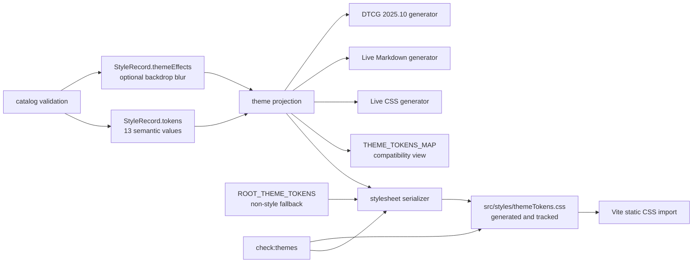

# Spec: Theme Generation

**Project Name:** Web Design Sample Selector (`design_sample_selector`)

**Initiative ID:** `scalable-style-library`

**Module ID:** `theme-generation`

**Depends on:** `style-contract` (`COMPLETE`), `catalog-validation` (`COMPLETE`)

**Document Status:** 구현·검증 완료 (`COMPLETE`)

**작성일:** 2026-08-30

**승인일:** 2026-08-30

**구현일:** 2026-08-30

**검증일:** 2026-08-30

---

## 1. Objective

24종에서 120종 이상으로 디자인 카탈로그를 확장할 때 스타일 토큰을 정규 카탈로그, 런타임 CSS, CSS/Markdown/DTCG 내보내기에 반복 입력하지 않도록 한다. 스타일별 13개 의미 토큰은 `StyleRecord.tokens`에서 한 번만 작성하고, 나머지 표현은 검증 가능한 결정론적 투영과 생성 결과로 만든다.

이 모듈의 사용자는 다음과 같다.

- 스타일 팩의 토큰과 선택적 테마 효과를 작성하는 개발자와 에이전트
- `[data-theme]` 기반 런타임 CSS를 소비하는 브라우저 UI
- CSS, Markdown, DTCG 2025.10 결과를 생성하는 인스펙터
- 토큰 중복 없이 새 스타일을 추가해야 하는 후속 `style-pack-authoring` 모듈

완료 상태에서는 새 스타일 하나를 추가할 때 `themeTokens.css`나 별도의 `THEME_TOKENS_MAP` 값을 수동으로 복사하지 않는다. 생성 파일이 오래되었거나 정규 토큰을 투영할 수 없으면 사용자 화면에 도달하기 전에 테스트 또는 빌드가 실패한다.

## 2. Approved Assumptions

다음 가정은 2026-08-30 사양 승인으로 확정되었다.

1. 스타일별 13개 의미 토큰의 유일한 작성 원천은 `StyleRecord.tokens`이다.
2. 런타임은 JavaScript로 `<style>`을 주입하지 않고, 정규 카탈로그에서 미리 생성해 저장소에 추적하는 `src/styles/themeTokens.css`를 계속 정적으로 import한다.
3. `:root` fallback은 특정 스타일이 아니므로 별도 동결 상수 `ROOT_THEME_TOKENS`가 소유한다.
4. 현재 세 스타일의 컨테이너 `backdrop-filter`는 13개 내보내기 토큰에 섞지 않고 선택 필드 `themeEffects.backdropBlur`로 소유한다.
5. 기존 24개 정규 ID와 21개 alias의 런타임 CSS 의미 및 정상 카탈로그 입력의 CSS/Markdown/DTCG 출력은 보존한다.
6. 알 수 없는 스타일 ID를 Swiss 토큰으로 조용히 바꾸는 기존 내부 폴백은 제거한다. 정규/alias 해석 실패는 명시적인 미선택 결과로 처리한다.
7. 생성 명령은 명시적으로 실행할 때만 파일을 쓰고, 일반 빌드는 생성 파일의 최신 여부만 검사한다.
8. 외부 런타임, CSS 파서, 스키마 라이브러리는 추가하지 않는다.

가정 4의 `themeEffects.backdropBlur`는 인스펙터 슬라이더 기본값인 `defaultTweaks.backdropBlur`와 다른 계약이다. 전자는 `[data-theme]` 컨테이너에 적용하는 기준 효과이고, 후자는 아키타입 컴포넌트의 조절 가능한 `--tweak-backdrop-blur` 초기값이다. 현재 `bento-grid`는 각각 `16px`와 `12px`이므로 자동 결합하면 시각 회귀가 발생한다.

## 3. Scope

### Included

- 의미 토큰 13개와 CSS custom property 13개의 명시적 일대일 매핑
- 정규 ID와 alias를 포함하는 동결 `ThemeDefinition` 투영
- 현재 `THEME_TOKENS_MAP`을 정규 카탈로그에서 만드는 호환 export
- `:root`, 24개 이상 `[data-theme]` 블록과 선택적 효과를 직렬화하는 순수 생성기
- 생성된 `src/styles/themeTokens.css`와 최신성 검사 CLI
- CSS/Markdown/DTCG 생성기의 정규 토큰 소비 전환
- 알 수 없는 ID의 무음 Swiss 폴백 제거
- `themeEffects.backdropBlur`의 계약 및 카탈로그 검증
- 기존 24종 전체 출력 행렬과 실제 Crostini Chrome 런타임 회귀 검증
- 생성 방식, 작성 절차와 기술 결정 문서 동기화

### Excluded

- 8개 아키타입의 HTML 또는 컴포넌트 CSS 구조 변경
- renderer, thumbnail, motion dispatch의 레지스트리 개편
- 신규 디자인, 카테고리, facet 또는 검색 UI 추가
- DTCG 버전 변경이나 새 토큰 종류 추가
- `defaultTweaks`의 의미 또는 슬라이더 범위 변경
- CSS minification, code splitting 또는 런타임 지연 로딩 최적화
- 현재 Google Fonts 로딩 방식 변경

## 4. Tech Stack

- JavaScript ES2022 정적 ES Module
- Node.js 20.x 또는 22 이상
- Vite 6의 기존 CSS import 및 `prebuild` 수명주기
- Node 내장 `fs`, `crypto`, 테스트 러너
- 표준 CSS custom properties와 `[data-theme]` 속성 선택자
- DTCG Format/Color Module Final Community Group Report 2025.10의 기존 출력 계약

생성 핵심은 브라우저에서도 import 가능한 순수 함수로 유지한다. 파일 시스템과 프로세스 종료 코드는 `scripts/generateThemeStyles.js`만 소유한다.

## 5. Pre-implementation Baseline and Duplication Inventory

2026-08-30 현재 조사 결과는 다음과 같다.

| Source | Style values | Additional responsibility |
| --- | ---: | --- |
| `src/catalog/packs/core/styles-*.js` | 24 × 13 | 정규 `StyleRecord.tokens` |
| `src/styles/themeTokens.css` | 24 × 13 | `:root`, 21개 alias selector, 3개 런타임 효과 |
| `src/utils/designSpecGenerator.js`의 `THEME_TOKENS_MAP` | 24 × 13 | 3개 unprefixed `backdrop-filter`, 내보내기 조회 |

- 24개 정규 레코드와 `THEME_TOKENS_MAP`의 13개 값은 전부 일치한다.
- 24개 CSS 블록과 정규 레코드의 13개 값도 전부 일치한다.
- alias는 총 21개이며 현재 CSS selector와 정규 카탈로그가 전부 일치한다.
- 추가 런타임 선언은 `glassmorphism: 20px`, `frutiger-aero: 14px`, `bento-grid: 16px`의 `backdrop-filter` 및 `-webkit-backdrop-filter`뿐이다.
- `:root`는 13개 fallback 값을 가지며 어느 개별 스타일의 토큰 집합도 아니다.

사양 승인 시 확정한 호환 기준선은 다음과 같다. 행렬 결합은 스타일 순서, 키 길이, 키, 출력 길이, 출력 문자열을 순서대로 연결한 UTF-8 바이트의 SHA-256이다. 런타임 CSS는 주석과 공백을 제외하고 selector 및 선언 순서를 직렬화한 의미 기준선이다.

| Baseline | Cases | SHA-256 |
| --- | ---: | --- |
| `THEME_TOKENS_MAP` 호환 객체 | 24 | `2e299391427ce9db7fa9b75cf55eeaea26abc9a54e921ef22cb6336f3126fdf5` |
| 런타임 테마 CSS 의미 | root 1 + theme 24 | `a4965a6dbbee982466ba1623e3a9309dde7fe204ccc4367eb9c18244f1b0d06d` |
| Live CSS | 24 × 8 archetypes × 3 modes = 576 | `b61766afb049fdba6d4c795db8263294aa72d6aa2201ba4e1aa720e14ee2e781` |
| Live Markdown | 24 × 8 archetypes × 2 devices = 384 | `e8b81f021fddf3268df1da306596d20d7059a6725261a8ee76ab9e319969c71a` |
| DTCG JSON | 24 | `e2949344331f8783fc37198e2de12bc64d9fa00f22ad73cf0ee4f1cf03adfc04` |

이 해시는 정상 24종 호환을 잠그는 테스트 오라클이며 새 스타일 추가 후에는 기존 24종 부분 행렬을 계속 비교한다. 생성 파일의 설명 주석과 공백은 공개 계약이 아니다.

## 6. Architecture and Data Flow



의존 방향은 `catalog → theme projection → runtime/export consumers`다. `src/catalog/`은 `src/theme/`이나 UI를 import하지 않는다. 생성기는 카탈로그의 공개 조회 API만 사용하고 개별 팩 파일을 직접 import하지 않는다.

## 7. Data and Public Interface Contracts

### 7.1 Additive style field

`StyleRecord`에 다음 선택 필드를 추가한다. 스키마 v1의 하위 호환 선택 필드이므로 `CATALOG_SCHEMA_VERSION`은 올리지 않는다.

```js
/**
 * @typedef {Object} ThemeEffects
 * @property {number} [backdropBlur] 0 이상의 유한한 CSS px 값
 */

/** @type {StyleRecord} */
const glassExample = {
  // ...existing fields
  themeEffects: {
    backdropBlur: 20
  }
};
```

- 필드가 없으면 `[data-theme]` 컨테이너 효과 선언을 만들지 않는다.
- 값이 있으면 `backdrop-filter: blur(Npx)`와 `-webkit-backdrop-filter: blur(Npx)`를 이 순서로 생성한다.
- `0`은 유효하며 두 선언을 `blur(0px)`로 생성한다. 효과를 원하지 않으면 필드 자체를 생략한다.
- 알 수 없는 `themeEffects` 키는 `THEME_EFFECT_UNKNOWN`, 음수·`NaN`·무한대·문자열 값은 `THEME_EFFECT_VALUE_INVALID` 카탈로그 오류다. 두 코드는 모든 출판 상태에서 error이며 경로는 `styles[<id>].themeEffects.<key>`다.
- 현재 세 레코드에 필드를 추가한 뒤 카탈로그 기준선은 계속 오류 0개·기존 경고 56개여야 한다.
- DTCG, Live Markdown과 13개 의미 토큰에는 이 값을 자동 추가하지 않는다.

### 7.2 Token-to-CSS mapping

다음 매핑과 순서는 안정 계약이다.

| Semantic key | CSS custom property |
| --- | --- |
| `background` | `--theme-bg` |
| `surface` | `--theme-surface` |
| `surfaceSubtle` | `--theme-surface-subtle` |
| `border` | `--theme-border` |
| `text` | `--theme-text` |
| `textMuted` | `--theme-text-muted` |
| `accent` | `--theme-accent` |
| `accentSecondary` | `--theme-accent-secondary` |
| `radius` | `--theme-radius` |
| `borderWidth` | `--theme-border-width` |
| `shadow` | `--theme-shadow` |
| `fontFamily` | `--theme-font-family` |
| `glow` | `--theme-glow` |

`THEME_TOKEN_KEYS`와 이 매핑의 키 집합·순서가 다르면 테스트와 빌드가 실패한다. 값은 정규 토큰 문자열을 수정하거나 정규화하지 않고 그대로 투영한다.

### 7.3 Theme definition

```js
/**
 * @typedef {Object} ThemeDefinition
 * @property {string} id
 * @property {readonly string[]} aliases
 * @property {string} categoryId
 * @property {number} order
 * @property {Readonly<ThemeTokens>} tokens
 * @property {Readonly<Record<string, string>>} cssCustomProperties
 * @property {Readonly<ThemeEffects>} themeEffects
 */
```

공개 진입점 `src/theme/index.js`는 다음 계약을 제공한다.

```js
getThemeDefinitionById(id);   // canonical ID 또는 alias → ThemeDefinition|null
getThemeDefinitions();       // 모든 출판 상태, order 후 ID 정렬, 재귀 동결
generateThemeStylesheet();   // 전체 결정론적 CSS 문자열
THEME_TOKENS_MAP;            // 기존 canonical-ID keyed 호환 export
THEME_TOKEN_CSS_PROPERTIES;  // 동결된 13개 의미 키 → CSS property 매핑
ROOT_THEME_TOKENS;           // 개별 스타일이 아닌 동결 root fallback
```

- `getThemeDefinitionById()`는 알 수 없거나 문자열이 아닌 ID에 `null`을 반환한다.
- alias 입력도 반환 레코드의 `id`는 정규 ID다.
- `getThemeDefinitions()`는 `draft/review`도 포함한다. 출판 상태가 바뀔 때 테마 파일을 수동 보강하지 않게 하기 위해서다. 실제 UI 노출 정책은 계속 카탈로그 조회 계층이 소유한다.
- 반환 객체, 중첩 토큰, selector 배열과 호환 맵은 재귀 동결한다.
- `THEME_TOKENS_MAP`은 기존 import를 깨지 않도록 `designSpecGenerator.js`에서도 재-export한다. canonical ID만 키로 가지며 13개 CSS custom property와, 해당할 때만 기존 unprefixed `backdrop-filter`를 포함한다.
- 어떤 공개 조회도 Swiss 또는 첫 스타일을 fallback으로 사용하지 않는다.

### 7.4 Root fallback

`ROOT_THEME_TOKENS`는 현재 `:root`의 13개 값을 의미 키로 한 번만 소유한다. 이는 카탈로그 스타일이 아니며 ID, alias, 출력 문서 또는 검색 결과를 갖지 않는다. 생성기는 이 상수를 같은 매핑으로 투영한 뒤 스타일 블록보다 먼저 출력한다.

### 7.5 Stylesheet serialization

- 스타일 순서는 `getThemeDefinitions()`의 `order` 후 ID 순서다.
- selector는 canonical ID를 먼저, 이어서 정규 레코드의 alias 순서로 출력한다.
- 각 블록은 13개 custom property를 고정 순서로 출력한 뒤 선택 효과를 출력한다.
- ID는 기존 카탈로그 검증의 kebab-case 계약을 통과한 값만 받는다. 생성기에서 별도 escaping이나 암묵적 교정을 하지 않는다.
- 헤더에는 생성 파일, 원천 모듈과 갱신 명령을 표시한다.
- 생성 결과는 LF와 파일 끝 개행 하나를 사용한다.
- 같은 입력은 플랫폼과 반복 실행에 관계없이 바이트가 같은 결과를 만든다.

## 8. Commands and Build Lifecycle

구현 후 다음 명령을 표준 계약으로 추가한다.

```bash
# 정규 카탈로그에서 추적 대상 CSS를 갱신
npm run generate:themes

# 파일을 쓰지 않고 생성 결과와 추적 파일의 일치 여부 검사
npm run check:themes

# 집중 테스트
npm test -- tests/themeGeneration.test.js

# catalog 검증 → theme 최신성 검사 → Vite 빌드
npm run build

# 전체 테스트와 빌드 게이트
npm run check
```

계획된 `package.json` 수명주기는 다음과 같다.

```json
{
  "scripts": {
    "generate:themes": "node scripts/generateThemeStyles.js",
    "check:themes": "node scripts/generateThemeStyles.js --check",
    "prebuild": "npm run validate:catalog && npm run check:themes",
    "build": "vite build",
    "check": "npm test && npm run build"
  }
}
```

CLI 종료 코드는 현재 프로젝트 규약을 따른다.

- `0`: 생성 성공 또는 `--check` 최신
- `1`: `--check`에서 파일 누락·오래됨
- `2`: 알 수 없는 옵션, 읽기·직렬화·쓰기 같은 도구 내부 실패

일반 빌드는 소스 트리를 변경하지 않는다. 카탈로그 토큰이나 alias를 바꾼 작성자는 `npm run generate:themes`로 결과를 명시적으로 갱신한 뒤 빌드한다.

## 9. Export and Compatibility Behavior

### 9.1 Valid styles

- 기존 24개 정규 스타일의 Live CSS 3개 모드, 8개 아키타입 조합은 바이트 단위로 보존한다.
- 기존 24개 스타일의 Live Markdown은 8개 아키타입과 Desktop/Mobile 조합에서 바이트 단위로 보존한다.
- 기존 24개 DTCG JSON은 key, value shape, 배열 순서, `$extensions`, 버전과 들여쓰기를 포함해 바이트 단위로 보존한다.
- CSS 런타임 파일은 설명 주석과 공백을 제외한 `:root`, selector, 선언, 값과 순서를 보존한다.
- canonical ID, alias와 브라우저 `data-theme` 전환 방식은 바꾸지 않는다.

### 9.2 Unknown and invalid styles

- `null` 또는 해석할 수 없는 ID의 CSS 생성은 `/* No design selected */`을 반환한다.
- Markdown 생성은 `# Design Specification (No Selection)`을 반환한다.
- DTCG 생성은 `{}`를 반환한다.
- 알 수 없는 ID를 가진 객체에서 이름·팔레트만 사용해 Swiss 토큰 문서를 만드는 동작은 제거한다.
- 정상 UI는 정규 카탈로그 조회와 저장 ID canonicalization을 통과하므로 이 경계 변경은 기존 사용자 흐름에 나타나지 않아야 한다.

### 9.3 Generated-file ownership

`src/styles/themeTokens.css`는 구현 이후 생성 파일이다. 수동 수정은 금지하고 원천 레코드, `ROOT_THEME_TOKENS`, 매핑 또는 직렬화기를 수정한 뒤 다시 생성한다. 코드 리뷰에서는 생성 파일만이 아니라 원천 diff와 `check:themes` 결과를 함께 본다.

## 10. Project Structure

```text
src/
├── catalog/
│   ├── contract.js                  # 선택적 ThemeEffects 계약
│   ├── packs/core/styles-*.js       # 유일한 스타일 토큰·효과 작성 원천
│   └── validation/                  # themeEffects 규칙 추가
├── theme/
│   ├── contract.js                  # root fallback, 의미 키 → CSS property 매핑
│   ├── projection.js                # StyleRecord → 동결 ThemeDefinition/호환 맵
│   ├── stylesheet.js                # 순수 결정론적 CSS 직렬화
│   └── index.js                     # 유일한 theme-generation 공개 진입점
├── styles/
│   └── themeTokens.css              # 생성·추적되는 런타임 CSS
└── utils/
    └── designSpecGenerator.js       # 정규 theme projection 소비, 호환 export 재노출

scripts/
└── generateThemeStyles.js           # write/check CLI 경계

tests/
└── themeGeneration.test.js          # 계약, 생성, 호환 행렬, CLI 회귀
```

구현 계획에서 단순화 결과 두 개의 작은 모듈로 충분하다면 `contract.js`와 `projection.js`를 합칠 수 있다. 다만 카탈로그 역방향 import 금지, 공개 진입점, 순수 직렬화와 CLI 파일 시스템 경계는 유지한다.

## 11. Code Style and Boundaries

- 프로젝트 소유 설명 주석은 한국어를 기본으로 하고 생성 CSS 헤더는 간결한 영문 명령과 원천 경로를 함께 표시한다.
- 생성 핵심은 입력을 수정하지 않는 순수 함수이며 전역 DOM, `process`, 파일 시스템을 읽지 않는다.
- object key 열거에 암묵적으로 의존하지 않고 `THEME_TOKEN_KEYS`와 명시적 매핑 순서를 사용한다.
- CSS 값은 검증된 카탈로그 문자열을 그대로 보존한다. 생성기가 색상, 폰트, shadow를 재포맷하지 않는다.
- 카탈로그 팩 파일 직접 import, Swiss fallback, 중복 토큰 literal과 런타임 `<style>` 주입을 금지한다.
- `designSpecGenerator.js`의 아키타입 템플릿, DTCG 파서와 다운로드 코드는 이번 범위에서 이동하거나 재작성하지 않는다.
- `src/theme/`의 브라우저 경로에는 Node 전용 모듈을 import하지 않는다.
- 생성 CSS의 변경은 사람이 작성한 원천과 검증 결과 없이 단독으로 받아들이지 않는다.

## 12. Testing and Verification

### 12.1 Test-driven increments

구현 전에 현재 코드로 통과하는 호환 기준선 테스트와 새 구조에서만 통과하는 실패 테스트를 분리한다. 새 테스트는 다음 결함을 각각 검출해야 한다.

- 의미 토큰과 CSS 매핑의 키 누락·추가·순서 변화
- 정규 토큰과 호환 map 또는 생성 CSS 값 불일치
- canonical/alias selector 누락·중복
- 선택 효과 누락, 잘못된 값과 vendor-prefixed 선언 누락
- 생성 파일 stale 상태
- 알 수 없는 ID가 Swiss 값으로 변환되는 회귀
- 반환 객체나 중첩 값 mutation
- Node 전용 CLI 코드의 브라우저 import 유입

### 12.2 Automated

```bash
npm test -- tests/themeGeneration.test.js
npm test -- tests/styleContract.test.js
npm test -- tests/catalogValidation.test.js
npm test -- tests/designSpecGenerator.test.js
npm test
npm run validate:catalog
npm run check:themes
npm run build
npm run check
git diff --check
```

호환 행렬 검증은 제5장의 기존 24종 SHA-256을 사용한다. 새 스타일이 추가되어도 기존 24종 부분 집합의 해시는 바꾸지 않는다. 의도적으로 기존 출력 계약을 바꾸는 미래 작업은 별도 승인과 새 기준선 근거가 필요하다.

### 12.3 Runtime and visual verification

ChromeOS Crostini Linux의 설치된 Google Chrome에서 다음을 검증한다.

1. 대표 스타일 8종과 세 선택 효과 스타일을 Detail 및 Split Compare에서 연다.
2. `data-theme` selector가 canonical ID와 alias 모두에서 같은 13개 computed custom property를 제공하는지 확인한다.
3. `glassmorphism`, `frutiger-aero`, `bento-grid`의 computed `backdrop-filter` 값이 각각 `20px`, `14px`, `16px`인지 확인한다.
4. 테마 전환 전후 게임 점수·장바구니 등 DOM 상태가 유지되는지 확인한다.
5. Desktop/Mobile 8개 아키타입과 CSS/Markdown/DTCG 다운로드가 기존 결과를 유지하는지 확인한다.
6. 애플리케이션 스타일시트가 200으로 응답하고 생성 selector가 computed style에 반영되며, console의 애플리케이션 오류와 런타임 style injection이 없는지 확인한다. Vite 개발 서버는 CSS `@import`를 소유 스타일시트 응답에 결합할 수 있으므로 별도 `themeTokens.css` 요청 이름 자체를 요구하지 않는다.

### 12.4 Definition of Done

- 실패 테스트를 먼저 확인한 뒤 최소 구현으로 통과시킨다.
- 집중 테스트, 전체 테스트, catalog 검증, theme 최신성 검사와 Vite 빌드가 통과한다.
- 기존 24종 호환 해시와 Crostini Chrome 런타임 검증이 모두 통과한다.
- 생성기를 우회하는 스타일 토큰 값 literal이 브라우저·내보내기 경로에 남지 않는다.
- 구현 파일, README, BUILD_GUIDE, CHANGELOG, `spec.md`, `designs.md`, ADR, 구현 요약과 역량 맵이 동기화된다.
- 무관한 프리뷰·아키타입·탐색 코드는 변경하지 않는다.

## 13. Success Criteria

1. [x] 스타일별 13개 토큰 값은 `StyleRecord.tokens`에만 사람이 작성한다.
2. [x] `THEME_TOKENS_MAP`은 정규 레코드에서 생성되며 기존 24종 호환 해시를 유지한다.
3. [x] `themeTokens.css`는 정규 레코드와 root fallback에서 결정론적으로 생성된다.
4. [x] 24개 정규 selector, 21개 alias와 3개 선택 효과의 런타임 의미 기준선을 유지한다.
5. [x] `npm run check:themes`가 최신 파일에는 `0`, 누락·stale 파일에는 `1`, 도구 오류에는 `2`를 반환한다.
6. [x] `npm run build`가 카탈로그 검증 후 theme 최신성 검사를 우회하지 않는다.
7. [x] Live CSS 576개, Markdown 384개와 DTCG 24개 기존 출력 행렬의 해시가 유지된다.
8. [x] 알 수 없는 ID가 Swiss 토큰으로 변환되지 않는다.
9. [x] theme public 결과는 정렬되고 재귀 동결되며 입력을 변형하지 않는다.
10. [x] 새 `draft/review/ready` 스타일도 추가 토큰 맵이나 CSS 수동 편집 없이 생성 결과에 포함된다.
11. [x] Node 전용 파일 시스템 코드가 브라우저 번들에 포함되지 않는다.
12. [x] Crostini Google Chrome에서 테마, 상태 보존, Desktop/Mobile과 내보내기 회귀가 없다.
13. [x] 외부 의존성, 신규 디자인 또는 아키타입 구조 변경이 없다.

### 13.1 Verification Evidence

- `npm run check`: 63/63 Node 테스트, catalog 오류 0개·경고 56개, theme 최신성 검사와 Vite 빌드가 통과했다.
- 호환 SHA-256은 map `2e2993…fdf5`, runtime CSS `a4965a…06d`, Live CSS `b61766…781`, Markdown `e8b81f…c71a`, DTCG `e29493…fc04`로 제5장 승인값과 일치했다.
- 프로덕션 산출물은 JavaScript `276.94 kB` (`75.35 kB` gzip), CSS `115.43 kB` (`21.79 kB` gzip)이며 Node CLI, `node:fs`와 생성기 오류 문자열은 브라우저 번들에 없었다.
- Crostini Google Chrome 151에서 45개 canonical/alias selector의 13개 computed property, 블러 `20/14/16px`, 대표 10개 Detail 스타일, 8개 Split 스타일, 16회 device 전환, 상태 복귀와 CSS/Markdown/DTCG 다운로드가 통과했다.
- 애플리케이션 리소스·console·runtime 오류는 0건이었다. 선택적 `/favicon.ico` 자동 요청 404는 제품 리소스 오류에서 분리했다.

## 14. Risks and Mitigations

| Risk | Impact | Mitigation |
| --- | --- | --- |
| 생성 CSS의 공백 차이를 시각 호환으로 오인 | High | selector·선언 의미 fingerprint와 computed style을 함께 비교한다. |
| `themeEffects`와 `defaultTweaks`를 합쳐 기존 효과가 달라짐 | High | 두 계약을 분리하고 bento의 16/12 차이를 명시적 테스트로 고정한다. |
| 생성 파일을 갱신하지 않아 개발 빌드가 실패 | Medium | stale 경로와 정확한 `generate:themes` 복구 명령을 CLI·BUILD_GUIDE에 표시한다. |
| prebuild가 파일을 자동 수정해 사용자 변경과 섞임 | Medium | prebuild는 `--check`만 실행하고 쓰기는 명시 명령에 제한한다. |
| 정규 카탈로그 import가 UI 순환 의존을 만듦 | High | catalog는 theme을 import하지 않는 단방향 경계를 테스트한다. |
| 호환 map 제거로 기존 테스트·외부 소비자가 깨짐 | High | 기존 이름을 정규 투영의 재-export로 유지하고 불변성만 강화한다. |
| 120종 CSS가 증가해 초기 로드 비용이 커짐 | Medium | 이번 모듈은 생성 정확성을 우선하며 실제 예산·분할은 `render-scalability`에서 측정 후 결정한다. |
| 해시만 통과하고 브라우저 렌더가 달라짐 | High | 대표 및 효과 스타일의 computed style과 실제 Chrome 사용자 흐름을 별도로 검증한다. |

## 15. Rollback Strategy

- 데이터·사용자 저장소·외부 API 마이그레이션은 없다.
- 새 theme 모듈과 CLI 연결에 문제가 생기면 `designSpecGenerator.js`의 소비 경계와 `prebuild`의 `check:themes` 연결을 마지막 통과 Checkpoint로 되돌릴 수 있다.
- 추적된 `themeTokens.css`는 생성 전 의미 기준선을 보존하므로 런타임 CSS만 독립적으로 복구할 수 있다.
- `themeEffects`는 선택 필드이며 제거해도 기존 13개 토큰 스키마는 유지된다. 다만 세 스타일의 효과 회귀가 있으므로 효과 필드와 생성기는 함께 롤백한다.
- rollback에서도 알 수 없는 ID를 Swiss로 대체하는 동작을 새 코드에 다시 도입하지 않는다. 필요하면 기존 릴리스 전체를 명시적으로 복원하고 사유를 기록한다.

## 16. Open Questions

구현을 막는 기술적 미확정 사항은 없다. 다음 세 항목은 2026-08-30 사양 승인으로 함께 확정되었다.

1. 생성 CSS를 저장소에 추적하고 빌드에서는 stale 검사만 수행한다.
2. `themeEffects.backdropBlur`를 `defaultTweaks`와 분리한다.
3. 알 수 없는 스타일의 Swiss 폴백을 제거한다.

이 중 하나를 다르게 선택해야 하면 구현을 멈추고 본 사양과 Decision 013을 먼저 수정해 다시 승인받는다.

## 17. Completion Record

이 사양과 구현 계획은 2026-08-30에 승인되었고 Task 1–9를 테스트 우선의 작은 증분으로 완료했다. 승인된 공개 API, 생성 CSS 추적 방식, 효과/tweak 분리, Swiss 폴백 제거와 호환 해시는 변경하지 않았다. Vite 개발 서버가 `@import`를 소유 스타일시트 응답에 결합한다는 런타임 검증 세부사항만 실제 관찰에 맞춰 명시했다.
