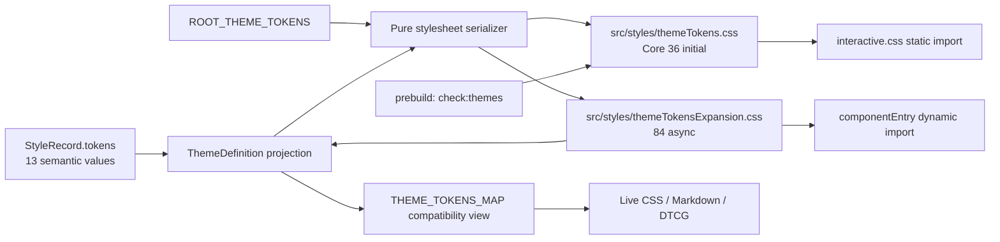
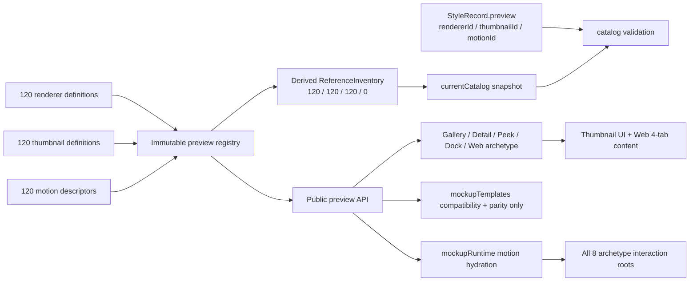
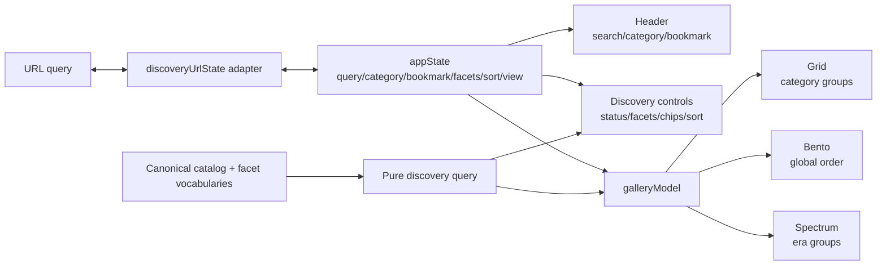
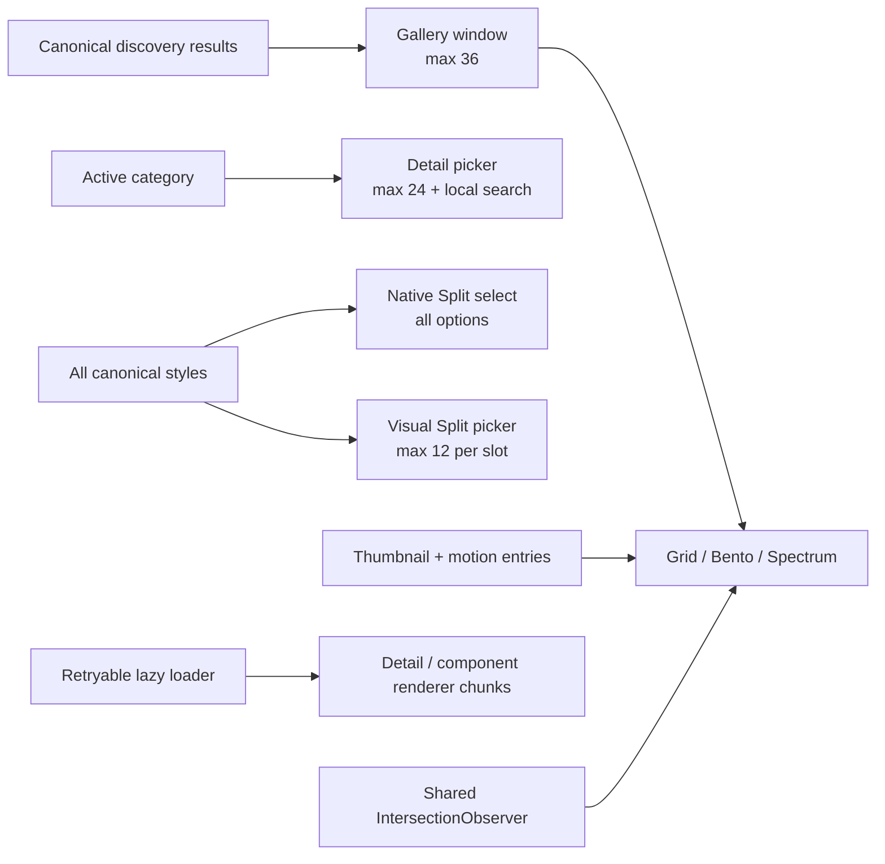
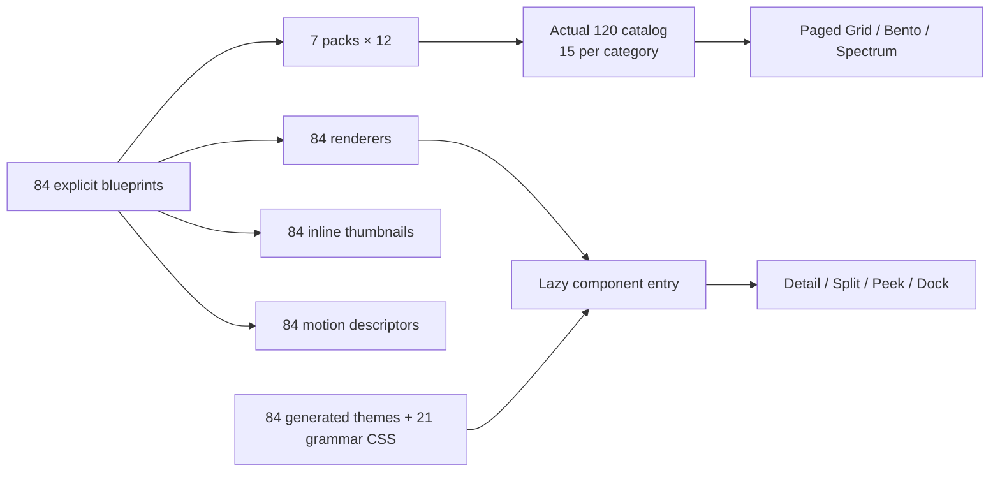
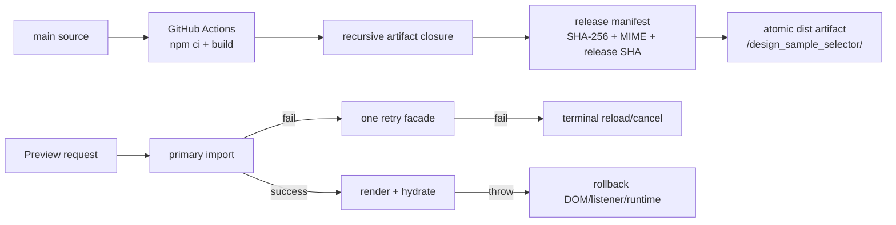
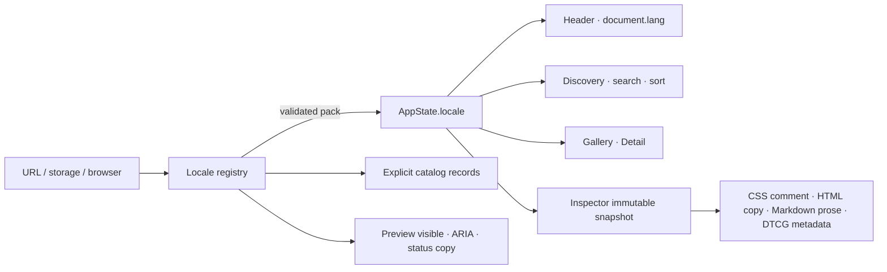

# UI/UX Design Specification (`designs.md`)
**Project Name:** Web Design Sample Selector 2 (`design_sample_selector`)
**Version:** 2.4.0
**Document Status:** Current UX Architecture / v2.4.0 Refactoring Verified

---

## 1. Design System & Global Visual Tokens

### 1.0 소프트 UI 재설계 (2026-10-18)

근거: 사용자 요청, 실제 120종 카탈로그, `ui-ux-pro-max`의 **Soft UI Evolution / Neumorphism / Compact Label Overflow** 지침. 검색 도구의 마케팅 Hero·후기 구성은 카탈로그 제품과 맞지 않아 채택하지 않았으며, 기존 3개 보기와 탐색 구조를 유지한다.

```text
소프트 UI 제어면: Header → 검색·조건 → 3개 Gallery 보기 → 선택 Dock
                                            ├→ Detail: 제어면 | 고유 테마 시안 | Inspector
                                            └→ Split: 제어면 | 테마 A | 테마 B
초기 CSS: index + interactive + wave1 thumbnails + soft-ui + preview-thumbnails
상세 CSS: core-preview + wave1-preview + expansion + audit9 + preview-refinements
```

- **시각 언어:** 밝은 청회색 바탕, 진한 잉크, 양방향 부드러운 그림자, 음각 활성 상태. 카테고리는 도형 아이콘과 짧은 표식으로 구분한다. Canvas는 초기화·중지 계약을 유지하되 메인에서 장식 입자를 표시하지 않는다.
- **카드:** 시안 선택 영역과 상세/즐겨찾기를 두 줄로 분리한다. 이름은 줄바꿈하며 높이 제한으로 자르지 않는다. 선택은 체크와 `aria-pressed`/`aria-current`로 함께 표현한다. 즐겨찾기·필터·보기 변경 시 해당 버튼의 키보드 포커스를 보존한다.
- **120종:** Core 24·Wave 1 12종의 고유 구조를 유지·보정하고 Expansion 84종은 21개 문법별 구성·재질·활자 위계를 재조정한다. 작은 thumbnail에는 긴 시안명 대신 도형 4개와 고유 palette를 표시한다. 이름은 바깥 label이 소유한다.
- **테마와 튜너:** 내부 mockup의 강제 cyan glow·둥근 모서리를 제거해 고유 테마를 드러낸다. radius/border는 기존 opt-in surface에 적용하고 그림자·blur·glow의 실시간 연결을 유지한다. 시안 폭은 container query로 판단한다. [CSS container queries 표준](https://www.w3.org/TR/css-conditional-5/)을 근거로 `cqi` 글자 크기를 사용한다.
- **접근성:** 읽는 글자 대비 4.5:1 이상을 목표로 하고 키보드 focus-visible·44px 조작 영역·reduced-motion을 유지한다. 메뉴의 가로 스크롤은 보이는 scrollbar와 키보드 포커스로 전체 항목에 도달하게 한다. 도크·상세·비교에도 재생/일시정지·효과음 조작을 제공한다.
- **반응형:** 320/375/768/1024/1440px와 좁은 desktop·split 컨테이너를 별도 검사한다. 정보는 재배치하고 dashboard 표만 자체 가로 스크롤을 허용한다. 닫힌 장바구니는 화면과 Tab 순서에서 제외한다.
- **상태·오류:** 선택/확정/즐겨찾기와 locale·Inspector·runtime 복원 계약을 유지한다. 미선택 확정 버튼은 disabled로 표시한다. 초기·빈 결과·lazy preview 오류·재시도 흐름은 기존 복구 계층을 사용한다.
- **성능:** 예산을 늘리지 않고 Core/Wave 1 상세 CSS를 지연 로드한다. 모양을 CSS로 구성해 초기 JavaScript에 SVG 경로 목록을 추가하지 않는다.

### 1.1 Color Tokens (CSS Custom Properties)

```css
:root {
  /* Core Background & Surfaces */
  --bg-dark-primary: #e9edf1;
  --bg-dark-surface: #edf1f5;
  --bg-dark-card: #edf1f5;
  --bg-glass-border: #cbd3dc;
  --bg-glass-hover: #9aa9b9;
  
  /* Primary Category Accents */
  --accent-swiss-red: #FF3300;
  --accent-brutal-yellow: #FFFF00;
  --accent-cyan: #245eac;
  --accent-magenta: #9c3762;
  --accent-emerald: #236649;
  --accent-y2k-chrome: #A855F7;
  --accent-kinetic-lime: #CCFF00;
  --accent-clay-orange: #FF6B4A;
  
  /* Typography & Ink */
  --text-primary: #263548;
  --text-secondary: #526175;
  --text-muted: #59697c;
  --text-inverted: #ffffff;
  
  /* Dynamic Parameter Tweak Defaults */
  --tweak-radius: 16px;
  --tweak-border-width: 1px;
  --tweak-shadow-depth: 12px;
  --tweak-backdrop-blur: 16px;
  --tweak-glow-intensity: 1.0;
  
  /* Transitions */
  --transition-fast: 0.15s cubic-bezier(0.4, 0, 0.2, 1);
  --transition-normal: 0.3s cubic-bezier(0.4, 0, 0.2, 1);
  --transition-bounce: 0.4s cubic-bezier(0.175, 0.885, 0.32, 1.275);
}
```

### 1.2 Typography Hierarchy

| Font Role | Font Family | Weights | Usage |
| --- | --- | --- | --- |
| Primary Display | `'Space Grotesk', sans-serif` | 700, 600 | Page Hero, Main Titles, Category Numbers |
| Body & UI | `'Inter', sans-serif` | 400, 500, 600, 700 | Descriptions, Cards, Tabs, Pros/Cons |
| Monospace / Code | `'Fira Code', 'Courier New', monospace` | 400, 600 | Live Code Inspector, Hex Codes, CLI UI |
| Editorial / Serif | `'Cinzel', serif` | 600, 700 | High-Fashion Editorial Mockups |

---

## 2. Screen Architecture & Layer Hierarchy

```
+-------------------------------------------------------------------+
| LAYER 7: Split Dual Comparison Modal View (z-index: 1200)         |
+-------------------------------------------------------------------+
| LAYER 6: Toast Notifications & Copy Feedback (z-index: 1100)      |
+-------------------------------------------------------------------+
| LAYER 5: Detail Showcase & Archetype Modal View (z-index: 800)    |
|          - Universal Top Selector (active category, max 24 chips) |
|          - 8 Page Archetype Viewport + Live Kinetic Simulator     |
|          - Live CSS Parameter Sliders & Inspector                 |
+-------------------------------------------------------------------+
| LAYER 4.5: Selection Dock + Confirm Sheet (z-index: 550)          |
+-------------------------------------------------------------------+
| LAYER 4.2: Hover/Focus Peek Live Preview (z-index: 500)           |
+-------------------------------------------------------------------+
| LAYER 4: Audio Player & BGM Synthesizer Widget (z-index: 600)     |
+-------------------------------------------------------------------+
| LAYER 3: Header, Discovery Controls & View Switcher              |
|          (z-index: 400)                                           |
+-------------------------------------------------------------------+
| LAYER 2: Gallery Main Grid / Bento / Spectrum Stream (z-index: 100|
+-------------------------------------------------------------------+
| LAYER 1: Canvas 2D Particle Background Renderer (z-index: 0)      |
+-------------------------------------------------------------------+
```

### 2.1 Catalog Data Boundary

```text
┌──────────────────────────────────────────────────────────────┐
│ src/catalog/packs/core/ + packs/expansion/                  │
│ Core 36 + 7 packs × 12 = actual 120 StyleRecord             │
│ legacy 24 + ready 96 · 13 tokens · preview refs             │
│ 8 manifests (canonical authored source)                     │
└───────────────────────────┬──────────────────────────────────┘
                            │ assemble, sort, recursively freeze
                            ▼
┌──────────────────────────────────────────────────────────────┐
│ src/catalog/index.js                                        │
│ categories · styles · facets · aliases · pack query API     │
└───────────────┬──────────────────┬────────────────────────────┘
                │                  │
                ▼                  ▼
       catalog validation   src/theme/projection.js
                                   │
                         ┌─────────┴─────────┐
                         ▼                   ▼
               generated theme CSS   export token view
                         │                   │
                         ▼                   ▼
                  Browser runtime   CSS · Markdown · DTCG

                src/catalog/legacyAdapter.js → src/data/categories.js
                                      │ unchanged UI imports
                                      ▼
                           Gallery · Detail · Split · State
```

- **영역 역할:** `contract.js`는 스키마 버전과 어휘를, `categories.js`와 `facets.js`는 탐색 사전을, core 팩은 호환 36종을, expansion 7개 팩은 신규 ready 84종을 소유한다. `index.js`는 actual 120의 유일한 정규 조회 경계이고 `src/theme/`은 이 공개 경계만 읽어 런타임 CSS와 내보내기 토큰을 투영한다.
- **구현 제약:** 정규 ID는 재사용하지 않고, 결과는 `order` 후 ID로 정렬하며, 공개 레코드와 중첩 컬렉션을 변경할 수 없다. 스타일별 13개 값은 `StyleRecord.tokens`에서만 작성하고 두 생성 theme CSS나 호환 map에 복사하지 않는다.
- **접근성:** 표시 문자열과 ID를 분리하고, 실제 탐색 UI는 native radio/checkbox·연결된 label/legend·키보드 조작·동적 결과 개수 안내를 제공한다.
- **반응형:** 카탈로그 데이터는 viewport와 독립적이다. Desktop/Mobile은 동일한 정규 스타일 ID를 사용하며, 현재 `380px` 모바일 샌드박스와 외부 브라우저 breakpoint 동작을 유지한다.
- **상태:** `legacy/ready`만 기본 조회되고 `draft/review`는 개발 조회에서만 노출된다. 로컬 저장 alias는 정규 ID로 해석한 뒤 상태에 기록한다.
- **오류 처리:** 잘못되거나 오래된 외부 ID는 `null`/빈 배열 또는 기존 미선택 내보내기로 처리한다. 내부 토큰·효과·렌더러 누락을 Swiss로 대체하지 않으며 catalog/theme 검증에서 빌드 전에 차단한다.

### 2.2 Generated Theme Boundary



- **생성 파일 소유권:** `themeTokens.css`와 `themeTokensExpansion.css`는 사람이 편집하지 않는다. 정규 레코드 변경 뒤 `npm run generate:themes`로 둘을 갱신하며 일반 빌드는 `npm run check:themes`로 읽기 전용 비교만 한다.
- **효과와 튜너 분리:** `themeEffects.backdropBlur`는 테마 컨테이너의 기준 효과이고 `defaultTweaks.backdropBlur`는 아키타입 슬라이더 초기값이다. `bento-grid`의 기준 효과 `16px`와 tweak `12px`를 포함해 서로 자동 결합하지 않는다.
- **반응형·상태:** 스타일 교체는 외부 preview viewport와 Desktop/Mobile·활성 아키타입·탭을 유지하면서 내부 renderer root와 motion을 새 스타일 것으로 교체한다. 교체 전 runtime snapshot을 복원하므로 게임·장바구니·댓글·채팅 같은 승인된 local state는 유지하되 이전 스타일의 카피·DOM 문법은 남기지 않는다.
- **접근성:** 생성 계층은 포커스 순서와 ARIA를 변경하지 않는다. 색상 대비·접근성 메모는 catalog-validation의 기존 오류/경고 정책을 계속 따른다.
- **오류 상태:** stale 또는 누락된 CSS는 빌드에서 복구 명령과 함께 실패한다. 알 수 없는 ID는 스타일을 추측하지 않으며, 잘못된 효과 값은 `THEME_EFFECT_*` 진단으로 차단한다.

### 2.3 Preview Registry Boundary



- **영역 역할:** `src/preview/`는 Web 4탭 renderer, 전체 UI용 thumbnail recipe, motion descriptor와 불변 registry를 소유한다. Gallery·Detail·Peek·Dock과 `archetypeTemplates.js`의 Web 경로는 `src/preview/index.js`를 직접 사용한다. `mockupTemplates.js`는 이전 위치 인자 호출과 parity만 보존하고, `mockupRuntime.js`는 모든 아키타입 root에서 등록된 motion class·effect layer descriptor를 소비한다.
- **구현 제약:** 정규 inventory와 공개 호환 API는 정적 definition에서 사전순으로 파생하며 별칭, 내부 map과 render 함수는 노출하지 않는다. 신규 스타일은 catalog의 세 참조와 `renderers.js`·`thumbnails.js`·`motions.js` definition을 함께 추가하고, `index.js`, compatibility 파일 또는 validation에 스타일별 switch/목록을 만들지 않는다. 런타임 등록·원격 HTML은 제공하지 않으며, 내부 UI의 승인된 dynamic import 경계는 아래 `render-scalability` 영역이 소유한다.
- **접근성·모션:** effect layer는 `aria-hidden="true"`이고 pointer event를 받지 않는다. `prefers-reduced-motion`이면 runtime이 `motion-reduced`를 적용해 effect layer를 숨기고 반복 meter/media 동작을 시작하지 않으며, CSS가 thumbnail·template 반복 animation을 억제한다. off-screen thumbnail은 `IntersectionObserver`의 `in-view` 상태로 일시 정지한다. 기존 키보드·포커스·상호작용 상태 계약은 유지한다.
- **반응형·상태:** registry는 device 폭을 결정하지 않는다. Detail의 `.mockup-viewport.desktop|mobile`이 동일 정규 스타일에서 레이아웃을 선택하며 Mobile은 모든 현재 `.archetype-unit`/`.mockup-unit`을 최대 `380px`로 제한하고 Web·Storefront·Dashboard·Chat을 모드 전용 규칙으로 재배치한다. hydration은 같은 root에서 class/layer를 중복 생성하지 않고 teardown cleanup을 보존한다. 스타일 전환은 바깥 viewport identity를 유지하고 inner renderer를 교체한 뒤 승인된 사용자 state와 현재 Zoom을 재적용한다.
- **오류 처리:** `hasPreviewReference()`와 capability 조회의 unknown은 `false`/`null`이다. 실제 render·hydration의 미등록 ID, 미지원 탭, 잘못된 definition/출력은 진단 필드를 가진 `PreviewRegistryError`다. Swiss, 일반 `Aa`, `none`으로 자동 대체하지 않으며 catalog prebuild가 정상 데이터의 세 참조와 파생 inventory 일치를 먼저 검사한다.

### 2.4 Wave 1 Visual Authoring Boundary

```text
styles-wave-1.js
       │ 12 ready records + explicit preview IDs
       ├───────────────┬──────────────────┬──────────────────┐
       ▼               ▼                  ▼                  ▼
renderers-wave-1  thumbnails-wave-1  motions-wave-1   wave1-styles.css
  12 × 4 tabs       12 motifs          12 policies      root-scoped visuals
       └───────────────┴──────────────────┴──────────────────┘
                               │
                               ▼
                    Core 36 registry + UI
```

- **모듈 소유권:** 기존 24종 파일은 호환 기준선으로 유지하고 신규 12종은 `styles-wave-1.js`, `renderers-wave-1.js`, `thumbnails-wave-1.js`, `motions-wave-1.js`, `wave1-styles.css`에 추가형으로 분리한다. registry와 catalog index만 두 세트를 조합한다.
- **시각 구별:** 12종은 색상뿐 아니라 DOM 골격, 정보 계층, 장식 도형과 타이포 스케일이 달라야 한다. 각 스타일의 네 Web 탭도 동일 장식의 반복이 아닌 서로 다른 실사용 구조를 제공한다.
- **DOM 제약:** thumbnail 출력은 Gallery·Detail·Split의 상위 버튼 안에 삽입되므로 내부에 `button`, `a`, `input`, `select`, `textarea`를 만들지 않는다. 보이는 조작 표지는 장식용 `span`으로 구현하며 실제 상호작용은 상위 컨트롤이 소유한다.
- **반응형:** 외부 브라우저 320/375/414/768/1024/1440px와 내부 Core 36 × 8 아키타입 × Desktop/Mobile 576상태를 별도 축으로 검증한다. Mobile은 최대 `380px`를 유지하면서 신규 스타일의 grid·tile·poster 구조가 한 열 또는 압축 레이아웃으로 실제 재배치되어야 한다.
- **접근성·상태:** 핵심 조작은 가능한 경우 44×44px 이상, 키보드 focus-visible, 색 외의 상태 표지를 제공한다. `prefers-reduced-motion`에서는 이동·왜곡·반복 애니메이션을 억제하고, Liquid Glass는 blur가 없어도 읽을 수 있는 backplate를 유지한다.
- **오류 처리:** 신규 ready 12종은 catalog 오류·경고 0을 만족한다. DTCG shadow의 CSS `none`은 구조화 타입을 깨는 문자열이 아니라 투명한 zero shadow로 정규화한다. renderer·thumbnail·motion 누락과 상호작용 요소가 섞인 thumbnail은 자동 회귀에서 실패한다.

### 2.5 Catalog Discovery Boundary



- **영역 역할:** `src/catalog/discovery.js`는 검색 문서·facet 정규화·AND/OR 질의·네 정렬·시대 그룹을 계산한다. `discoveryUrl.js`와 `discoveryUrlState.js`는 순수 URL 계약과 history side effect를 분리한다. `discoveryControls.js`/`discoveryMarkup.js`는 header와 독립된 수명주기로 결과 상태·facet·정렬·활성 칩을 관리하고, `galleryModel.js`가 한 canonical 결과 집합을 세 보기 문법으로 투영한다.
- **구현 제약:** category와 bookmark는 독립 조건이다. 서로 다른 facet은 AND, 하나의 multiple facet 값은 OR이며 single facet은 하나만 유지한다. unknown URL/facet 값은 허용 목록에서 제거하고 검색은 120자로 제한한다. 검색 타이핑은 `history.replaceState`, 뒤로/앞으로 이동은 `popstate` 복원으로 처리한다.
- **접근성:** 결과 개수는 `role="status"`/`aria-live="polite"`로 알린다. 10개 facet은 native `details`, radio/checkbox와 label/legend를 사용하고 disclosure 표식을 텍스트와 함께 표시한다. 활성 조건과 초기화는 키보드로 제거할 수 있으며 빈 결과 초기화 뒤 검색 입력으로 포커스를 복원한다.
- **반응형·상태:** facet은 기본적으로 접힌 compact row이며 열린 facet만 전체 폭을 사용한다. 320~1440px에서 가로 overflow 없이 동작하고 모바일 조작 대상은 최소 44px다. re-render 뒤 열린 facet과 초점을 유지하고 `prefers-reduced-motion`에서는 탐색 전환 시간을 제거한다.
- **오류·빈 상태:** 검색 문자열은 출력 전에 escape하고 잘못된 외부 값은 기본 상태로 정규화한다. 결과가 없으면 현재 조건을 숨기지 않고 전체 초기화 동작을 제공한다. 세 보기는 같은 canonical ID 집합을 유지하되 Grid는 category grouping, Bento는 전역 sort, Spectrum은 실제 `classification.era.start` grouping을 사용한다.

### 2.6 Render Scalability Boundary



- **영역 역할:** `src/scalability/renderWindow.js`가 DOM과 state를 모르는 gallery window와 bounded picker를 제공한다. `mainView.js`는 한 canonical 결과를 36개씩 세 보기로 투영하고, `stylePickerMarkup.js`는 Detail 24개·Split 슬롯당 12개의 고비용 thumbnail 상한과 선택 고정을 공유한다.
- **구현 제약:** Gallery page는 URL이 아닌 local 표현 상태이며 query/filter/sort/view 결과가 바뀌면 1페이지로 돌아간다. actual 120은 기본 네 페이지이고 Split native select는 전체 120 option을 유지해 visual window 밖 스타일도 접근 가능하다.
- **지연 코드:** 초기 경로는 thumbnail·motion만 정적으로 사용한다. Peek/확정은 component loader를, Detail/Split은 component graph를 포함한 Detail module loader를 유일 복구 경계로 사용한다. 각 경계는 primary/retry facade를 최대 두 번만 사용하고 두 번째 실패 뒤에는 추가 요청 없는 terminal reload 상태가 된다.
- **접근성·상태:** pager는 native button과 polite range status, picker는 label이 있는 search와 polite 결과 status를 제공한다. 현재 선택은 검색 결과에 없어도 한 번 고정한다. Detail loading/error는 modal opener capture, initial focus, Tab loop, Escape/cancel, focus restore를 제공하고 stale async 응답은 현재 state를 다시 확인한다. Peek와 Confirm Sheet는 배경을 막지 않는 non-modal `region`이며 각 preview viewport의 `data-theme`은 선택 ID와 일치한다.
- **모션·수명:** thumbnail은 viewport 안에서만 실행하며 re-render/unmount 시 observer를 해제한다. reduced-motion에서는 observer·실행 animation이 0이고 페이지 교체 뒤 detached observed node도 0이다.
- **초기 표시:** `body[data-app-pending]`의 UI를 `visibility:hidden`으로 정상 레이아웃 안에서 준비하고 웹 폰트 정착 뒤 노출한다. 이 방식은 공간을 제거하는 `display:none`과 달리 첫 화면 기하를 보존하며 Chrome 최종 CLS `0`을 달성했다.
- **실측 기준:** actual 120은 보기별 최대 36 thumbnails와 네 페이지 전체 ID 도달성을 유지한다. 초기 JS/CSS 기준선은 `88.60/32.86kB` gzip이고 Blog progress는 375/768/1024px의 실제 responsive scroll owner에서 각각 0→100과 ARIA를 확인한다. 기존 Chrome interaction 수치는 CDP 왕복이 섞여 FIN-F006 근거에서 제외했다. 새 hard gate는 페이지 내부 input dispatch부터 operation별 state/DOM 정착까지의 제품 처리시간을 재며, 독립 3회 모두 median 120ms/max 200ms 이하여야 한다. 정착 뒤 2 animation frames와 Long Task는 별도 presentation 진단으로 남겨 제품 처리와 frame scheduler 변동을 구분한다.

### 2.7 Actual 120 Expansion Boundary



- **주요 영역:** 7개 팩은 콘텐츠와 manifest를, `authoring.js`는 21개 문법의 분류·토큰 기본값·출처·접근성 원칙을 소유한다. 각 blueprint는 이름·팔레트·카피·모티프와 고유 프리뷰 ID를 명시한다.
- **시각 제약:** 같은 문법군의 네 시안도 고유 색·이름·카피·variant를 가지며 `.e120-*` root 아래에서만 스타일링한다. 외부 이미지·폰트·오디오 asset과 브랜드 화면 복제는 사용하지 않는다.
- **반응형:** Desktop `.e120-stage`는 두 열, `.mockup-viewport.mobile`은 한 열과 축소된 아트 영역을 사용한다. Chrome actual 행렬은 신규 84종 모두에서 grid가 달라짐을 검증한다.
- **접근성·상태:** 신규 84종은 `ready`, 출처·접근성 메모·텍스트 대비 진단 오류/경고 0이다. 조작 요소는 명시적 레이블과 44px 기준을 따르고 reduced-motion에서 반복 움직임을 억제한다.
- **오류 처리:** ID/alias 충돌, 누락 renderer·thumbnail·motion, fallback, stale 생성 CSS 또는 initial bundle 예산 초과는 자동 게이트에서 실패한다. 신규 상세 CSS는 initial에 포함하지 않고 component entry 이후에만 요청한다.

### 2.8 Pages Artifact and Recovery State Boundary



- **배포 제약:** production entry는 hashed `dist/assets`만 허용하며 source `/src/main.js`와 source CSS module graph는 게시하지 않는다. 지원 URL은 project root와 query/hash이며 임의 deep path는 404가 정상이다.
- **복구 상태:** loading → ready 또는 recoverable error → retrying → ready/terminal의 단방향 상태를 사용한다. terminal에서는 같은 importer를 반복하지 않고 reload와 닫기만 제공한다.
- **Peek 상호작용:** region 안의 native `상세 보기` button이 키보드 activation을 소유하고, card double click은 mock action/button을 제외한 경우에만 같은 Detail 경로를 호출한다.
- **진단·rollback:** 사용자 UI에는 일반 오류 문구만 보이며 안전한 phase/attempt/resource class는 최대 20개의 in-memory diagnostic으로 분리한다. 실패한 mount는 subscription, global key handler, mockup runtime과 부분 DOM을 전부 정리한다.
- **신뢰·저장:** renderer는 정적 registry 소유 HTML이며 executable sink를 거부한다. localStorage는 key당 16,384자, bookmarks 120, recents 6 상한과 corrupt/oversize 폐기를 적용한다.

---

### 2.9 Locale Snapshot and Semantic Geometry Boundary

`src/i18n/`은 locale ID·296-key UI copy inventory, locale별 catalog/preview content와 lazy pack lifecycle을 소유한다. AppState에는 검증된 locale ID만 commit하며 pack import가 끝나기 전 visible state를 바꾸지 않는다. Header, Discovery, Gallery, Detail, Split, recovery, 8개 archetype, 상호작용 runtime과 Inspector는 각 update 시작 시 하나의 locale snapshot을 읽어 혼합 언어 frame을 만들지 않는다. Catalog coverage는 `translated`·`invariant-approved`·`placeholder` provenance와 암묵 fallback을 field 단위로 집계하며 placeholder, 암묵 fallback 또는 미승인 동일 문자열이 하나라도 있으면 snapshot validation을 실패시킨다.

locale pack은 `ui`, `catalog`, `preview` 세 사람용 콘텐츠 영역을 독립적으로 소유한다. catalog는 category/facet와 120개 style의 이름·요약·palette·특징·장단점을 명시 record로 제공하고, preview는 renderer가 표시하는 visible/ARIA/status copy를 제공한다. canonical style/category/facet ID와 CSS·HTML·DTCG machine key는 별도 contract에 남아 locale pack의 display value와 섞이지 않는다. 일본어·중국어 간체·중국어 번체에서 영문 정식명이 필요한 브랜드·약어는 좁은 invariant allowlist로만 허용한다.

Stage 2의 장문 편집 결과는 locale별 `catalog/*Editorial.js`에 style profile로 분리한다. 공용 `applyEditorialReview.js`는 기존 배열 길이와 machine ID를 보존하는 투영만 담당하며, 문장 조립·구두점·palette 표시명과 용도는 각 locale 규칙이 소유한다. 따라서 한 locale의 자연스러운 문체를 위해 다른 locale 문장을 번역 원천이나 runtime fallback으로 재사용하지 않는다.

최종 locale reflow 게이트는 5개 locale마다 320/375/768/1024/1440px와 물리 1280px/CSS 640px/DPR 2의 200% 상태를 분리한다. Gallery와 Detail에서 document overflow, 화면 밖 interactive control, 접근성 이름과 주요 영역 경계를 수집하되 category·archetype·Inspector처럼 의도된 내부 가로 스크롤은 허용한다. 320px Game HUD의 스킬과 CTA는 `.game-action-bar`가 내용 길이에 따라 줄바꿈해 locale별 버튼을 viewport 안에 유지한다. Detail의 다섯 tuner range는 고정 영문 병기 대신 같은 locale snapshot의 `<label for>`를 접근성 이름으로 사용한다.



Inspector의 사람용 산출물만 locale별로 바뀐다. CSS custom property/selector, HTML ID·data attribute, DTCG structural key는 canonical ID와 stable palette ID를 사용해 같은 set을 유지한다. locale 재렌더는 기존 focus target을 복원한 뒤 focus trap만 다시 연결하며 첫 버튼으로 재초점하지 않는다.

테마 geometry는 `surface/control/pill` 세 의미를 가진다. Tuner는 preview markup의 `data-tweak-surface`에만 `--tweak-surface-radius`와 border/shadow 변수를 적용한다. badge·chip·meter처럼 capsule을 의도한 요소는 `--theme-pill-radius`를 사용하고 tuner가 덮어쓰지 않는다.

## 3. Main Gallery Layout & 3 View Modes

### 3.1 Top Navigation & Search/Filter Controls
- **Global Header:**
  - 정적 SVG 브랜드와 v2.4 PREVIEW 표식. Canvas와 BGM 구현 상태 칩은 메인 제어면에서 숨기며 오디오 조작은 플레이어·도크·모달에서 제공한다.
  - 한국어·영어·alias·분류 metadata를 찾는 최대 120자 실시간 검색과 clear button.
  - 실제 개수를 표시하는 8개 category tag와 독립 `Bookmarks (N)` 조건. 두 조건은 동시에 적용된다.
  - View Mode Toggle Switch (`Grid`, `Bento`, `Spectrum`).
  - Split Comparison Drawer Trigger (`Compare (2)`).
- **Independent Discovery Panel:**
  - 현재 결과/전체 수를 알리는 polite live status와 네 정렬 모드.
  - 기본 접힘 상태의 10개 native facet disclosure, 선택 조건 chip과 전체 초기화.
  - panel 자체가 header 검색 caret 갱신과 분리되어 입력·열림·포커스 상태를 안정적으로 유지한다.

### 3.2 View Modes
1. **Grid Mode (`view-mode-grid`):**
   - 8개 카테고리의 소프트 카드와 항상 보이는 시안 타일. 선택 체크, 두 줄의 상세/즐겨찾기 조작, 페이지 단위 36개 시각 창을 사용한다.
2. **Bento Mode (`view-mode-bento`):**
   - Asymmetric Bento Grid highlighting featured styles, interactive live mini-widgets, and color chips directly on the main board.
3. **Spectrum Mode (`view-mode-spectrum`):**
   - `classification.era.start`에서 파생한 실제 시대 bucket의 연대기 stream. `era-desc`에서는 그룹 순서를 역전하며 각 카드가 시대와 상위 category를 함께 표시한다.

---

## 4. Detail View & 8 Core Page Archetypes Specification

### 4.1 Universal Top Design Selector Bar
Located at the topmost header of the detail modal:
1. **Category Tabs Row (8 Genres):** Swiss, Brutalism, Depth, Retro, Editorial, Y2K, Hypertech, Soft 3D.
2. **Category-Bounded Sub-Style Chips:** 활성 category의 스타일만 표시하며 최대 24개 miniature thumbnail chip을 만든다. 한 category가 24개를 넘으면 local 검색을 제공하고 현재 선택은 결과와 무관하게 고정한다.
3. **Instant Action Buttons:** Bookmark (★), Confirm Style (✓), Split Compare (⚖️), and Close (✕).
4. **Keyboard Shortcuts:** `[` / `]` for previous/next style, `Shift + Left/Right` for category jump, `Esc` to close.

### 4.2 8 Core Page Archetype Tabs & Viewport
- **Archetype Navigation Bar (`role="tablist"`):**
  - `[ 🎮 Game HUD ]`: Target reflex clicker game, HP/MP bars, skill cooldown, combo multiplier.
  - `[ 🌐 Web SaaS ]`: Modern SaaS landing with Hero, Widget, Form, and Pricing sub-tabs.
  - `[ 📱 Mobile App ]`: Native mobile frame with status bar, feed cards, notification swipe, bottom 4-tab bar.
  - `[ 🛍️ E-Commerce ]`: Product showcase, color/size chips, quantity stepper, cart drawer, checkout modal.
  - `[ 📰 Blog & Post ]`: Article reader, scroll progress bar, like particle counter, live comment authoring.
  - `[ 📊 Dashboard ]`: KPI analytics cards, 1D/1W/1M time range filters, responsive data table with sort.
  - `[ 🎵 Media Player ]`: Track vinyl/cassette artwork, play/pause controls, interactive scrub bar, visualizer.
  - `[ 💬 Chat & DM ]`: Multi-channel sidebar, chat bubble stream, emoji reactions, message composer.
- **Device Switcher:** Desktop uses the standard preview width (up to `860px`); Mobile constrains every current `.archetype-unit` and legacy `.mockup-unit` preview to a `380px` phone frame, applies compact Web/Storefront/Dashboard/Chat layouts without relying on the outer browser breakpoint, and preserves the rendered interaction state.
- **Zoom Switcher:** 80/100/120% 중 활성 버튼의 `data-scale`이 단일 진실 원천이다. 스타일 또는 아키타입 전환으로 inner renderer가 교체되면 hydration 뒤 같은 scale과 `center top` origin을 새 root에 다시 적용한다.

#### 4.2.1 Stateful renderer transition matrix

| Archetype | 스타일 전환 시 보존 | 새 스타일에서 다시 생성 |
| --- | --- | --- |
| Game | HP/coin/combo/target HP/level/kills | style name, renderer markup, motion/effect layer |
| Web | 현재 tab과 input/select/checkbox 값 | style-specific component renderer와 copy |
| Mobile | 표준 form control 값 | style copy와 visual structure |
| E-commerce | quantity, color, size, cart | product/style copy, checkout dialog는 닫힘 |
| Blog | claps, reading mode, comments | article/style copy, progress owner binding |
| Dashboard | filter, sort와 행 기준 데이터 | style labels와 initial visual shell |
| Media | play, progress, volume, queue index | track/style labels와 spectrum binding |
| Chat | channel, 최대 50개 동적 user/bot message | style/channel shell과 motion |

전환 순서는 `snapshot → teardown → 새 renderer HTML → data-theme/data-archetype → hydrate(snapshot) → Inspector refresh`다. `#mockup-viewport` identity, device class, scroll layout은 유지하지만 renderer root identity는 유지 대상으로 보지 않는다.

#### 4.2.2 E-commerce checkout and Blog reading states

- `바로 구매`와 cart checkout은 source를 구분한다. empty cart의 checkout은 disabled/안내 상태이고 direct buy는 quantity 1 이상이면 modal summary를 연다.
- Checkout modal은 제목·source·수량·합계, 확인·취소를 제공한다. initial focus는 취소 control, Tab은 dialog 내부를 순환하고 Escape/취소는 opener로 복원한다. cart는 확인 완료 때만 비운다.
- Blog reading mode는 버튼 `aria-pressed`, accessible label, light background와 dark text를 함께 바꾼다. progress bar는 `role="progressbar"`, `aria-valuemin/max/now`를 제공하고 1024px 이하에서는 `.modal-body-grid`, 그보다 넓으면 `.mockup-viewport`의 실제 scroll position을 사용한다.
- Blog comment와 Chat message는 500자, 동적 history는 50개를 상한으로 하며 오류 status는 입력과 연결한다.

### 4.3 Right Column: Live Parameter Tweak Sliders & Reactive Design Spec Inspector
- **Interactive Palette Cards:** HEX click-to-copy with audio ping and toast notice.
- **표시·전달 경계:** 제목/배지, palette grid와 32px 이상 swatch, custom range track/thumb, Inspector와 장단점 card 규칙은 `audit9-detail.css`에 있고 Detail component chunk와 함께 지연 로드한다. 각 카드의 flex 축소를 금지해 카드가 아니라 우측 sidebar가 스크롤을 소유한다. 640px 이하에서는 palette와 장단점 grid를 한 열로 바꾸고 조작 target은 최소 44px을 유지한다.
- **접근성·상태:** palette는 native button과 visible focus를 사용하고 range는 연결된 label/현재값을 유지한다. CSS 누락 회귀는 Detail sidebar markup의 모든 class가 실제 loaded stylesheet selector를 갖는지 Node에서 검사하며, Chrome은 computed style뿐 아니라 제목·설명의 실제 bounding box가 hero card 안에 보이는지도 검사한다.
- **Live Parameter Tweak Sliders (Live CSS Variables Binding):**
  - Border Radius slider (`0px` ~ `64px`)
  - Border Width slider (`0px` ~ `12px`)
  - Shadow Depth slider (`0px` ~ `30px`)
  - Backdrop Blur slider (`0px` ~ `32px`)
  - Glow Intensity slider (`0.0` ~ `2.0`)
- **Semantic scope:** radius/border/shadow는 root와 선택된 주요 surface의 `data-tweak-surface`에만 적용한다. 내부 button/input/badge의 고유 geometry와 pill radius는 유지한다.
- **Locale transition:** locale 변경은 현재 renderer state를 snapshot/rehydrate하고 활성 Inspector tab/CSS mode, sidebar·viewport scroll과 focus를 복원한다. 네 pane은 동일 locale epoch에서 함께 생성하고 code node는 `textContent`로 기록한다.
- **Dynamic 4-Tab Reactive Inspector & Spec Generator:**
  - `role="tablist"` navigation: `[ 💻 Live CSS ]`, `[ 📄 Live HTML ]`, `[ 📋 Live designs.md ]`, `[ 🏷️ Design Tokens ]`.
  - **Live CSS Sub-Toggles:** `전체 번들 (Full)` / `테마 토큰만 (Tokens Only)` / `아키타입 CSS (Component)`.
  - **Live designs.md Viewer:** Real-time rendered Markdown document containing complete D3D specifications, ASCII archetype layout, color tables, and kinetic interaction guides.
  - **Design Tokens Viewer:** DTCG 2025.10 structured JSON. CSS color/gradient/transparent values, dimensions, font stacks, and layered shadows have explicit conversion policies.
  - **Action Toolbar:** `📋 클립보드 복사`, `💾 .css / .html / .md / .json 다운로드`, `📦 통합 TXT 스냅샷`. 스냅샷은 네 산출물을 한 `.txt`에 구획화한 검토용 문서이며 ZIP 패키지가 아니다.
  - **rAF Update Engine:** Continuous parameter input is frame-coalesced; user actions always resolve the latest application state before generation or export.
  - **Re-entry State:** 상세 모달을 열 때 인스펙터는 CSS/전체 번들로 초기화되며 active class, `aria-selected`, pane, CSS submode, 다운로드 라벨이 일치한다.
- **Characteristics & Pros/Cons Hover Cards.**

---

## 5. Side-by-Side Dual Split Comparison View

- Selects any two sub-styles (e.g. `Grid-Driven Modernism` vs `Trendy Neo-Brutalism`).
- Synchronized Archetype selection across Left (Style A) and Right (Style B).
- 각 슬롯은 전체 정규 스타일을 제공하는 native select와 검색 가능한 최대 12개 visual thumbnail picker를 함께 사용한다. 현재 선택은 검색 결과 밖이어도 고정 표시한다.
- All 8 archetype tabs (including Media and Chat), synchronized across A/B.
- The active archetype tab exposes `aria-selected="true"` and `tabindex="0"`; the other tabs use `aria-selected="false"` and `tabindex="-1"`. ArrowLeft/ArrowRight/Home/End move and activate tabs, and both comparison viewports are linked as tabpanels.
- Keyboard `Escape` / close returns to the originating view (`MAIN` gallery or `DETAIL` modal).
