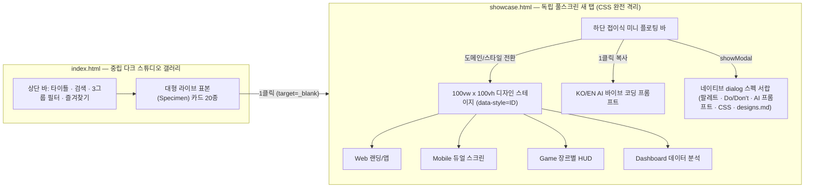

# DESIGN SPECTRUM 3.0 — UI 및 구조 설계서 (designs.md)

> **기준 사양:** [spec.md](./spec.md) (v3.0.0)
> **최종 갱신:** 2026-11-19

---

## 1. 시스템 및 화면 아키텍처

---

## 2. 주요 영역과 컴포넌트 역할

### 2.1 메인 갤러리 (`index.html` + `src/gallery/`)
- **스튜디오 셸 (`gallery.css`)**: 눈의 피로를 줄이고 각 표본의 채도와 명암비를 그대로 드러내는 중립 다크 표면(`#0a0c10`, `#12151c`, 미세한 `#232836` 보더).
- **표본 카드 (`specimenCard.js` + `src/showcase/domainArtwork.js`)**:
  - 상단 62%: `data-style="<id>"`가 적용된 라이브 미니 포스터 스테이지. 각 스타일의 고유 배경 텍스처, 전용 Google Font 헤드라인, 시그니처 SVG 그래픽, 실제 컴포넌트 미니 조각이 어우러져 클릭 전에도 디자인 정체성이 즉시 드러난다.
  - 하단 38%: 번호(`01`~`20`) + 그룹 배지 + 스타일명(한/영) + 한 줄 정의 + 5색 컬러 스트립 + 특징 3태그 + 즐겨찾기 버튼 + 4대 도메인 빠른 열기 링크(`웹 · 모바일 · 게임 · 대시보드`).

### 2.2 독립 풀스크린 쇼케이스 (`showcase.html` + `src/showcase/`)
- **도메인 렌더러 4종**:
  - `domainWeb.js`: 풀페이지 브랜드/제품 웹 경험(내비게이션, 스타일별 맞춤 SVG 히어로 아트워크, 인터랙티브 탭/기능 카드, 실사용 입력 폼 및 CTA, 푸터).
  - `domainMobile.js`: 데스크톱에서는 2개의 플래그십 모바일 화면(메인 피드/대시 + 상세/컨트롤 시트)을 나란히 배치해 여백을 풍성하게 채우고, 좁은 화면에서는 전환형 단일 디바이스로 반응.
  - `domainGame.js`: 스타일별 장르 아이덴티티(픽셀 JRPG, 신스웨이브 아웃런, 아르데코 카드 RPG, 네오 브루탈리즘 격투 아케이드, 스위스 정밀 퍼즐, 클레이 캐주얼 등)에 맞춘 풀블리드 배경·전용 SVG 보스/월드 아트워크·체력/에너지 HUD·클릭 가능한 공격/스킬/콤보 인터랙션.
  - `domainDashboard.js`: 사이드바/탑바 + KPI 지표 + 스타일별 컬러/선형 문법을 따르는 순수 SVG 영역/막대/도넛 차트 + `7일/30일/90일` 인터랙티브 필터 + 실시간 상태 테이블.
- **플로팅 스튜디오 HUD (`floatingHud.js`)**:
  - 기본 높이 52px 이하의 컴팩트한 다크 글래스 필. 접기 버튼으로 우측 하단 작은 아이콘 버튼 하나로 축소 가능.
  - 어떤 스타일이 열려도 가독성이 깨지지 않도록 독립 네임스페이스(`.studio-hud`, `.studio-drawer`)와 고정 다크 토큰을 사용.
- **스펙 서랍 (`<dialog class="studio-drawer">`)**:
  - `showModal()`로 브라우저 Top Layer에 렌더링되어 `backdrop-filter`, `transform`, `z-index`가 강한 스타일 위에서도 항상 깔끔하게 열린다.
  - ESC 키 닫기, 백드롭 클릭 닫기, 닫힘 시 트리거 포커스 자동 복구를 브라우저 네이티브로 보장한다.

---

## 3. 구현 제약과 주의사항

1. **CSS 격리**: `index.html`은 `gallery.css`와 `styles-20.css`만 로드하고, `showcase.html`은 `showcase-base.css`, `showcase-domains.css`, `styles-20.css`만 로드한다. 갤러리 셸 규칙이 쇼케이스 도메인 내부로 새어나가지 않아야 한다.
2. **텍스트 무결성**: 모든 카피는 자연스러운 한국어(+ 의도된 영문 디자인 용어)로 직접 작성하며, 런타임 정규식 치환기를 절대 사용하지 않는다.
3. **오디오 금지**: 어떤 모듈에서도 `AudioContext`, `HTMLAudioElement`, Web Audio API를 생성하거나 호출하지 않는다.
4. **웹폰트 폴백**: Google Fonts를 로드하되 네트워크 차단/오프라인 환경에서도 레이아웃이 무너지지 않도록 스타일별 유사 시스템 폰트 폴백 스택을 명시한다.

---

## 4. 접근성, 반응형, 상태 및 오류 처리 기준

- **키보드 및 접근성**:
  - 갤러리 카드와 도메인 빠른 링크는 시맨틱 `<a>`로 구현해 Enter/Cmd+Click/중클릭 새 탭 열기를 네이티브로 지원한다.
  - 쇼케이스 단축키: `1`~`4`(도메인 전환), `[` / `]`(이전/다음 스타일), `c`(AI 프롬프트 복사, 입력창 포커스 제외), `g`(스펙 서랍 토글), `Escape`(서랍 닫기).
  - 모든 아이콘 버튼에 `aria-label`, 토글에 `aria-pressed`, 토스트에 `role="status" aria-live="polite"`를 부여한다.
  - `prefers-reduced-motion: reduce` 시 장식용 애니메이션을 정지한다.
- **반응형 기준**:
  - `360px` / `768px` / `1024px` / `1440px`에서 가로 스크롤(`scrollWidth > clientWidth`)이 발생하지 않도록 구성한다.
- **상태 및 오류 처리**:
  - 잘못된 `?style=` 쿼리 파라미터 진입 시 크래시 없이 기본 스타일(`swiss-grid`)로 안전하게 폴백하고 안내 배지를 표시한다.
  - 검색/즐겨찾기 결과가 0건일 때 빈 상태 메시지와 '필터 초기화' 버튼을 제공한다.
  - 클립보드 API가 제한된 환경(HTTP/권한 거부)에서는 `textarea` 폴백 복사를 수행하고 실패 시 서랍 내 수동 복사 안내를 표시한다.
