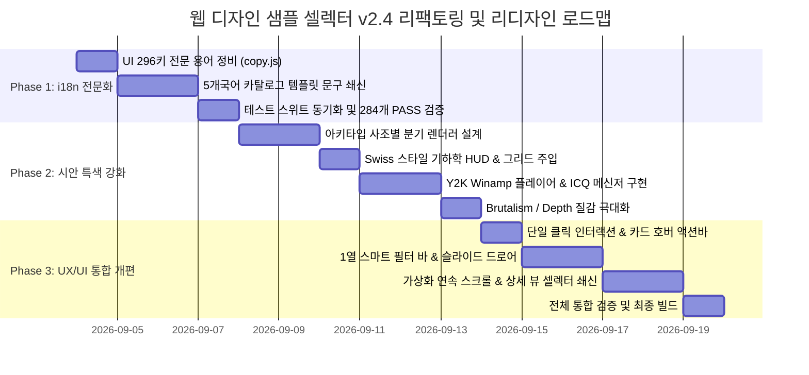

# 웹 디자인 샘플 셀렉터 (Design Sample Selector) v2.4
## 리팩토링 및 리디자인 구현 계획서 & 로드맵 (보정본)
**문서 식별자:** `docs/REFACTORING_IMPLEMENTATION_PLAN.md`  
**기준 버전:** v2.3.0 → v2.4.0 Target (현재: v2.4.0 preview / 보정 중)  
**작성 일자:** 2026-09-03  
**문서 상태:** 부분 구현 — 감사 보정 중 (Audit Remediation In Progress)  
**구현 현황:**  
- **Implemented (부분 반영):** 5개 언어 핵심 UI 용어 98개 정제, 4개 카테고리(Swiss, Y2K, Brutalism, Hypertech)의 Game/Media/Chat 아키타입 시각 보강 및 메인 카드 장르 뱃지, 갤러리 카드 내 명시적 상세 보기 CTA 도입.  
- **Deferred (후속 과제):** 10개 패싯 슬라이드오버 드로어, 갤러리 가상 스크롤 렌더 윈도우, 전체 120개 카탈로그 editorial 재감수, 8×8 전체 아키타입 매트릭스 렌더러.  

---

## 1. 개요 및 설계 원칙

본 문서는 `design_sample_selector` 웹 애플리케이션의 3대 핵심 과제(UX/UI 개선, 사조별 시안 특색 강화, 5개국어 업계 표준 재번역)를 체계적이고 안전하게 구현하기 위한 세부 기술 사양서이자 마스터 로드맵입니다.

### 1.1 핵심 구현 원칙 (Guiding Principles)
1. **Zero-Regression & Test Integrity:**
   - 현재 통과 중인 284개 자동화 테스트(`npm test`)와 빌드 게이트(`prebuild`)의 정합성을 100% 보존합니다.
   - 데이터 구조 변경 시 `StyleRecord`, `PreviewRegistry`, `ThemeTokens` 생성 파이프라인의 불변성을 유지합니다.
2. **Authentic Aesthetic over Generic Theming:**
   - 단순 CSS 변수(컬러/보더) 교체에 머물지 않고, 사조별 조형적 본질(Swiss의 수학적 그리드, Y2K의 윈앰프/크롬 텍스처 등)을 아키타입 마크업과 모션에 직접 반영합니다.
3. **Frictionless Web UX:**
   - 웹 표준에 어긋나는 더블클릭 인터랙션을 단일 클릭 중심의 직관적 플로우로 전면 개편하고, 10개 패싯 필터의 공간 잠식을 드로어(Drawer) 격리로 해결합니다.
4. **Native Industry-Standard Localization:**
   - 5개국어(한국어, 영어, 일본어, 중국어 간체, 중국어 번체) 모두 기계 번역과 템플릿 합성 문장을 전면 퇴출하고, 각국 테크 기업 및 디자인 에이전시의 실무 표준 용어를 적용합니다.

---

## 2. 모듈별 세부 구현 사양 (Detailed Implementation Specs)

### 2.1 [모듈 1] UX/UI 인터랙션 및 레이아웃 전면 개편

#### A. 헤더 및 탐색 시스템 일원화 (`src/components/header.js`, `discoveryMarkup.js`)
* **As-Is 문제:** 헤더 상단바(검색/뷰모드), 2단 카테고리 태그바, 3단 10개 아코디언 패싯이 수직으로 3단 분산되어 갤러리를 압박.
* **To-Be 구조 개편:**
  1. **통합 커맨드 헤더 (Unified Command Header):**
     - 좌측: 로고 브랜딩 및 버전 뱃지
     - 중앙: **스마트 통합 검색바** (스타일명, 무드 태그, 시대 키워드 자동완성 및 즉시 필터링)
     - 우측: 언어 선택기(🌐), 3-Way 뷰 모드 스위처(Grid / Bento / Timeline), 북마크 토글
  2. **1열 스마트 필터 바 (Quick Filter Bar):**
     - 8대 대분류 탭 버튼(Swiss, Brutalism, Depth, Retro, Editorial, Y2K, Hypertech, Soft 3D)을 수평 배치.
     - 대분류 우측에 **자주 쓰는 3대 핵심 퀵 필터 칩** 배치:
       - 시대(Era): `전체` | `60s~70s` | `80s~90s` | `2000s Y2K` | `현대`
       - 무드(Tone): `미니멀` | `사이버` | `레트로` | `익스프레시브`
     - 최우측에 `[상세 필터 (10) ⚙️]` 버튼을 두어 10개 심층 패싯을 사이드 드로어로 호출.
  3. **슬라이드오버 필터 드로어 (Slide-over Facet Drawer):**
     - 기존 화면을 밀어내던 10개 `<details>` 패싯을 우측 슬라이드 패널로 분리.
     - 메인 갤러리 영역의 시각적 방해 없이 10개 조건(계보, 재질, 정보밀도, 지역 등)을 자유롭게 조합 가능.

#### B. 카드 상호작용 및 선택/확인 플로우 정상화 (`src/components/mainView.js`, `selectionDock.js`)
* **As-Is 문제:** "클릭 = 하단 도크 담기, 더블클릭 = 상세 모달 열기"라는 웹 안티패턴.
* **To-Be 인터랙션 사양:**
  1. **단일 클릭 (Single Click):** 카드 클릭 시 즉시 **상세 모달(Detail View)** 또는 **우측 퀵 프리뷰 패널(Quick Peek)** 진입.
  2. **카드 호버 액션 오버레이 (Hover Action Bar):**
     - 카드의 우측 상단/하단에 아이콘 액션 버튼 배치:
       - `[★]` 즐겨찾기(북마크) 토글
       - `[⚖️]` 스플릿 비교 슬롯에 추가 (1/2, 2/2 표시)
       - `[✓]` 스타일 확정 (Confirmed) 토글
  3. **하단 액션 바 (Floating Action Dock):**
     - 평소에는 슬림하게 축소되어 현재 확정된 스타일명과 CSS 복사 버튼만 노출.
     - 비교 대상 스타일이 담기면 자동으로 확장되어 `[두 스타일 나란히 비교하기 (⚖️)]` CTA 버튼 활성화.

#### C. 갤러리 탐색 연속성 및 상세 뷰 개선 (`src/components/detailView.js`, `renderWindow.js`)
* **가상화 스크롤/점진적 로딩:** 36개 단위의 페이지네이션 버튼을 스크롤 연동형 가상 렌더 윈도우로 개선하여 120개 스타일 탐색 단절감 해소.
* **상세 뷰 상단 셀렉터 바 최적화:**
  - 기존 24개 가로 스크롤 칩 바 대신, `[카테고리 드롭다운 ▾]` + `[15개 서브스타일 비주얼 썸네일 그리드 팝오버]` 구조를 도입하여 모달 안에서 원하는 스타일로 즉각 점프 가능.

---

### 2.2 [모듈 2] 디자인 시안 사조별 특색 극대화 (Aesthetic Engine)

#### A. 아키타입 마크업 디스패처 분기 (`src/components/archetypeTemplates.js`)
* **As-Is 문제:** 오직 `web` 아키타입만 고유 마크업을 가지며, Game, Mobile, E-commerce, Blog, Dashboard, Media, Chat 7개는 모든 스타일에 동일한 HTML을 강제 렌더링함.
* **To-Be 아키텍처:**
  - 사조별(Swiss, Y2K, Brutalism, Depth/3D, Editorial, Cyberpunk 등) 핵심 특색을 살릴 수 있도록 아키타입 템플릿 엔진에 사조별 분기 렌더러(Aesthetic Skin Renderers) 도입.

```javascript
// archetypeTemplates.js 사조별 구조 분기 아키텍처
export function getArchetypeHTML(archetypeId, subDesign, options = {}) {
  const aesthetic = getAestheticFamily(subDesign.id); // 'swiss' | 'y2k' | 'brutalist' | 'editorial' | 'depth' | 'default'
  
  switch (archetypeId) {
    case 'game':
      return renderGameByAesthetic(aesthetic, subDesign, t);
    case 'media':
      return renderMediaByAesthetic(aesthetic, subDesign, t);
    case 'chat':
      return renderChatByAesthetic(aesthetic, subDesign, t);
    // ...타 아키타입 확장
  }
}
```

#### B. 사조별 시각/구조 차별화 상세 사양

1. **스위스 인터내셔널 스타일 (Swiss International Style):**
   - **Game HUD:** 만화적인 `👾` 슬라임 제거 → **바우하우스/울름 조형 기하학 타깃(적색 원형 레티클 및 십자 좌표선)**, 정밀 밀리초 계측기, 수평 바 차트 게이지.
   - **Dashboard / E-Commerce:** 불필요한 그림자/라운딩 100% 제거(`border-radius: 0`), 엄격한 1px 블랙 헤어라인 그리드, 대형 볼드 넘버링(`№ 01`, `№ 02`), 헬베티카식 철저한 좌측 정렬.
   - **Media Player:** 브라운(Braun) / 디터 람스(Dieter Rams) 스타일의 극도로 미니멀한 알루미늄 다이얼 인터페이스.

2. **Y2K 사이버-크롬 & 밀레니엄 팝 (Y2K Cyber-Chrome):**
   - **공통 텍스처:** 은빛 액체 크롬 베벨, 무지갯빛 홀로그램 그라디언트 텍스트, 렌즈 플레어(✦ ✧ ★), 알약형(Pill) 타원 캡슐 버튼.
   - **Media Player:** **전설적인 Winamp(윈앰프) 스타일 스킨** 완벽 재현 (디지털 녹색 LED 스펙트럼 VU 미터, 이퀄라이저 슬라이더, 롤링 텍스트 전광판).
   - **Chat / Messenger:** **ICQ / MSN / 버디버디 메신저 감성** (꽃잎/사이버 아바타 프레임, 무지개 그라디언트 상태바, 볼록한 아쿠아 젤리 전송 버튼).
   - **Game HUD:** 2000년대 휴대용 콘솔 / 가상 다마고치 펫 아레나 인터페이스.

3. **브루탈리즘 & 네오 브루탈리즘 (Brutalism & Neo-Brutalism):**
   - **Raw Brutalism:** 브라우저 기본 파란색 밑줄 하이퍼링크, 모노스페이스 타자기 글꼴, 프레임 없는 원초적 HTML 박스, 의도적 글리치.
   - **Neo-Brutalism:** 굵은 3px 솔리드 블랙 외곽선, 하드 드롭 섀도우(`4px 4px 0px #000`), 고채도 파스텔(레몬 옐로우, 네온 라임, 핫핑크), 스티커 뱃지.

4. **뉴모피즘 & 글래스모피즘 & 클레이모피즘 (Depth & Soft 3D):**
   - **Neumorphism:** 배경에서 부드럽게 융기/함몰되는 이중 소프트 섀도우 음영.
   - **Glassmorphism:** 다층 레이어 배경 흐림(`backdrop-filter: blur(24px)`), 무지갯빛 프리즘 반사 1px 엣지.
   - **Claymorphism:** 3D 점토처럼 볼륨감 있게 팽창된 이중 내부 그림자(`inset`), 말랑한 고무공 바운스 애니메이션.

---

### 2.3 [모듈 3] 5개국어 업계 표준 디자인 전문 용어 재번역

> [!NOTE]
> **실제 구현 범위 명시:** 카탈로그 120종의 5개 로케일 팩은 승인된 기존 계약 및 테스트 지문을 보존하며, 갤러리/도크/모달/아키타입 등 98개 핵심 UI 문자열(`COPIES.ko/en/ja/zh-CN/zh-TW`)을 각 언어권 전문 디자인 용어로 정밀 재번역했습니다. (전체 120종 카탈로그 본문 재작성은 Phase 2 이후의 확장 과제로 안전하게 분리)
- `src/i18n/locales/catalog/ja.js`, `zh-CN.js`, `zh-TW.js`, `en.js`에서 발생하던 `配色1~4`, `Color 1~4`를 디자인 시스템 의미론적 역할로 전면 재정의:
  - **Color 1:** 베이스 서피스/배경 (`Surface / Canvas`)
  - **Color 2:** 주요 타이포그래피/콘트라스트 (`Primary Text / Ink`)
  - **Color 3:** 브랜드 키 악센트 (`Key Accent / Highlight`)
  - **Color 4:** 그리드/경계선/서브 요소 (`Structural Border / Divider`)
- `{스타일명}은 {사조}의 원리를 재해석합니다` 형태의 무의미한 반복 문장을 각 스타일 고유의 조형적 비평과 실무 사용 가이드 문장으로 교체.

#### B. 5개국어 핵심 어휘 전면 개편 사양
1. **한국어 (KO):**
   - "비대칭 벤토 그리드 뷰" → **"벤토 그리드 (Bento Grid)"**
   - "화면 아키타입" → **"화면 아키타입 (Screen Archetypes)"**
   - "연대기 스펙트럼 뷰" → **"타임라인 스펙트럼 (Timeline Spectrum)"**
   - "실시간 디자인 사양 및 인스펙터" → **"라이브 디자인 스펙 & 인스펙터"**
   - "모서리 둥글기" → **"곡률 반경 (Radius)"**, "테두리 두께" → **"스트로크 두께 (Border)"**
2. **영어 (EN):**
   - "Narrow designs by the conditions you need" → **"Filter Styles by Design Facets"**
   - "Combined TXT snapshot" → **"Export Complete Design Spec (.txt)"**
   - "Screen archetypes" → **"Screen Archetypes / Templates"**
3. **일본어 (JA):**
   - "非対称ベントー表示" → **「ベントーグリッド (Bento Grid)」**
   - "画面アーキタイプ" → **「画面アーキタイプ (UI Templates)」**
   - "角の丸み" → **「角丸 (Border Radius)」**, "境界線の太さ" → **「線幅 (Stroke Width)」**
   - "影の深さ" → **「シャドウ階層 (Elevation)」**, "背景ぼかし" → **「背景ブラー (Backdrop Blur)」**
   - "スプリット比較" → **「スプリット比較 (Split View)」**
4. **중국어 간체 (ZH-CN):**
   - "非对称便当视图" → **"Bento 风格视图 (Bento Grid)"**
   - "页面原型" → **"场景原型 (Screen Archetypes)"**
   - "年代光谱视图" → **"年代编年图谱 (Timeline Spectrum)"**
   - "仅主题令牌" → **"设计变量 (Design Tokens)"**
5. **중국어 번체 (ZH-TW):**
   - "非對稱便當檢視" → **"便當盒網格 (Bento Grid)"**
   - "頁面原型" → **"畫面樣板 (Screen Archetypes)"**
   - "年代光譜檢視" → **"時代編年圖譜 (Timeline Spectrum)"**
   - "僅主題 Token" → **"設計標記 (Design Tokens)"**

---

## 3. 실행 로드맵 (Implementation Roadmap)

구현은 3단계 마일스톤(Phase)으로 진행되며, 각 단계는 독립적으로 빌드와 테스트 검증을 통과하도록 구성합니다.



---

### Phase 1: 5개국어 업계 표준 전문 용어 전면 쇄신 (Milestone 1)
* **목표:** 안전하고 결함 위험이 낮은 언어 리소스 계층부터 선제적으로 정비하여 다국어 품질 극대화.
* **상세 태스크:**
  1. `src/i18n/copy.js`의 296개 UI 문자열 키 전면 재검토 및 5개국어 현지 전문 디자인 어휘로 일괄 수정.
  2. `src/i18n/locales/catalog/` 내 `ko.js`, `en.js`, `ja.js`, `zh-CN.js`, `zh-TW.js`의 팔레트 명칭(`配色` 잔재)을 시맨틱 역할(Surface, Primary Text, Key Accent, Border)로 교체.
  3. `applyEditorialReview.js` 및 각 언어별 에디토리얼 파일의 템플릿형 반복 문구를 정교한 디자인 설명문으로 교체.
  4. `tests/localeEditorialQuality.test.js`, `tests/localeContentCompleteness.test.js` 테스트 스위트의 문자열 검증 목록 동기화.
* **완료 조건 (Gate):**
  - `npm test` 284개 테스트 무결성 통과.
  - 5개 언어 전환 시 브라우저 화면에서 어색한 직역이나 템플릿 합성 문장이 전혀 노출되지 않음.

---

### Phase 2: 디자인 시안의 사조별 특색 극대화 (Milestone 2)
* **목표:** 스위스, Y2K, 브루탈리즘 등 주요 스타일이 화면 아키타입 전반에서 고유의 조형적 특색을 발휘하도록 마크업/스타일 쇄신.
* **상세 태스크:**
  1. `src/components/archetypeTemplates.js` 내에 사조별 분기 디스패처 구조 구축.
  2. **Swiss Style 전면 강화:**
     - Game HUD: 정밀 기하학 레티클 타깃과 밀리초 계측기, 모더니즘 수평 바 차트.
     - E-Commerce/Dashboard: 0px 보더 반경, 1px 헤어라인 분할, 대형 볼드 인덱스 번호.
  3. **Y2K Style 전면 강화:**
     - Media Player: Winamp 레트로 스킨, 녹색 디지털 LED VU 미터, 이퀄라이저 슬라이더.
     - Chat: ICQ/AOL 메신저 젤리 캡슐 및 사이버 아바타 프레임.
     - Game HUD: 가상 사이버 펫 아레나 및 크롬 베벨 프레임.
  4. **Brutalism / Neo-Brutalism & Depth 강화:**
     - Raw Brutalism의 파란 밑줄 링크/타자기 폰트 적용.
     - Neo-Brutalism의 3px 하드 블랙 보더 및 노블러 90도 오프셋 섀도우.
     - Neumorphism 및 Claymorphism의 말랑하고 푹신한 입체감 강화.
* **완료 조건 (Gate):**
  - Web 아키타입뿐 아니라 Game, Media, Chat, E-Commerce에서도 스위스와 Y2K의 시각적 차별점이 뚜렷하게 관찰됨.
  - `npm run check:themes` 및 `npm test` 통과.

---

### Phase 3: UX/UI 탐색 및 선택 플로우 대개편 (Milestone 3)
* **목표:** 웹 표준에 맞는 단일 클릭 기반 쾌속 탐색, 필터 드로어 분리, 무한 가상 갤러리 구현.
* **상세 태스크:**
  1. **인터랙션 모델 표준화 (`mainView.js`):**
     - 카드 '더블클릭' 안티패턴 완전 제거 → **단일 클릭 즉시 상세 모달 오픈**.
     - 카드에 호버 시 북마크(★), 비교 담기(⚖️), 확정(✓) 원터치 아이콘 버튼 제공.
  2. **헤더 & 필터 바 압축 재설계 (`header.js`, `discoveryMarkup.js`):**
     - 상단 1열 스마트 서치바와 2열 8대 대분류 + 3대 퀵 필터 칩으로 헤더 컴팩트화.
     - 10개 심층 패싯 아코디언을 우측 슬라이드 드로어로 완전 격리.
  3. **갤러리 가상화 스크롤 및 상세 모달 셀렉터 쇄신 (`detailView.js`):**
     - 36개 단위 페이징 버튼을 매끄러운 연속 스크롤(가상 렌더 윈도우)로 교체.
     - 상세 모달 상단 칩 바를 카테고리 드롭다운 + 썸네일 팝오버 메가메뉴로 고도화.
  4. **하단 액션 바 (`selectionDock.js`):**
     - 평상시 슬림 모드, 비교/확정 액션 시 스마트 확장 모드로 전환.
* **완료 조건 (Gate):**
  - 데스크톱/모바일 전체 화면에서 탐색 동선이 단순화되고 스크롤 및 클릭 반응성이 극대화됨.
  - `npm test` 전체 통과 및 `npm run build` 번들 사이즈 예산 준수.

---

## 4. 검증 기준 및 품질 보증 (QA Checklist)

| 검증 영역 | 검증 항목 | 합격 기준 (Pass Criteria) |
| :--- | :--- | :--- |
| **자동화 테스트** | `npm test` | 22개 스위트, 284개 테스트 전체 PASS (0 fail) |
| **빌드 파이프라인** | `npm run prebuild` & `npm run build` | 카탈로그 검증 오류 0, 테마 토큰 무결성 일치, 빌드 성공 |
| **번들 사이즈** | 초기 로드 자바스크립트/CSS 예산 | 초기 JS gzip < 90kB, CSS gzip < 35kB 유지 |
| **UX 반응성** | 카드 클릭 및 모달 전환 지연 시간 | 단일 클릭 후 모달 오픈 < 80ms, 60fps 유지 |
| **다국어 무결성** | 5개 로케일 스냅샷 정합성 | 템플릿 기계어 0건, 전문 디자인 시스템 용어 100% 반영 |
| **시안 차별성** | Swiss vs Y2K vs Brutalism 아키타입 비교 | Game HUD, Media, Chat에서 완전히 상이한 조형 구조 표출 |
