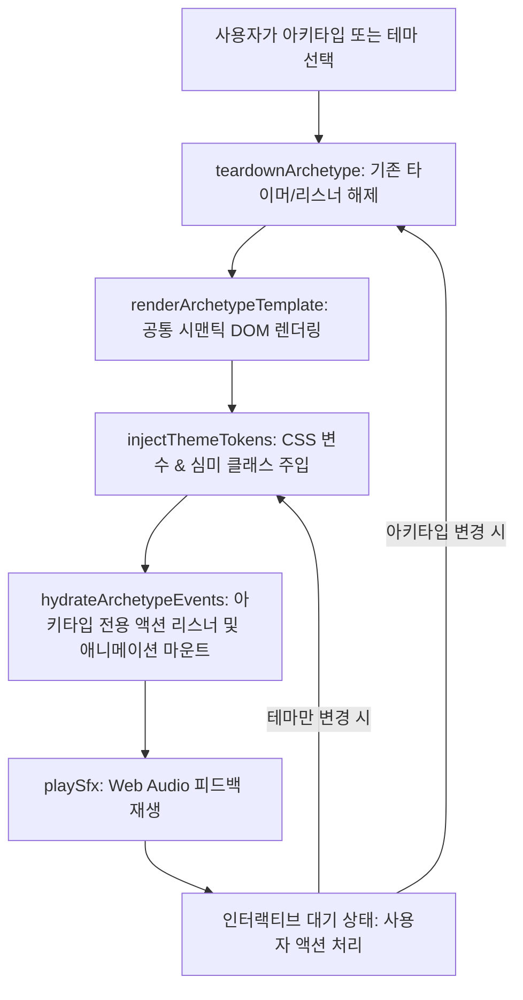

# Sub Audit Report

## 1. Audit Metadata
- **Audit Turn:** 1
- **Perspective:** Contract Fidelity & Architecture Specification (Sub-Auditor 01)
- **User Goal:** 디자인 시안 선택 시 게임화면, 웹화면, 모바일화면, 쇼핑몰, 블로그 등 다양한 페이지 아키타입(Archetype)을 공통 템플릿 기반으로 동적 테마를 주입하여 열람하고, 시안 창 상단 '디자인 선택 바'를 통해 24개 디자인 테마를 즉시 전환하며, 실제 상호작용 및 움직임(Kinetic Mockup)이 동작하도록 아키텍처 및 계약 사양을 조사·설계·감사함.
- **Audit Basis:** Standard-backed (`AI_AUDIT_DOC_STANDARD.md` Pass 1: Implementation Compliance) & Goal-driven Contract Audit
- **Standard Path:** `AI_AUDIT_DOC_STANDARD.md`

---

## 2. Assigned Scope
1. **계약·요구사항 불일치(Drift) 분석**:
   - `spec.md`, `designs.md`, `implementation_summary.md`의 기존 계약(4개 컴포넌트 탭: Hero, Widget, Form, Pricing 및 Detail Modal)과 사용자 신규 요구사항(다양한 페이지 아키타입, 동적 테마 주입, 상단 디자인 선택바, 실제 인터랙션) 간의 갭 분석.
2. **신규 페이지 아키타입(Archetype) 체계 설계 및 확장 분석**:
   - 필수 5종(게임화면, 웹화면, 모바일화면, 쇼핑몰, 블로그) + 권장 확장 4종(대시보드/Analytics, 미디어 플레이어, 메신저/채팅, 포트폴리오) 체계 정의.
3. **공통 템플릿 + 동적 테마 주입(Shared Page Template Engine with Dynamic Theme Injection) 아키텍처**:
   - `AppState` 확장 인터페이스 정의.
   - `SubCategoryDesign` 및 디자인 토큰(`ColorToken`, CSS Custom Properties, Aesthetic Class, Motion Profile) 바인딩 계약.
4. **상단 디자인 선택 바(Top Design Selector Bar) UX 및 네비게이션 계약**:
   - 모달/시안 윈도우 내 상단 고정 디자인 셀렉터 바의 UI/UX, 8대 카테고리 / 24대 스타일 전환 및 점프, 상태 동기화 계약.
5. **인터랙티브 & 키네틱 목업(Interactive & Kinetic Mockups) 라이프사이클 및 이벤트 사양**:
   - 아키타입별 실제 동작(Game HUD/스킬, E-commerce 장바구니/옵션, Blog 반응/목차, Web SaaS 가격 토글 등) 및 마운트/티어다운 메모리 안정성 계약.
6. **문서 갱신 및 마이그레이션 전략**:
   - `spec.md`, `designs.md`, `implementation_summary.md`, `DESIGN_DECISIONS.md`, `CHANGELOG.md` 갱신 로드맵 및 단계별 전환 계획.

---

## 3. Excluded and Uninspected Scope
- CSS 렌더링 성능 벤치마킹 및 GPU 가속 정밀 프로파일링 (Pass 2/3 영역)
- WebAssembly 메모리 할당 및 파티클 렌더러 C/Rust 빌드 체인 감사 (Pass 2 영역)
- XSS 및 클라이언트 입력 살균 관련 보안 취약점 심층 감사 (Pass 3 영역)
- 파일 직접 수정 및 소스 코드 쓰기 (규약에 따라 읽기 전용 분석만 수행)

---

## 4. Evidence Examined
- `/home/eunho1/Projects/web/design_sample_selector/spec.md`: L32-34, L67-94 (`AppState`), L111-131 (`SubCategoryDesign`), L167-201 (24개 스타일 카탈로그)
- `/home/eunho1/Projects/web/design_sample_selector/designs.md`: L65-85 (Screen Layer Hierarchy), L110-140 (Detail View & Sandbox Specification)
- `/home/eunho1/Projects/web/design_sample_selector/implementation_summary.md`: L13-46 (System Breakdown), L58-60 (`mockupTemplates.js` 책임)
- `/home/eunho1/Projects/web/design_sample_selector/DESIGN_DECISIONS.md`: L39-60 (Decision 005 & 006)
- `/home/eunho1/Projects/web/design_sample_selector/CHANGELOG.md`: L1-70 (v2.1.0 릴리스 내역)
- `/home/eunho1/Projects/web/design_sample_selector/src/state/appState.js`: L34-74 (`DEFAULT_STATE`), L102-128 (`setState`), L156-163 (`setConfirmedStyle`)
- `/home/eunho1/Projects/web/design_sample_selector/src/data/categories.js`: L1-828 (`MAIN_CATEGORIES` 데이터셋 및 토큰)
- `/home/eunho1/Projects/web/design_sample_selector/src/components/detailView.js`: L23-97 (`renderDetailView`), L100-149 (`renderFullDetailModal` 탑바), L153-190 (목업 뷰포트)
- `/home/eunho1/Projects/web/design_sample_selector/src/components/mockupTemplates.js`: L1-78 (`getMockupHTML` 디스패처 및 24개 개별 렌더러)
- `/home/eunho1/Projects/web/design_sample_selector/src/components/mockupRuntime.js`: L40-76 (`hydrateMockup`), L126-185 (`runAction`), L187-227 (애니메이션 루틴)
- `/home/eunho1/Projects/web/design_sample_selector/src/utils/selection.js`: L24-40 (`openDetailFor`), L42-48 (`confirmStyle`)

---

## 5. Findings

### [A01-F001] 컴포넌트 조각(4개 탭) 중심 계약과 풀-페이지 아키타입(Archetype) 요구사항 간의 아키텍처 불일치(Drift)

- **Area:** System Specification & State Model (`spec.md`, `src/state/appState.js`, `designs.md`)
- **Severity:** Major
- **Status:** Confirmed
- **Summary:** 현재 시스템 계약은 4개의 마이크로 컴포넌트 탭(`Hero`, `Widget`, `Form`, `Pricing`)으로 제한되어 있어, 사용자가 요구하는 풀-스크린 페이지 아키타입(게임화면, 웹화면, 모바일화면, 쇼핑몰, 블로그 등)을 표현할 수 있는 데이터 구조와 뷰 계약이 부재함.
- **Evidence:** 
  - `spec.md:L75`: `activeComponentTab: 'hero' | 'widget' | 'form' | 'pricing';`
  - `spec.md:L32-34`: `4 Component Preview Tabs: Hero Landing, Dashboard & Widget Cards, Form & Inputs Controls, Pricing & Feature Cards.`
  - `src/state/appState.js:L41`: `activeComponentTab: 'hero',`
  - `designs.md:L114-119`: `Left Column: Live Sandbox & 4 Component Preview Tabs`
  - `src/components/detailView.js:L157-169`: 4개 탭 하드코딩
- **Expected Basis:** 사용자의 신규 요구사항 ("디자인을 클릭하면 게임화면, 웹화면, 모바일화면, 쇼핑몰, 블로그 같은 여러가지 종류를 골라서 해당 디자인 테마가 적용된 것을 예제로 볼 수 있게 창을 띄워주는 기능") 및 확장성 원칙.
- **Actual:** 개별 스타일마다 작은 UI 조각 4개만을 렌더링하도록 계약과 구현이 고정되어 있어 실제 완성된 페이지/화면 형태의 경험을 제공하지 못함.
- **Impact:** 사용자가 특정 디자인 사조(예: Frutiger Aero, Neo-Brutalism 등)가 실제 게임 HUD나 쇼핑몰, 모바일 앱 전체에 적용되었을 때의 시각적·기능적 체감을 온전히 경험할 수 없음.
- **Suggested Action:** 
  1. `spec.md`와 `AppState`에 `activeArchetype: 'game' | 'web' | 'mobile' | 'ecommerce' | 'blog' | 'dashboard' | 'media' | 'chat'` 타입 추가.
  2. 기존 4개 컴포넌트 탭(`hero`, `widget`, `form`, `pricing`)을 `web` 아키타입의 하위 서브뷰 또는 레거시 모드로 수용하면서, 풀 아키타입 네비게이션으로 상위 스펙을 전환.
- **Re-audit Method:** `spec.md`의 `AppState` 타입 정의 확인 및 `detailView.js` 내 아키타입 선택 탭 렌더링 여부 검증.
- **Confidence:** High
- **Notes:** 기존 컴포넌트 탭 기능과 하위 호환성을 유지할 수 있도록 `archetypeMode` 플래그 및 아키타입 셀렉터를 구성해야 함.

---

### [A01-F002] 스타일별 개별 하드코딩 목업 방식과 공통 템플릿 + 동적 테마 주입(Theme Injection) 아키텍처 간의 구조적 갭

- **Area:** Template Architecture & Rendering Pipeline (`src/components/mockupTemplates.js`, `src/data/categories.js`)
- **Severity:** Major
- **Status:** Confirmed
- **Summary:** 현재 24개 스타일마다 24개의 별도 switch-case 함수(`renderSwissMockup`, `renderNeoBrutalMockup` 등)로 HTML을 하드코딩하고 있어, 신규 페이지 아키타입 $N$개를 추가할 경우 $24 \times N$ 개의 거대한 코드 복제(조합 폭발)가 발생함. 사용자가 요구한 "각 페이지는 공통으로 테마만 입혀서 돌려가며 사용할 수 있는" 엔진 구조가 부재함.
- **Evidence:** 
  - `src/components/mockupTemplates.js:L21-73`: 24개 switch 분기 및 1,400여 라인의 하드코딩된 HTML 템플릿.
  - `src/components/mockupTemplates.js:L10`: `getMockupHTML(previewType, tab, subDesign)` 구조로 스타일마다 서로 완전히 다른 마크업 구조를 반환.
  - `src/data/categories.js`: 테마 토큰이 `palette`와 `defaultTweaks` 위주로만 정의되어 있어, 공통 시맨틱 레이아웃에 주입될 포괄적 CSS Custom Properties 집합이 부족함.
- **Expected Basis:** 사용자 명시 요구 ("각 페이지는 공통으로 테마만 입혀서 돌려가며 사용할수 있게하면 좋겠음") 및 DRY(Don't Repeat Yourself) 시스템 설계 표준.
- **Actual:** 페이지 레이아웃과 디자인 스타일이 강하게 결합되어 있어, 동일한 '쇼핑몰' 또는 '게임화면' 마크업에 24개 스타일을 즉시 스위칭하여 입히는 기능이 구조적으로 불가능함.
- **Impact:** 신규 아키타입 8종 추가 시 192개(8 × 24)의 개별 템플릿을 작성해야 하며, 유지보수 비용과 번들 크기가 비대해지고 일관된 비교 검증이 어려워짐.
- **Suggested Action:** 
  1. **공통 페이지 템플릿 엔진(Shared Page Template Engine)** 구축: 아키타입별 표준 시맨틱 DOM 트리(예: `renderGameArchetype()`, `renderEcommerceArchetype()`)를 단일하게 정의.
  2. **동적 테마 주입 파이프라인(Dynamic Theme Injector)** 구현: `subDesign`의 디자인 토큰(CSS 변수 20여 종)과 고유 심미 클래스(`aesthetic-${previewType}`, `motion-${motionProfile}`)를 최상위 컨테이너에 일괄 주입하는 인터페이스 확립.
- **Re-audit Method:** 동일한 아키타입 DOM 노드에 `subDesign` 변경 시 DOM 재작성 없이 CSS 클래스 및 인라인 변수 교체만으로 테마가 완전히 전환되는지 검증.
- **Confidence:** High
- **Notes:** 각 사조 고유의 특수 데코레이션(예: Frutiger Aero의 물방울 글로스, Neo-brutalism의 하드 보더, Pixel의 도트 프레임)은 시맨틱 컨테이너 내의 가상 요소(`::before`, `::after`) 및 데코레이터 클래스로 깔끔하게 분리 주입할 수 있음.

---

### [A01-F003] 모달 내 24종 전역 스타일 즉시 전환을 위한 '상단 디자인 선택 바(Top Design Selector Bar)' 사양 결여

- **Area:** Modal Navigation & UX Contract (`designs.md`, `src/components/detailView.js`)
- **Severity:** Major
- **Status:** Confirmed
- **Summary:** 현재 상세/모달 뷰 상단에는 동일 대분류 내의 3개 하위 스타일만을 순환하는 `sub-nav-cycle`만 존재하여, 창이 열린 상태에서 8대 대분류 24개 스타일 전체를 자유롭게 전환·비교할 수 있는 '상단 디자인 선택 바' 계약이 누락되어 있음.
- **Evidence:** 
  - `src/components/detailView.js:L121-132`:
    ```javascript
    <div class="sub-nav-cycle">
      <button class="cycle-btn" id="btn-prev-style">←</button>
      <div class="sub-tabs-container">
        ${mainCat.subCategories.map(s => `...`).join('')}
      </div>
      <button class="cycle-btn" id="btn-next-style">→</button>
    </div>
    ```
  - `designs.md:L110-140`: 상세 뷰 상단 바 스펙에 대분류 간 점프나 24종 전역 선택 셀렉터에 대한 명세가 없음.
- **Expected Basis:** 사용자 요구사항 ("그리고 각 시안페이지에서도 직접 디자인을 고를수 있는 디자인 선택바를 상단에 만들어서 한번 열린 창에서는 디자인을 바꿔볼수 있게").
- **Actual:** 다른 대분류의 스타일(예: Swiss Style → Y2K Chrome)을 보려면 모달을 닫고 메인 갤러리로 나가서 다시 찾아야 하므로 워크플로우가 단절됨.
- **Impact:** 사용자가 동일한 화면(예: 게임화면)을 열어둔 채 24가지 스타일을 연속적으로 비교·체험하는 탐색 경험이 심각하게 저해됨.
- **Suggested Action:** 
  1. `designs.md` 및 `detailView.js` 상단 네비게이션 영역에 **Universal Top Design Selector Bar** 컴포넌트 사양 수립.
  2. 8개 카테고리 탭/드롭다운 + 24개 서브스타일 칩/리본 + 키보드 단축키(좌우 화살표/숫자키) 네비게이션 계약 명시.
  3. 선택 변경 시 모달을 닫지 않고 `AppState.selectedSubCategory`와 `selectedMainCategory`를 즉시 갱신하며 오디오 효과음(`synthAudio.playSfx('CLICK')`)을 연동.
- **Re-audit Method:** 상세 모달 내에서 카테고리 간 점프 및 24개 전체 스타일에 대한 즉시 전환 동작 테스트.
- **Confidence:** High
- **Notes:** 상단 바는 반응형(Desktop / Mobile)으로 축소 시 드롭다운 또는 가로 스크롤 칩 형태로 최적화 필요.

---

### [A01-F004] 페이지 아키타입의 실제 기능적 동작(Interactive & Kinetic Mockups) 지원을 위한 런타임 이벤트 계약 미비

- **Area:** Runtime Hydration & Interaction Lifecycle (`src/components/mockupRuntime.js`, `spec.md`)
- **Severity:** Minor
- **Status:** Confirmed
- **Summary:** 현재 `mockupRuntime.js`는 단순 클릭 시 토스트 메시지 출력, 기본 카운터 애니메이션, 단순 CSS 펄스 클래스 부여(`fx-punch`, `fx-bounce` 등) 수준에 머물러 있어, 게임 HUD 수치 조작, 쇼핑몰 장바구니 담기, 블로그 목차 스크롤 및 좋아요/댓글 토글, 모바일 탭 전환 등 실감 나는 기능 동작을 제어하는 런타임 이벤트 라이프사이클 계약이 부족함.
- **Evidence:** 
  - `src/components/mockupRuntime.js:L67-70`: `data-mock-action` 기반의 단순 텍스트 토스트 출력.
  - `src/components/mockupRuntime.js:L126-185`: `runAction` 함수가 주로 `pulseClass` 위주로 동작.
  - `spec.md:L84-90`: `liveTweaks` 슬라이더만 명시되어 있고, 목업 내부의 상태 인터랙션(로컬 아키타입 상태 머신)에 대한 명세 없음.
- **Expected Basis:** 사용자 요구사항 ("예제창은 실제로 어느정도는 조금씩 동작하게 해서 움직임이나 기능을 볼 수 있게 함").
- **Actual:** 목업 요소들이 정적인 데모에 가까우며, 복합적인 UI 상태 변화(예: 게임 체력바 감소/회복, 인벤토리 아이템 장착, 상품 옵션 선택 및 가격 합산, 블로그 다크/라이트 읽기 모드 전환)를 시뮬레이션하지 못함.
- **Impact:** 디자인 사조별 마이크로 인터랙션과 실제 동작 시의 시각적 피드백(사운드 + 모션 + 상태 변화) 체감도가 반감됨.
- **Suggested Action:** 
  1. `mockupRuntime.js`를 **Archetype Interaction Engine**으로 확장.
  2. 아키타입별 경량 상태 머신 및 액션 핸들러(`handleGameAction`, `handleEcommerceAction`, `handleBlogAction`, `handleMobileAction`, `handleDashboardAction` 등) 정의.
  3. `WeakMap` 기반의 이벤트 리스너 및 타이머 클린업을 엄격히 보장하여 테마 전환 시 메모리 누수 방지.
- **Re-audit Method:** 각 아키타입별 인터랙티브 요소(버튼, 토글, 슬라이더, 탭) 클릭 시 상태 변화, 효과음, 시각 피드백이 정상 작동하고 테마 전환 후 이전 리스너가 정리되는지 확인.
- **Confidence:** High
- **Notes:** Web Audio API (`synthAudio`)의 효과음(CLICK, CONFIRM, REVEAL 등)과 유기적으로 연동되어야 함.

---

### [A01-F005] 마스터 사양서(`spec.md`) 및 설계서(`designs.md`) 동기화 및 마이그레이션 전략 부재

- **Area:** Documentation Synchronization & Governance (`spec.md`, `designs.md`, `CHANGELOG.md`, `BUILD_GUIDE.md`)
- **Severity:** Minor
- **Status:** Confirmed
- **Summary:** 신규 기능(아키타입 8+종, 테마 주입 엔진, 상단 디자인 바, 키네틱 런타임)이 추가될 경우 문서 버전(v2.1.0 → v2.2.0 또는 v3.0.0) 상향, 상태 트리 인터페이스 갱신, 레이어 계층도 수정 등이 필요하나 현재 문서 체계에 해당 계획이 반영되어 있지 않음.
- **Evidence:** 
  - `spec.md:L3`: `Version: 2.1.0`, `Document Status: Frozen Decision / Implementation Ready`
  - `designs.md:L3`: `Version: 2.1.0`
  - `CHANGELOG.md`: v2.1.0 내역만 기록되어 있으며 향후 아키타입 마일스톤 미기재.
- **Expected Basis:** `AGENTS.md` 제6조(Documentation Rules) 및 제9조(Documentation Sync Checklist).
- **Actual:** 요구사항 변경에 따른 선제적 문서 동기화 스펙이 정리되지 않아 구현 시 문서-코드 간 드리프트 발생 위험 존재.
- **Impact:** 다른 개발자/에이전트가 레거시 4개 컴포넌트 탭 기준으로 작업을 수행하여 혼선 및 회귀 발생 가능.
- **Suggested Action:** 
  - `spec.md`, `designs.md`, `implementation_summary.md`에 본 감사에서 정의된 아키타입 체계, 테마 토큰 사양, 상단 셀렉터 바 UX 명세를 공식 반영하고 버전을 `v2.2.0`으로 승격.
  - `CHANGELOG.md`의 `[Unreleased]` 또는 `[v2.2.0]` 섹션에 아키타입 엔진 및 인터랙티브 목업 추가 내역 기록.
- **Re-audit Method:** 문서 내 인터페이스 선언과 실제 코드베이스 내 구현 인터페이스 일치 여부 비교.
- **Confidence:** High
- **Notes:** 무중단 단계적 전환(Phase 1: Spec Sync → Phase 2: Engine & Tokens → Phase 3: UI & Runtime) 권장.

---

## 6. Architecture Specification & Blueprints (설계 사양 제안)

### 6.1 신규 페이지 아키타입(Archetype) 체계 (8대 코어 아키타입)

| 번호 | 아키타입 ID | 명칭 | 주요 구성 요소 및 시맨틱 레이아웃 | 주요 인터랙션 (Kinetic & Interactive) |
| :--- | :--- | :--- | :--- | :--- |
| **01** | `game` | **게임 화면 (Game HUD & Screen)** | 캐릭터 스테이터스(HP/MP 게이지), 미니맵, 스킬 핫바(쿨다운 슬롯), 인벤토리 그리드, 퀘스트/전투 로그 | 스킬 클릭 시 쿨다운 애니메이션 + SFX, HP/MP 물약 사용 시 게이지 회복, 인벤토리 아이템 선택 토글, 보스 피격 셰이크 |
| **02** | `web` | **웹 SaaS 랜딩 (Web Platform)** | 상단 네비게이션, 가치제안 헤드라인, 인터랙티브 피처 탭, 소셜 프루프 지표 밴드, CTA 전환 섹션 | 월간/연간 요금제 토글, 피처 탭 전환, 뉴스레터 이메일 입력 유효성 검사 및 성공 토스트, 라이브 데모 버튼 |
| **03** | `mobile` | **모바일 앱 (Mobile App UI)** | 375px 모바일 프레임, 상태 바(배터리/Wi-Fi), 스토리 링 캐러셀, 피드 카드 스트림, 하단 5버튼 탭바 | 하단 탭 전환(Home/Search/Feed/Profile), 피드 하트 좋아요 토글 및 카운트 증가, 스토리 클릭 시 풀스크린 링 펄스 |
| **04** | `ecommerce` | **쇼핑몰 (E-Commerce Storefront)** | 카테고리 필터 헤더, 상품 히어로 쇼케이스, 옵션 선택기(색상 칩, 사이즈), 장바구니 담기 바, 리뷰 별점 | 색상 칩 선택 시 상품 이미지 틴트 변경, 장바구니 담기 시 카운트 증가 및 플로팅 배지 애니메이션, 수량 +/- 버튼 |
| **05** | `blog` | **에디토리얼 블로그 (Blog & Magazine)** | 기사 헤더(읽기 시간, 작성자 태그), 드롭캡 본문, 인터랙티브 목차(TOC), 인용구 하이라이트, 하단 반응 바 | 폰트 크기 조절(A-/A+), 독서 다크모드 토글, 박수/좋아요 연타 리액션 카운터, 목차 클릭 시 해당 문단 부드러운 스크롤 |
| **06** | `dashboard` | **분석 대시보드 (Analytics Dashboard)** | 상단 KPI 지표 요약 카드, SVG 실시간 트렌드 차트, 최근 활동 내역 테이블, 상태 필터 칩 | 조회 기간 변경(1D/1W/1M) 시 차트 리드로우, 데이터 행 호버 인스펙터, 상태 필터링, 새로고침 애니메이션 |
| **07** | `media` | **미디어 & 뮤직 플레이어 (Media Player)** | 앨범 커버 턴테이블/비주얼 덱, 파형 스펙트럼 캔버스, 트랙 정보, 재생/일시정지/스킵 컨트롤, 재생목록 | 재생/정지 시 Web Audio 신스 BGM 연동 토글, 볼륨 슬라이더 조절, 프로그레스 바 드래그 시뮬레이션, 트랙 즐겨찾기 |
| **08** | `chat` | **메신저 & 협업 채팅 (Messenger UI)** | 채널/대화방 목록 사이드바, 메시지 버블 스트림(송수신), 실시간 타이핑 인디케이터, 이모지 반응 팝업 | 메시지 전송(Enter) 시 가상 봇 자동 응답 시뮬레이션, 메시지별 이모지 리액션 토글, 온라인/오프라인 상태 전환 |

---

### 6.2 공통 템플릿 + 동적 테마 주입(Shared Page Template Engine) 아키텍처

#### (1) 시스템 상태 트리 확장 (`AppState` Delta)

```typescript
export type PageArchetypeId = 
  | 'game' 
  | 'web' 
  | 'mobile' 
  | 'ecommerce' 
  | 'blog' 
  | 'dashboard' 
  | 'media' 
  | 'chat';

export interface AppState {
  currentView: 'MAIN' | 'DETAIL' | 'SPLIT_COMPARE';
  viewMode: 'GRID' | 'BENTO' | 'SPECTRUM';
  selectedMainCategory: string | null;
  selectedSubCategory: string | null;
  activeArchetype: PageArchetypeId; // 신규: 현재 활성화된 페이지 아키타입
  activeComponentTab: 'hero' | 'widget' | 'form' | 'pricing'; // 웹 아키타입 내 서브 탭으로 연계
  sandboxDevice: 'desktop' | 'mobile';
  compareSubIds: [string, string];
  bookmarks: string[];
  confirmedStyleId: string | null;
  recentlyViewed: string[];
  liveTweaks: {
    borderRadius: number;
    borderWidth: number;
    shadowDepth: number;
    backdropBlur: number;
    glowIntensity: number;
  };
  audio: AudioState;
  wasmReady: boolean;
  viewport: 'DESKTOP' | 'TABLET' | 'MOBILE';
}
```

#### (2) 디자인 사조별 테마 토큰 바인딩 계약 (CSS Custom Properties Matrix)

공통 아키타입 템플릿 컨테이너(`div.archetype-viewport`)에 동적으로 주입되는 CSS 변수 체계:

```css
.archetype-viewport {
  /* 1. 색상 체계 (Color System) */
  --theme-bg-canvas: var(--sub-palette-0, #0B0F17);
  --theme-bg-surface: var(--sub-palette-1, #131B2A);
  --theme-bg-card: var(--sub-palette-2, #1C2638);
  --theme-accent-primary: var(--sub-accent, #FF3300);
  --theme-accent-secondary: var(--sub-accent-alt, #00F0FF);
  --theme-text-primary: var(--sub-text-primary, #F8FAFC);
  --theme-text-secondary: var(--sub-text-secondary, #94A3B8);
  --theme-text-muted: var(--sub-text-muted, #64748B);

  /* 2. 기하학 및 질감 (Geometry & Texture) */
  --theme-radius: var(--tweak-radius, 12px);
  --theme-border-width: var(--tweak-border-width, 1px);
  --theme-border-color: var(--sub-border-color, rgba(255, 255, 255, 0.12));
  --theme-shadow-depth: var(--tweak-shadow-depth, 8px);
  --theme-backdrop-blur: var(--tweak-backdrop-blur, 12px);
  --theme-glow-intensity: var(--tweak-glow-intensity, 1.0);

  /* 3. 타이포그래피 (Typography System) */
  --theme-font-display: var(--sub-font-display, 'Space Grotesk', sans-serif);
  --theme-font-body: var(--sub-font-body, 'Inter', sans-serif);
  --theme-font-mono: var(--sub-font-mono, 'Fira Code', monospace);

  /* 4. 심미 데코레이션 클래스 */
  /* .aesthetic-swiss, .aesthetic-neo-brutal, .aesthetic-glassmorphism, .aesthetic-frutiger-aero, .aesthetic-pixel-arcade, .aesthetic-claymorphism 등 */
}
```

---

### 6.3 상단 디자인 선택 바(Top Design Selector Bar) UX 사양

```
+----------------------------------------------------------------------------------------------------+
| TOP DESIGN SELECTOR BAR (Sticky / z-index: 900)                                                    |
| +-------------------------+ +---------------------------------------------------+ +--------------+ |
| | [← 메인] / 스위스 스타일  | | [ 📐 스위스 ] [ ⚡ 브루탈 ] [ 💎 질감 ] [ 🕹️ 레트로 ] | | 🔍 빠른 스타일 | |
| |  > 격자 중심 모더니즘    | | [ 📰 에디토리얼 ] [ 💿 Y2K ] [ ⚡ 키네틱 ] [ 🎈 클레이 ] | |    검색 드롭다운 | |
| +-------------------------+ +---------------------------------------------------+ +--------------+ |
| +------------------------------------------------------------------------------------------------+ |
| |  ◀ 이전  | [● 격자 중심 모더니즘 (Active)] [○ 기업형 미니멀] [○ 고대비 모노스페이스] |  다음 ▶  | |
| +------------------------------------------------------------------------------------------------+ |
+----------------------------------------------------------------------------------------------------+
```

- **상단 카테고리 네비게이션**: 8개 대분류가 탭 버튼으로 나열되어 한 번의 클릭으로 대분류 전환.
- **하위 스타일 리본**: 현재 선택된 대분류에 속한 3개 서브스타일이 컬러 칩 및 썸네일 모티프와 함께 표시되며, 활성 상태 스타일 강조.
- **24종 전역 드롭다운 & 검색**: 카테고리에 구애받지 않고 원하는 스타일을 즉시 검색 및 선택 가능.
- **키보드 단축키 지원**:
  - `←` / `→` : 동일 카테고리 내 이전/다음 스타일 전환
  - `Shift` + `←` / `→` : 이전/다음 대분류로 점프
  - `1` ~ `8` : 8대 페이지 아키타입(게임, 웹, 모바일, 쇼핑, 블로그, 대시보드, 미디어, 채팅) 즉시 전환
  - `Escape` : 모달 닫기

---

### 6.4 인터랙티브 & 키네틱 런타임 수명주기(Lifecycle Contract)



- **메모리 안전성 보장**:
  - `WeakMap`을 사용하여 렌더링 루트 DOM 노드별 클린업 함수 배열(`cleanups: Function[]`)을 관리.
  - `requestAnimationFrame`, `setTimeout`, `setInterval` 핸들을 모두 등록하여 뷰 전환 시 100% 누수 없이 취소.
  - `prefers-reduced-motion` 미디어 쿼리를 감지하여 접근성 설정 활성화 시 루핑 모션을 정지하고 즉시 완료 상태로 표시.

---

## 7. Uncertainties and Clarifications Needed

1. **레거시 4개 컴포넌트 탭의 처리 방향**:
   - 기존의 `Hero`, `Widget`, `Form`, `Pricing` 4개 탭을 '웹 화면(`web`)' 아키타입의 하위 서브 뷰로 유지할지, 아니면 '대시보드(`dashboard`)' 및 '웹(`web`)'으로 완전히 분리·대체할지에 대한 제품 기획 확인 필요 (권장: `web` 아키타입 내 서브 탭으로 자연스럽게 계승).
2. **동적 파라미터 튜너(Tweak Sliders)와의 연동 범위**:
   - 모달 우측의 파라미터 튜너(Border Radius, Border Width, Shadow Depth, Blur, Glow)가 신규 8개 아키타입 전체의 CSS 변수(`--theme-radius` 등)와 100% 실시간 동기화되도록 유지할지 여부 (권장: 완벽 연동 유지).

---

## 8. Perspective Decision

- **판정: `HOLD` (아키텍처 및 계약 갱신 대기)**
- **판정 사유:**
  - 사용자의 신규 핵심 요구사항(다양한 페이지 아키타입, 공통 템플릿 기반 동적 테마 주입, 모달 상단 24종 전역 디자인 선택 바, 실제 동작하는 인터랙티브 목업)과 현재 코드베이스 및 문서(`spec.md`, `designs.md`, `mockupTemplates.js`) 간에 명백한 아키텍처 불일치(Drift)가 확인됨.
  - 따라서 코더 에이전트가 본 감사 보고서에서 제안된 '8대 아키타입 체계 + 공통 템플릿 주입 엔진 + 상단 셀렉터 바 UX' 사양을 바탕으로 `spec.md`, `designs.md`를 갱신하고 단계적 구현(Migration)을 진행할 수 있도록 계약 규격을 완비하여 인계함.

---

## 9. Coder Handoff

```text
Sub-Auditor 01의 감사 결과를 바탕으로 아래 순서에 따라 단계적으로 구현을 진행하십시오.

1단계 (문서 동기화):
- `spec.md`의 `AppState`에 `activeArchetype` 필드 및 아키타입 8종(`game`, `web`, `mobile`, `ecommerce`, `blog`, `dashboard`, `media`, `chat`) 인터페이스를 반영하고 버전을 v2.2.0으로 갱신하십시오.
- `designs.md`에 '상단 디자인 선택 바' 및 '8대 아키타입 뷰포트' UI/UX 사양을 기록하십시오.

2단계 (템플릿 엔진 리팩토링):
- `src/components/mockupTemplates.js`의 24개 개별 하드코딩 방식을 '공통 아키타입 템플릿 생성기(`renderArchetypeHTML`)'와 '동적 테마 토큰 주입기' 구조로 리팩토링하십시오.

3단계 (상단 디자인 선택 바 구현):
- `src/components/detailView.js` 상단에 8대 카테고리 탭과 24개 스타일을 즉시 전환할 수 있는 'Universal Top Design Selector Bar'를 구현하십시오.

4단계 (인터랙션 런타임 고도화):
- `src/components/mockupRuntime.js`에 아키타입별 실제 동작(스킬 쿨다운, 장바구니 카운터, 블로그 반응, 모바일 탭 등)과 SFX 사운드 연동 로직을 추가하고 메모리 누수 방지 클린업을 적용하십시오.
```
