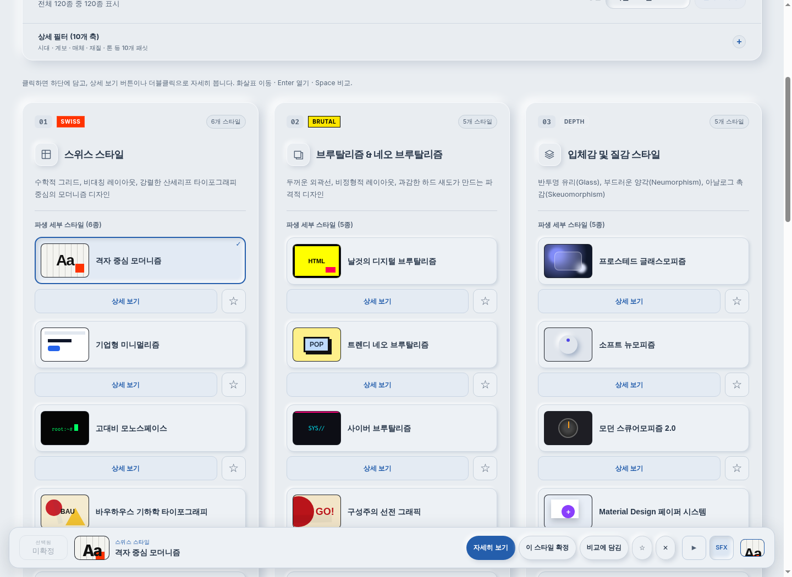

# 소프트 UI 및 120종 시안 재점검

작성일: 2026-10-18. 근거: 사용자 요청, 현재 구현, UI/UX Pro Max의 Soft UI Evolution·Neumorphism·Compact Label Overflow 지침, 격리 Chrome의 렌더 결과.

## 반영 내용

| 요청 | 구현·검수 근거 |
| --- | --- |
| 메인을 깔끔한 소프트 뉴모피즘으로 변경 | `soft-ui.css`: 청회색 표면, 양각·음각, 진한 텍스트, 일관된 SVG 아이콘, 검색·필터·카드·도크·상세·비교 제어면 |
| 모든 테마를 해당 사조에 맞게 재점검 | Core 24·Wave 1 12종의 고유 구조를 보존·보정, Expansion 84종의 21개 문법별 재질·타입·구도 보강, 긴 thumbnail 문구를 도형 구성으로 교체, 120 Hero contact sheet 15장 육안 확인 |
| 클릭·선택·표시 개선 | 명확한 선택 체크·ARIA, 상세 버튼과 즐겨찾기 분리, 포커스 보존, 최초 모달 포커스, 최근 시안 클릭 오류 수정, native 확정 버튼, 도크·모달 내 BGM/SFX 조작 |
| 글자·도안·메뉴의 넘침 수정 | 좁은 desktop·split을 mobile과 별도 검증, CJK 행간 보정, 긴 카드명 줄바꿈, 표 자체 스크롤, 폼·가격표·채팅 재배치, 썸네일 selector 범위 제한 |
| GitHub 전달 | 기존 추적 브랜치 `gemini_ux_enhanced`에 검증 후 커밋·푸시. 원격 HEAD 동일 여부는 Git 명령으로 확인 |

## 검증

| 게이트 | 결과 |
| --- | --- |
| `npm run check` | Node 293/293, catalog 오류 0, 생성 theme 검사 및 프로덕션 빌드 통과 |
| `npm run qa:visual:chrome` | 실제 5개 locale snapshot × 120종 × 4개 컨테이너 × 11개 뷰 = **26,400상태**, 레이아웃 문제 0 |
| Gallery | 5 locale × 5개 폭 × 3개 보기 = **75상태**, 가로 넘침·잘린 제목/메뉴 0 |
| 실제 UI 조작 | 선택·북마크 pressed 상태, 키보드 포커스, 보기 전환, 도크 언어/최근 시안, 언어 왕복 후 상세 이름, 모달 오디오, 5개 튜너 연결, 모달 Tab 모두 통과 |
| `qa:catalog120:chrome` | production artifact의 **1,920 device 상태 + Web 480탭**, 전체 ID·thumbnail·상태 보존·Zoom·상호작용·진단 통과 |
| `npm run qa:pages:chrome` | 초기 진입·재시도·Detail/Split 정상, 네트워크 10가지 + renderer/hydration 2가지 실패 복구, 문제 0 |
| `npm run analyze:bundle` | 기존 JavaScript 88,980B / CSS 33,000B gzip 예산 유지. 상세 CSS를 지연 로드하고 thumbnail을 CSS로 구성 |
| 코드 리뷰·차이 검사 | 별도 리뷰에서 찾은 튜너·좁은 채팅·오디오 접근·CSS 누출·도크 언어/최근 시안 문제 수정, `git diff --check` 통과 |

컨테이너는 760px desktop / 320px mobile / 320px desktop / 320px split이며, 추가 Web 3탭까지 각 상태에서 검사한다. Gallery의 외부 폭은 320/375/768/1024/1440px다. 검사기는 `scrollWidth`뿐 아니라 글자의 실제 range와 clipping ancestor, 세로 잘림, root 축소를 검사한다. 반복 이동은 reduced-motion에서 정지한다.

메인 텍스트의 바탕 `#e9edf1` 대비는 primary **10.59:1**, secondary **5.37:1**, muted **4.78:1**, 활성 파랑 **5.46:1**이다. 이는 메인 토큰의 대비 검증이며 전체 사조의 공식 접근성 인증을 의미하지 않는다. 기존 legacy catalog 메타데이터 경고 56건은 이번 시각 개선의 새 오류가 아니다.

재현에 필요한 스크립트와 소스는 저장소에 포함한다. 전체 contact sheet·원본 상세 로그·격리 프로필은 프로젝트 내부 `.antigravity/soft-ui-evidence/`에 보존하며 Git에는 대표 화면과 정리한 결과만 포함한다. snapshot hash 6개 변경은 모바일 switch의 이름·장식 ARIA 추가만을 반영했으며, 해당 두 attribute를 제외하면 이전 해시와 같음을 대조했다.

## 대표 화면

[메인](main-final.png) · [상세](detail-final.png) · [비교](split-final.png) · [모바일](mobile-final.png)

