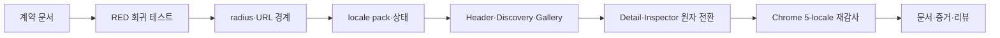

# Implementation Plan: Audit 11 radius·5-locale remediation

**Source:** `docs/multi_audit/11/final_audit_report_11.md`

**Status:** 구현·검증·재감사 증거 기록 완료 (`COMPLETE`, 2026-08-31)

**Task list target:** `tasks/todo.md`

## 1. 목표

120종 카탈로그의 `999px` pill 의미와 조절 가능한 surface radius를 분리하고, 튜너 범위를 모든 경계에서 동일하게 강제한다. 동시에 `ko`, `en`, `ja`, `zh-CN`, `zh-TW`를 lazy locale pack으로 제공해 상단 메뉴, 검색·정렬·ARIA, Detail과 Inspector 산출물이 같은 locale snapshot을 사용하도록 한다.

## 2. 계약 결정

- `radius` tweak는 `0..64px`의 semantic surface에만 적용한다. pill은 locale과 tweak에 독립적인 `--theme-pill-radius`를 사용한다.
- 테마·카테고리 전환은 대상 기본 tweak로 reset하고 아키타입 전환은 tweak를 보존한다.
- locale 전환은 선택·tweak·mock runtime·Inspector tab·scroll·focus를 보존한다.
- locale 선택 우선순위는 URL → localStorage → browser preference → `ko`다. pack 실패 시 현재 정상 locale을 유지한다.
- display text만 번역한다. CSS property/custom property ID, selector, HTML ID/data attribute, DTCG structural key와 파일명은 바꾸지 않는다.

## 3. 의존 순서

## 4. 단계

1. 사양·설계·ADR에 semantic radius, 전환 행렬, locale와 fallback을 먼저 기록한다.
2. Audit 11 실패 모드를 Node 테스트로 재현한다.
3. 공유 tuner limits, semantic geometry, URL allowlist·길이 경계를 구현한다.
4. dependency 없는 lazy locale runtime과 5개 pack 완전성 검증을 구현한다.
5. Header·Discovery·Gallery와 document language를 locale state에 연결한다.
6. Detail·Inspector 네 pane을 하나의 locale snapshot으로 생성하고 안전한 text sink로 갱신한다.
7. 전체 Node/build/bundle/audit와 Crostini Chrome locale·radius 행렬을 실행한다.
8. finding별 재감사 판정과 남은 번역 품질·운영 위험을 기록하고 5축 코드 리뷰를 수행한다.

## 5. 위험과 완화

| 위험 | 완화 |
| --- | --- |
| locale pack이 초기 JS 예산을 초과 | 한국어 외 pack은 literal dynamic import로 분리하고 bundle gate로 실측 |
| locale 전환이 Detail runtime을 초기화 | viewport snapshot/rehydrate와 Inspector UI·focus·scroll 복원 테스트 |
| 번역 display name이 machine key를 변경 | palette stable ID를 legacy projection과 generator 끝까지 보존하고 key-set equivalence 검사 |
| raw template sink가 번역 문자열을 해석 | 사용자/번역 text는 escape 또는 DOM `textContent`, code pane은 항상 `textContent` |
| 5개 언어 번역 품질 편차 | 구조·완전성은 자동 gate로 고정하고 전문 언어 감수는 별도 잔여 위험으로 명시 |

## 6. 완료 조건

- Audit 11 FIN-F001~F010은 코드·테스트로 해소되고 F011~F012는 구현 또는 명시적 재검증 판정을 갖는다.
- 120종의 tweak가 공통 limits를 만족하고 문제 8종의 pill 표현은 유지된다.
- 5개 locale에서 메뉴·검색·정렬·ARIA·Inspector가 일관되고 machine key set이 동일하다.
- Node, catalog/theme, Vite, gzip, dependency audit와 Chrome 시각·상호작용 게이트가 통과한다.
- `docs/multi_audit/11/re_audit_evidence_11.md`에 finding별 증거를 기록한다.

## 7. 완료 결과

- FIN-F001~F012를 코드·계약·회귀·Chrome 증거에 대조했고 저장소/로컬 Crostini 범위에서 해소 또는 검증했다.
- Node `206/206`, Vite `87 modules`, catalog errors 0/legacy warnings 56, dependency vulnerabilities 0이다.
- initial gzip은 JS `88,979/88,980B`, CSS `32,994/33,000B`로 hard budget을 유지한다.
- actual-120은 `1,920`상태·Web `480`탭·diagnostics 0, Discovery는 9시나리오·6폭·diagnostics 0, Pages fault matrix는 issues 0이다.
- 전문 번역 감수와 운영 CSP·Google Fonts 응답 헤더는 코드 완료와 분리된 잔여 위험이다.
