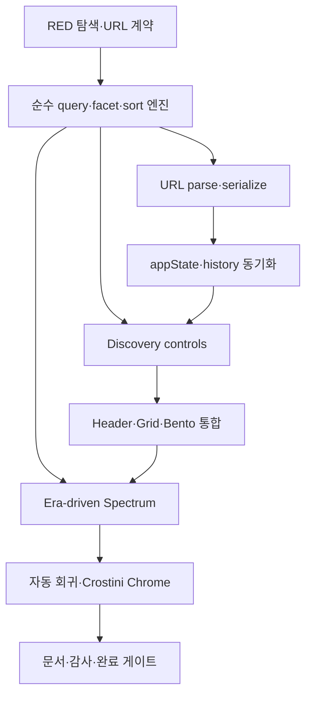

# Implementation Plan: `catalog-discovery`

**Initiative:** `scalable-style-library`

**Module:** `catalog-discovery`

**Source specification:** `SPEC-catalog-discovery.md` (`COMPLETE`)

**Plan status:** 구현·검증·문서화 완료 (`COMPLETE`)

**승인일:** 2026-08-30

**완료일:** 2026-08-30

**Task list target:** `tasks/todo.md`

**Previous completed plan:** `tasks/archive/catalog-expansion-wave1-plan.md`

---

## 1. Overview

Core 36을 유지한 채 정규 catalog metadata 위에 검색·category·bookmark·10 facet·정렬의 순수 질의 계약을 먼저 만든다. 그 계약을 URL과 app state에 연결한 뒤 별도 discovery controls와 세 gallery mode가 같은 결과를 소비하게 한다. Spectrum은 시대 시작 연도를 기준으로 다시 구성하고, 실제 Crostini Chrome에서 반응형·접근성·URL 복원까지 검증한다.

## 2. Dependency Graph

## 3. Architecture Decisions

1. `src/catalog/discovery.js`가 DOM과 app state를 모르는 순수 질의 원천이다.
2. URL 계약은 별도 순수 module로 테스트하고 브라우저 history side effect는 얇은 state adapter가 담당한다.
3. `activeFilter`는 `ALL` 또는 category ID만 유지하고 북마크는 독립 boolean 조건으로 결합한다.
4. facet은 정규 사전의 `selectionMode`를 강제하며 unknown 입력은 버린다.
5. 기존 `SubCategoryDesign` 호환 projection을 재작성하지 않고 canonical 결과 ID로 현재 UI 레코드를 결합한다.
6. discovery controls는 header와 main 사이의 독립 root에 mount하여 header 검색 caret patch와 수명주기를 분리한다.
7. Spectrum만 era group을 사용하고 Grid/Bento의 기존 시각 문법은 보존한다.
8. Wave 2·virtualization·dynamic import·dependency 추가·Git/배포는 범위에서 제외한다.

## 4. Task Index

### Phase A — Pure contracts

1. 탐색·URL RED 계약을 실제 Core 36과 synthetic edge fixture로 고정한다.
2. 검색 문서, facet 정규화/AND·OR, 정렬, 시대 bucket/group과 공개 API를 구현한다.
3. URL parse/serialize와 app state/history 동기화를 구현한다.

### Checkpoint A

- 탐색·URL 표적 테스트 GREEN
- 기존 Core 36 ID·catalog 순서·immutability 회귀 GREEN
- URL invalid input과 default omission GREEN

### Phase B — User-facing discovery

4. 결과 상태·정렬·확장형 facet·활성 칩 UI를 구현한다.
5. 검색·category·bookmark와 Grid/Bento를 공통 질의 결과에 연결한다.
6. Spectrum을 실제 era bucket 기반으로 전환한다.

### Checkpoint B

- 세 gallery mode가 같은 조건에서 같은 canonical ID 집합을 표시
- 검색 caret, bookmark, detail 진입, keyboard navigation 회귀 정상
- label/legend/live status/focus/44px/empty reset 계약 통과

### Phase C — Runtime proof and handoff

7. discovery 전용 Crostini Chrome QA 하네스와 대표 증거를 추가한다.
8. module/master spec과 UX 설계 문서를 실제 구현과 동기화한다.
9. ADR와 사용자 변경 문서를 실제 구현과 동기화한다.
10. capability·운영·감사·인수인계 문서를 실제 증거로 전환한다.
11. 작업 기록과 Definition of Done을 닫고 전체 최종 검사를 수행한다.

## 5. Verification Matrix

| Gate | Command / Evidence |
| --- | --- |
| Focused discovery | `npm test -- tests/catalogDiscovery.test.js` |
| Catalog regression | `npm test -- tests/styleContract.test.js tests/catalogValidation.test.js` |
| Preview integration | `npm test -- tests/previewIntegration.test.js tests/previewRegistry.test.js` |
| Catalog CLI | `npm run validate:catalog` |
| Generated theme | `npm run check:themes` |
| Full gate | `npm run check` |
| Browser | `npm run qa:discovery:chrome` — 격리 Chrome, 320/375/414/768/1024/1440px, 검색/category/bookmark/facet/sort/URL/empty/세 view/a11y/reduced-motion/diagnostics |
| Diff hygiene | `git diff --check`와 비밀·임시 자원·범위 외 변경 점검 |

## 6. Risks and Mitigations

| Risk | Impact | Mitigation |
| --- | --- | --- |
| header와 main이 서로 다른 필터 로직 사용 | High | 순수 query function을 양쪽이 직접 소비하고 ID 집합을 통합 테스트 |
| URL subscriber loop·검색 history 폭증 | High | popstate guard + canonical equality + `replaceState` |
| 10 facet UI가 모바일을 압도 | High | 기본 compact toolbar, facet별 native `details`, 활성 칩, 44px target |
| single/multiple 의미 혼동 | Medium | radio+전체와 checkbox를 사전 selectionMode에서 파생 |
| Spectrum 시대 하드코딩 잔존 | High | era boundary unit test와 DOM 시대 그룹 assertion |
| 검색 문자열 XSS | High | 최대 길이, pure normalization, 출력 escape, invalid URL sanitization |
| 다음 성능 모듈 범위 침범 | Medium | DOM 최적화·dynamic import 없이 기능 정확성까지만 구현 |

## 7. Parallelization

공유 상태·query 계약 의존성이 크므로 이번 모듈은 한 작업 흐름에서 순차 구현한다. 자동 테스트와 문서 검토는 각 checkpoint 뒤 독립적으로 실행할 수 있으나 별도 agent 위임은 사용하지 않는다.

## 8. Boundaries

- Always: RED→GREEN, 정규 catalog 단일 원천, URL invalid sanitization, 접근성/반응형, 전체 회귀, 문서 동기화
- Ask first: category/ID 변경, dependency·asset·server 추가, Wave 2, Git commit·배포
- Never: Swiss fallback, 검색 문자열 무escape 출력, 기본 Chrome profile 연결, 테스트 skip, 가상화 선행 구현

## 9. Open Questions

없음. 사용자의 “승인”에 따라 사양·계획·구현·검증을 완료했다. Core 36을 유지했고 다음 계획 대상은 `render-scalability`다.

## 10. Completion Evidence

- 탐색 집중 테스트 15/15, 전체 `npm run check` 121/121 및 Vite 51-module production build 통과
- catalog 오류 0/legacy 경고 56, generated theme CSS 최신 상태
- 격리 Chrome `151.0.7922.173`: 9개 시나리오, 6개 폭, 세 보기, 88/88 named inputs, diagnostics/issue 0
- `.antigravity/archive/catalog-discovery-chrome-qa/`에 report와 320px/1440px 대표 화면 보존
- Wave 2·가상화·dynamic import·Git commit/push·배포 미수행
