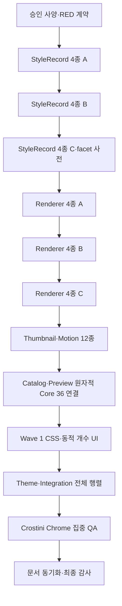

# Implementation Plan: `catalog-expansion` Wave 1

> Archive note: 2026-08-30 `catalog-discovery` 계획 착수 전에 완료 상태를 보존했다.

**Initiative:** `scalable-style-library`

**Module:** `catalog-expansion`

**Delivery Slice:** Wave 1 (`24 → 36`)

**Source specification:** `SPEC-catalog-expansion.md` (`COMPLETE`)

**Plan status:** 구현·검증 완료 (`COMPLETE`)

**사양·계획·구현 지시일:** 2026-08-30

**완료일:** 2026-08-30

**Task list target:** `tasks/todo.md`

**Previous completed plan:** `tasks/archive/preview-registry-plan.md`

---

## 1. Overview

실제 사용자 카탈로그를 24종에서 36종으로 확장한다. 신규 12종은 세 번의 4종 데이터 증분과 세 번의 4종 renderer 증분으로 나눠 작성하고, 각 증분마다 실패 테스트→최소 구현→표적 검증을 수행한다. 모든 신규 스타일이 준비되기 전에는 core manifest와 공개 카탈로그에 연결하지 않아 중간 상태를 사용자에게 노출하지 않는다.

Wave 1은 기존 24종의 ID·alias·프리뷰·테마·내보내기 fingerprint를 subset 기준으로 보존한다. 신규 12종은 출처와 접근성 메모를 갖춘 `ready` 레코드, 독립 renderer/thumbnail/motion, HTML/CSS 전용 시각 문법을 제공한다. 최종적으로 실제 Crostini Google Chrome에서 36종, 8대 아키타입, Desktop/Mobile과 reduced-motion을 검증하고 Wave 2로 진행하지 않고 멈춘다.

## 2. Dependency Graph



## 3. Architecture Decisions

1. **Additive Wave module:** 기존 24종 파일을 대량 재작성하지 않고 `styles-wave-1.js`, `renderers-wave-1.js`, `thumbnails-wave-1.js`, `motions-wave-1.js`, `wave1-styles.css`를 별도로 조합한다.
2. **Hidden until complete:** 신규 definitions는 직접 단위 테스트할 수 있지만 12종 전체와 모든 참조가 준비되기 전에는 public catalog/registry에 연결하지 않는다.
3. **Ready means clean:** 신규 12종은 품질 오류·경고 0을 요구한다. 전체 경고 56개는 기존 `legacy` 24종에서만 유지한다.
4. **Subset compatibility:** 기존 고정 hash는 legacy 24종 배열에만 적용하고, 36종 total hash는 새 fixture로 분리한다.
5. **Independent preview IDs:** renderer, thumbnail과 motion 참조를 각각 명시적으로 등록하며 대체 키나 Swiss fallback을 만들지 않는다.
6. **Real motion only:** 신규 motion은 `metadata-only`를 금지하고 실제 CSS 또는 markup 채널과 `suppress` reduced-motion 정책을 가진다.
7. **No external assets:** 저작권·네트워크·Crostini 성능 위험을 줄이기 위해 HTML/CSS 도형과 기존 폰트 스택만 사용한다.
8. **Dynamic public counts:** 헤더, 접근성 레이블, 문서 title의 실제 수는 코드에서 파생하거나 36종 출시값으로 동기화하고 component 내부에는 `24`를 남기지 않는다.
9. **No commit/deploy:** 프로젝트 승인 경계에 따라 테스트와 변경 요약까지만 수행하고 Git commit·push·배포는 하지 않는다.

## 4. Target Structure

```text
src/
├── catalog/
│   ├── facets.js
│   ├── index.js
│   └── packs/core/
│       ├── manifest.js
│       └── styles-wave-1.js
├── preview/
│   ├── index.js
│   ├── renderers-wave-1.js
│   ├── thumbnails-wave-1.js
│   └── motions-wave-1.js
├── components/
│   ├── header.js
│   └── detailView.js
└── styles/
    └── wave1-styles.css

tests/
├── styleContract.test.js
├── catalogValidation.test.js
├── previewRegistry.test.js
├── previewIntegration.test.js
├── themeGeneration.test.js
├── designSpecGenerator.test.js
└── sandboxDeviceStyles.test.js
```

## 5. Task Index

### Phase A — Contract and catalog

1. 승인 사양·기존 24 subset·신규 12 roster의 RED 계약을 고정한다.
2. 데이터 Batch A: Bauhaus, De Stijl, Flat Design, Constructivist를 작성한다.
3. 데이터 Batch B: Punk Zine, Material Design, Liquid Glass, Art Deco를 작성한다.
4. 데이터 Batch C: Psychedelic, Art Nouveau, Risograph, Metro와 필요한 facet 값을 작성한다.

### Checkpoint A

- 비공개 Wave 1 레코드 12종의 schema·출처·대비·접근성 품질 0/0
- canonical·alias·facet 충돌 0
- 공개 카탈로그는 완전한 preview 연결 전까지 24종으로 정상 유지

### Phase B — Preview implementations

5. Renderer Batch A 네 스타일 × 네 탭을 구현한다.
6. Renderer Batch B 네 스타일 × 네 탭을 구현한다.
7. Renderer Batch C 네 스타일 × 네 탭을 구현한다.
8. 독립 thumbnail·실제 motion 12종을 작성한다.
9. 완성된 catalog와 preview definition을 한 작업에서 Core 36으로 원자적으로 연결한다.

### Checkpoint B

- preview inventory `36/36/36/0`
- Web 144개, thumbnail 36개, total preview 180개 정상
- 기존 24 × 5 subset hash 보존

### Phase C — Visual integration

10. Wave 1 전용 CSS와 동적 사용자 개수 표기를 연결한다.
11. 생성 theme·내보내기·8대 archetype·Desktop/Mobile 자동 행렬을 36종으로 확장한다.

### Checkpoint C

- 전체 Node 테스트와 production build 통과
- 288 archetype HTML 및 576 device 상태 계약 통과
- 생성 CSS 최신, 신규 스타일 selector와 motion evidence 일치

### Phase D — Documentation and runtime proof

12. Crostini Chrome 집중 QA를 수행하고 발견 사항을 표적 수정한다.
13. 사용자 문서와 디자인·결정 이력을 36종으로 동기화한다.
14. 권위·감사·인수인계 문서를 Wave 1 실제 상태로 전환한다.
15. 전체 자동 검사와 실제 Chrome 최종 감사를 완료하고 체크포인트를 인계한다.

## 6. Verification Matrix

| Gate | Command / Evidence |
| --- | --- |
| Focused catalog | `npm test -- tests/styleContract.test.js tests/catalogValidation.test.js` |
| Focused preview | `npm test -- tests/previewRegistry.test.js tests/previewIntegration.test.js` |
| Theme/export | `npm test -- tests/themeGeneration.test.js tests/designSpecGenerator.test.js` |
| Device CSS | `npm test -- tests/sandboxDeviceStyles.test.js` |
| Catalog CLI | `npm run validate:catalog` |
| Generated theme | `npm run check:themes` |
| Full gate | `npm run check` |
| Browser | 격리 Chrome profile, 320/375/414/768/1024/1440, Core 36 × 8 × 2 = 576상태, console·network·a11y·reduced-motion·Desktop/Mobile |

## 7. Risks and Mitigations

| Risk | Impact | Mitigation |
| --- | --- | --- |
| 12종 동시 저작으로 품질이 얕아짐 | High | 4종씩 데이터·renderer 증분, 차별화 표와 탭별 구조 테스트 |
| 기존 24 fingerprint가 total 의미로 덮임 | High | legacy subset fixture와 Wave 1 total fixture 분리 |
| CSS selector 누출 | High | 스타일별 root namespace, 기존 24 hash·브라우저 비교 |
| Glass/Flat/포스터 접근성 저하 | High | ready 4.5:1, signifier/backplate, reduced-motion, 실제 키보드 QA |
| CSS·JS bundle 증가 | Medium | 외부 asset 0, 파일별 delta 기록, Chrome load trace |
| 사용자 기본 Chrome 세션 영향 | High | 임시 `--user-data-dir`만 사용하고 기본 프로필에 연결하지 않음 |

## 8. Boundaries

- Always: 실패 테스트, 표적 검증, 기존 24 subset 호환, ready 품질과 문서 동기화
- Ask first: ID·category 변경, dependency·asset 추가, Git commit·배포, Wave 2 진입
- Never: 무음 fallback, 테스트 삭제·skip, 기본 Chrome profile 연결, 외부 작품·브랜드 복제

## 9. Open Questions

없음. 신규 12종, category 배치와 36종 목표는 2026-08-30 사용자 지시로 승인됐고 같은 날 구현·자동·Chrome 검증을 완료했다. Wave 2는 미착수 상태다.

## 10. Completion Record

- Tasks 1–15와 Checkpoints A–C, Final Checkpoint를 완료했다.
- Core 36, ready 12 품질 0/0, catalog 0/56, preview inventory `36/36/36/0`, Node 106/106, Vite 45 modules가 통과했다.
- Chrome 151은 세 gallery mode, 6개 browser width, Core 36 × 8 × Desktop/Mobile 576상태, 신규 12종 집중 Detail, Split와 reduced-motion을 실패 0·application diagnostics 0으로 통과했다.
- 최종 리뷰에서 발견한 nested thumbnail control, DTCG `none` shadow, control clipping 검증 공백, 375/414px·576상태 행렬 공백을 모두 수정하거나 검증 계약으로 보완했다.
- Git commit·push·배포와 Wave 2 콘텐츠 구현은 수행하지 않았다.
