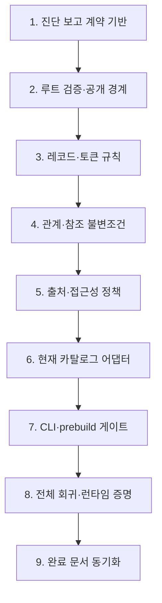

# Implementation Plan: `catalog-validation`

**Initiative:** `scalable-style-library`

**Module:** `catalog-validation`

**Source specification:** `SPEC-catalog-validation.md` (`IMPLEMENTED`)

**Plan status:** 승인·구현 완료 (`APPROVED / COMPLETE`)

**사양 승인일:** 2026-08-30

**계획 승인일:** 2026-08-30

**작성일:** 2026-08-30

**구현 완료일:** 2026-08-30

**Task list target:** `tasks/todo.md`

**Previous completed plan:** `tasks/archive/style-contract-plan.md`

---

## 1. Overview

정규 카탈로그를 120종 이상으로 확장하기 전에 데이터 오류를 빌드 단계에서 발견하는 Node 전용 검증 계층을 구현한다. 순수 검증 API는 구조·ID·관계·참조·출처·접근성 문제를 결정론적인 보고서로 모으고, CLI와 Vite `prebuild` 경계가 승인된 정책에 따라 실패 여부를 결정한다.

이 계획은 승인된 `catalog-validation` 사양만 구현한다. 프리뷰 레지스트리 개편, 런타임 토큰 생성, 새 스타일·카테고리·검색 UI 추가는 후속 모듈로 남긴다. 구현은 이 계획의 별도 승인 전에는 시작하지 않는다.

## 2. Scope

### Included

- 동결된 진단 이슈·요약·오류 객체와 안정 정렬 계약
- 카탈로그 루트, 레코드 필드, 스키마, ID와 순서 검증
- alias·category·facet·pack·preview·asset 관계 검증
- 13개 테마 토큰, 팔레트, 기본 트윅의 보수적 형식 검증
- 출판 상태에 따른 출처·라이선스·접근성·대비 severity 정책
- 공개 카탈로그 API로 만드는 현재 스냅샷과 임시 참조 인벤토리
- 기본/verbose/JSON/strict CLI와 종료 코드 0/1/2
- `validate:catalog`와 `prebuild` 빌드 게이트
- 현재 24종 경고 기준선, 전체 회귀, Crostini Chrome 무변경 증명
- 사용자·운영·사양·ADR·감사 문서 동기화

### Excluded

- 카탈로그 데이터를 자동 수정하거나 누락값을 기본 스타일로 대체
- 프리뷰 switch, 썸네일, 모션 구현을 영구 레지스트리로 이전
- 런타임 CSS와 내보내기 토큰의 원천 통합
- 신규 스타일·카테고리·facet UI와 검색 기능
- 외부 URL 접속, 라이선스 법률 판단, 전체 CSS 파서 도입
- 사용자 브라우저 저장 데이터 검사

## 3. Planning Assumptions and Invariants

- 시작 기준선은 Node 테스트 25개와 Vite 프로덕션 빌드 통과 상태다.
- 현재 24개 스타일은 모두 `legacy`다. 출처·접근성·계산 불가 대비 경고의 정확한 개수는 구현 전에 추정하지 않고 Task 6에서 실제 결과로 고정한다.
- 기본 빌드는 오류만 차단한다. 현재 부채 때문에 `--strict`가 실패하는 것은 승인된 정상 동작이다.
- 새 검증 모듈은 브라우저 import 그래프에 들어가지 않으며 기존 정규 ID 24개, alias 21개, 저장 키와 UI 계약을 변경하지 않는다.
- 새 외부 의존성, 네트워크 접근, 스키마 버전 변경은 이 계획에 포함되지 않는다.
- 한 Task 안에서 실패하는 테스트를 먼저 확인하고 최소 구현으로 통과시킨다. Checkpoint가 실패하면 다음 Phase로 넘어가지 않는다.

## 4. Architecture Decisions

- `src/catalog/validation/index.js`만 공개 진입점으로 사용하고 보고서 생성, 규칙, 현재 카탈로그 조립과 CLI 프로세스 제어를 분리한다.
- 규칙은 입력을 수정하지 않는 순수 함수로 유지한다. 파일 시스템과 `process.exitCode`는 `scripts/validateCatalog.js`만 소유한다.
- 데이터 오류는 가능한 범위까지 한 보고서에 수집한다. 상위 구조가 없어 의미가 없는 파생 진단만 억제한다.
- 이슈의 안정 계약은 `code`, `severity`, `path`, `entityType`, `entityId`, `relatedPath`, 정렬 순서다. 사람용 `message` 문구는 안정 계약으로 만들지 않는다.
- 현재 카탈로그 스냅샷은 `src/catalog/index.js` 공개 조회 API만 사용한다. 팩 내부 데이터 파일 직접 import는 금지한다.
- 임시 참조 인벤토리는 검증 입력만 제공한다. renderer/thumbnail/motion 디스패치의 새 원천으로 사용하지 않는다.
- 색상과 CSS 값은 사양에 적힌 보수적 범위만 파싱한다. 판별할 수 없는 대비는 통과로 오인하지 않고 경고한다.
- CLI 기본 출력은 오류 전체와 코드별 경고 요약만 표시해 빌드 로그를 제한하고, `--verbose`에서 개별 경로를 노출한다.

## 5. Dependency Graph



Tasks 4와 5는 논리적으로 독립된 규칙 묶음이지만 `rules.js`와 같은 테스트 파일을 공유하므로 현재 작업에서는 순차 진행한다. 이 계획은 병렬 에이전트나 별도 worktree를 전제로 하지 않는다.

## 6. Task Index

상세 acceptance criteria, 검증 명령, 의존성과 예상 파일은 `tasks/todo.md`에 기록한다.

### Phase A: Diagnostic Contract

- [x] Task 1: 진단 보고 계약 기반
- [x] Task 2: 루트 검증·공개 경계

### Checkpoint A

- [x] 공개 API와 루트 오류가 결정론적이고 불변인 보고서를 만들며 전체 테스트·빌드가 통과한다.

### Phase B: Validation Rules

- [x] Task 3: 레코드·토큰 규칙
- [x] Task 4: 관계·참조 불변조건
- [x] Task 5: 출처·접근성 정책

### Checkpoint B

- [x] 승인된 진단 코드와 severity 전환을 손상 fixture가 증명하고 전체 회귀가 통과한다.

### Phase C: Current Catalog Build Gate

- [x] Task 6: 현재 카탈로그 어댑터
- [x] Task 7: CLI·prebuild 게이트

### Checkpoint C

- [x] 현재 24종은 오류 0개·경고 56개 기준선으로 기본 빌드를 통과하고 strict 모드는 기대 종료 코드 `1`로 경고를 실패 처리한다.

### Phase D: Proof and Handoff

- [x] Task 8: 전체 회귀·런타임 증명
- [x] Task 9: 완료 문서 동기화

### Final Checkpoint

- [x] `SPEC-catalog-validation.md`의 성공 조건 11개가 모두 증거와 함께 충족된다.
- [x] `npm run check` 49/49와 Crostini Google Chrome 151 회귀 검증이 통과한다.
- [x] 새 검증 코드가 브라우저 번들에 포함되지 않고 기존 24종 사용자 흐름이 유지된다.
- [x] 다음 모듈로 넘어가기 전 사용자 검토 게이트에 도달했다.

각 Checkpoint 결과는 `tasks/todo.md`와 사용자 업데이트에 기록한다. 계약 변경이나 실패가 없으면 승인된 순서대로 다음 Phase를 계속 진행하고, 사양 변경이 필요하면 작업을 멈추고 먼저 승인을 받는다.

## 7. Verification Strategy

### Test-driven increments

각 Task에서 해당 오류를 만드는 최소 손상 fixture를 먼저 추가해 실패를 확인한 뒤 구현한다. 전체 사람용 메시지를 비교하지 않고 안정 계약인 코드·severity·path·entity와 순서를 검사한다.

### Automated

```bash
npm test -- tests/catalogValidation.test.js
npm test
npm run validate:catalog
npm run validate:catalog -- --json
npm run validate:catalog -- --verbose
npm run validate:catalog -- --strict
npm run build
npm run check
git diff --check
```

`npm run validate:catalog -- --strict`는 현재 legacy 경고가 남아 있는 동안 종료 코드 `1`이 기대 결과다. 이 명령만 성공 종료를 요구하지 않고 실제 코드와 출력 정책을 검증한다.

### Integration and runtime

1. 공개 조회 API로 만든 스냅샷이 8개 카테고리, 24개 스타일, 10개 facet, 1개 팩을 포함하는지 확인한다.
2. 기본 CLI는 오류 0개로 종료 코드 `0`, strict는 경고 때문에 `1`, 잘못된 옵션은 `2`인지 확인한다.
3. `npm run build` 로그에서 `prebuild` 검증이 먼저 실행되는지 확인한다.
4. 프로덕션 산출물과 소스 import를 검사해 Node 전용 검증 모듈이 브라우저 그래프에 포함되지 않는지 확인한다.
5. ChromeOS Crostini Linux Google Chrome에서 Grid/Bento/Spectrum, Detail, Split, 저장 복원, 내보내기와 Desktop/Mobile 8개 아키타입을 재검증한다.

### Definition of Done

각 Task는 개별 acceptance criteria 외에도 다음 기준을 충족해야 완료로 표시한다.

- 새 동작을 제거하면 실패하는 테스트가 있고 오류·경계 경로도 포함한다.
- 집중 테스트, 기존 전체 테스트, 관련 빌드가 통과한다.
- 원본 입력을 변형하지 않고 기존 공개 계약과 브라우저 동작을 회귀시키지 않는다.
- 중복 로직, 디버그 출력, 죽은 코드와 무관한 리팩터링이 없다.
- 공개 인터페이스와 중요한 기술 결정이 실제 구현과 동기화된다.
- 위험 변경은 되돌림 경로가 있고 최종 병합·배포 전 사용자 검토를 받는다.

## 8. Risks and Mitigations

| Risk | Impact | Mitigation |
| --- | --- | --- |
| 손상된 상위 필드가 연쇄 진단을 대량 생성 | High | 상위 guard가 실패한 파생 규칙은 건너뛰고 대표 코드만 fixture로 고정한다. |
| 결정론적 정렬이 입력 배열 순서에 의존 | High | 순서를 뒤섞은 동등 fixture의 보고서 전체를 비교하고 원본 배열 mutation을 검사한다. |
| 보수적 CSS 검사가 유효 값을 오탐하거나 대비를 거짓 통과 | High | 지원 문법을 사양 범위로 제한하고 계산 불가 값을 `CONTRAST_UNCHECKED`로 노출한다. |
| legacy 경고가 빌드 로그를 덮거나 조용히 증가 | Medium | 기본 출력은 코드별 개수와 대표 경로로 제한하고 정확한 코드별 기준선을 통합 테스트에 둔다. |
| 임시 참조 인벤토리와 실제 dispatch가 어긋남 | High | 현재 24종 참조를 회귀 테스트로 고정하고 파일에 교체 조건을 명시한다. `preview-registry` 외 용도로 확장하지 않는다. |
| `prebuild` 추가로 기존 로컬 빌드가 중단 | High | Task 6에서 오류 0개 기준선을 먼저 만든 뒤 Task 7에서 연결하고 기본 모드는 경고를 허용한다. |
| Node 전용 모듈이 클라이언트 번들에 유입 | Medium | 앱 import 방향을 변경하지 않고 빌드 산출물·import 그래프와 기존 번들 기준선을 확인한다. |
| 단일 `rules.js`가 과도하게 복잡해짐 | Medium | 규칙군별 작은 순수 함수와 공통 guard만 사용하고 각 Task에서 단순화 검토를 수행한다. |

## 9. Rollback Strategy

- Task 6까지는 검증 코드가 기존 앱 실행 경로와 빌드 수명주기에 연결되지 않는다.
- Task 7의 `prebuild` 연결이 기존 빌드를 막으면 package script 연결만 되돌려 원래 Vite 빌드를 복구할 수 있다. 데이터와 사용자 저장소 마이그레이션은 없다.
- 검증기는 읽기 전용이며 정규 ID, alias, 스키마 버전, 런타임 UI 데이터를 변경하지 않는다.
- Checkpoint에서 회귀가 발견되면 해당 Task를 완료 처리하지 않고 마지막 통과 Checkpoint의 파일 범위로 원인을 제한한다. 무관한 기존 변경은 되돌리지 않는다.
- 임시 인벤토리는 후속 `preview-registry`가 같은 `ReferenceInventory` 계약을 제공할 때 공급자만 교체할 수 있다.

## 10. Open Questions

구현을 막는 미확정 사항은 없다. 현재 legacy 경고의 정확한 코드별 개수는 구현 결과로 측정해 Task 6에서 기준선으로 확정한다.

## 11. Approval Gate

이 계획과 `tasks/todo.md`는 2026-08-30에 승인되었다. Task 1부터 순차 진행하며 각 Checkpoint에서 검증 근거를 기록한다.
