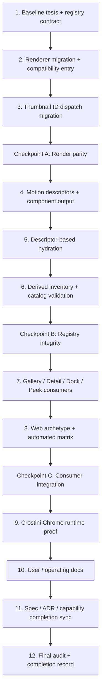

# Implementation Plan: `preview-registry`

**Initiative:** `scalable-style-library`

**Module:** `preview-registry`

**Source specification:** `SPEC-preview-registry.md` (`COMPLETE`)

**Plan status:** 완료 (`COMPLETE`)

**사양 승인일:** 2026-08-30

**계획 승인일:** 2026-08-30

**Checkpoint A 승인일:** 2026-08-30

**작성일:** 2026-08-30

**Task list target:** `tasks/todo.md` (`COMPLETE`)

**Previous completed plan:** `tasks/archive/theme-generation-plan.md`

**Previous completed task list:** `tasks/archive/theme-generation-todo.md`

---

## 1. Overview

현재 24종의 Web 목업, 썸네일과 모션 참조를 명시적이고 동결된 `src/preview/` 레지스트리로 이전한다. 정상 카탈로그 입력의 HTML과 브라우저 동작은 그대로 유지하되, 기존 24분기 switch, renderer ID 기반 썸네일 객체, CSS class 문자열 조합과 수동 `legacyReferenceInventory.js`를 제거한다. 조회 API는 알 수 없는 참조에 `false`/`null`, 실제 렌더 경계는 안정 code를 가진 `PreviewRegistryError`를 사용한다.

계획은 generic registry와 실패 계약을 먼저 검증하고, 현재 renderer 본문을 의미 변경 없이 옮긴 뒤 thumbnail ID 직접 디스패치와 motion descriptor를 연결한다. 새 registry에서 파생한 inventory가 catalog validation을 대체한 후 전체 UI와 Crostini Chrome 151에서 96개 Web 탭, 384개 archetype/device 조합과 reduced-motion을 검증한다.

이번 계획은 Wave 0 구조 이전만 수행한다. 신규 디자인·시각 효과, 탐색 UI, 지연 로딩, 가상화, 성능 예산과 style-pack 저작 규칙은 후속 모듈에 남긴다.

## 2. Scope

### Included

- renderer/thumbnail/motion definition과 generic 불변 registry 계약
- 정규 ID, renderer 별칭, 탭, motion channel, asset path와 render output 검증
- 기능 탐지, capability 조회, 구조화된 오류와 두 동기 render API
- 24개 Web renderer의 의미 불변 이전
- 24개 thumbnail recipe의 `thumbnailId` 직접 디스패치 전환
- 24개 motion의 unit/effect class, 구현 channel과 reduced-motion 정책 등록
- 기존 `getMockupHTML()` 호환 진입점과 `brutalism → raw-brutal` 별칭
- registry-derived `ReferenceInventory`와 catalog validation 연결
- `legacyReferenceInventory.js`, switch, generic thumbnail fallback과 무검증 motion 문자열 제거
- 전체 자동 회귀, 실제 Crostini Chrome 검증과 관련 문서·ADR·감사 동기화

### Excluded

- 새 renderer, thumbnail, motion과 기존 시각 품질 변경
- 8개 archetype HTML 구조와 사용자 상호작용 재설계
- catalog 검색·facet·정렬 또는 스타일 수 증가
- dynamic import, 비동기 loader, 가상화와 번들 분할
- 런타임 plugin, 원격 코드·HTML과 외부 dependency
- 사용자 저장 ID, schema version, theme/export 계약 변경
- 배포, 릴리스, Git commit·push·tag

## 3. Architecture Decisions

1. **Static immutable composition:** core definition 배열은 빌드 시 한 번 registry로 조립한다. runtime 등록과 side-effect registration API는 만들지 않는다.
2. **Two failure boundaries:** `hasPreviewReference()`와 capability 조회는 잘못된 외부 입력에 `false`/`null`을 반환한다. 실제 renderer/thumbnail 실행과 registry 구성은 구조화된 오류로 실패한다.
3. **Private implementation maps:** 공개 API는 구현 함수와 내부 `Map`을 노출하지 않는다. renderer capability와 motion descriptor, 동결 inventory만 읽을 수 있다.
4. **Renderer parity before cleanup:** 24개 renderer 함수 본문은 공백·카피·HTML을 정리하지 않고 기계적으로 이전한다. public component render 경계는 legacy `motionProfile` 또는 canonical `preview.motionId`를 정규화해 등록된 `unitClass`를 한 번만 적용하여 현재 output hash를 유지한다.
5. **Thumbnail identity is independent:** thumbnail definition은 `thumbnailId`가 key이며 기존 `thumb-${rendererId}`, `data-motif`, palette 변수 호환에 필요한 legacy presentation metadata를 자체 소유한다. renderer ID를 fallback key로 쓰지 않는다.
6. **Motion describes evidence:** `effect-layer`, `unit-class`, `template-local`, `thumbnail-local`, `interaction-local`, `metadata-only`를 실제 CSS·markup 근거에 맞게 등록한다. 등록 자체를 새 애니메이션 구현으로 간주하지 않는다.
7. **Inventory is derived:** catalog validation은 registry 정규 ID와 asset 합집합에서 파생한 사전순 inventory만 사용한다. renderer 별칭은 inventory에 넣지 않는다.
8. **One-way ownership:** canonical catalog는 preview를 import하지 않는다. Node validation snapshot만 preview inventory를 소비하며 UI는 `src/preview/index.js` 또는 얇은 compatibility entry를 통해 렌더한다.
9. **Synchronous Wave 0 API:** 현재 렌더 흐름과 state를 보존하기 위해 동기 string API를 유지한다. async pack loading은 `render-scalability`에서 별도 API로 설계한다.

## 4. Planned Project Structure

```text
src/
├── preview/
│   ├── contract.js
│   ├── registry.js
│   ├── renderers.js
│   ├── thumbnails.js
│   ├── motions.js
│   └── index.js
├── components/
│   ├── mockupTemplates.js
│   ├── mockupRuntime.js
│   └── archetypeTemplates.js
└── catalog/
    └── validation/
        └── currentCatalog.js

tests/
├── previewRegistry.test.js
├── catalogValidation.test.js
└── designSpecGenerator.test.js
```

`renderers.js`는 현재 큰 HTML 구현을 소유하므로 파일 크기 자체를 줄이기 위한 24파일 분할은 하지 않는다. 이 모듈의 목표는 디스패치·참조 원천 통합이며, 템플릿 본문의 추가 분할은 실제 유지보수 병목이 측정될 때 별도 리팩터로 검토한다.

## 5. Dependency Graph



Task 1이 공개 contract와 테스트 fixture를 고정한 뒤에만 core 구현을 연결한다. renderer와 thumbnail은 같은 기존 파일을 이동하므로 Tasks 2–3은 순차 수행한다. motion definition과 DOM hydration을 Tasks 4–5로 나누고, runtime이 안정된 뒤 Task 6에서 inventory를 validation에 연결하여 잘못된 중간 registry가 정상 catalog snapshot으로 오인되지 않게 한다.

## 6. Planned Slices and Checkpoints

상세 acceptance criteria, 명령, 예상 파일과 완료 체크박스는 승인된 `tasks/todo.md`에서 추적한다.

### Phase A: Registry Kernel and Render Parity

- [x] Task 1: 현재 기준선과 generic registry·오류 계약을 테스트로 고정
- [x] Task 2: 24개 renderer와 `getMockupHTML()` 호환 경계 이전
- [x] Task 3: 24개 thumbnail recipe를 `thumbnailId` 직접 디스패치로 이전

### Checkpoint A: Render Parity

- [x] 24 renderer, 24 thumbnail, renderer 별칭과 네 탭의 등록 불변조건이 통과한다.
- [x] 24종 × 5출력 SHA-256이 `4b0ccbb887d83676464dc523ece67fdd7ed5ee43d4941d741a992a5354c9d4d9`다.
- [x] unknown renderer/thumbnail, 잘못된 탭과 빈 output이 다른 스타일로 대체되지 않는다.
- [x] renderer switch와 generic thumbnail fallback이 남지 않는다.

### Phase B: Motion and Validation Integration

- [x] Task 4: 24개 motion descriptor와 component output 연결
- [x] Task 5: motion descriptor 기반 DOM hydration 전환
- [x] Task 6: registry-derived inventory를 catalog validation에 연결하고 임시 목록 제거

### Checkpoint B: Registry Integrity

- [x] renderer/thumbnail/motion 집합이 catalog의 24개 참조 집합과 각각 정확히 같다.
- [x] `brutalism` 별칭은 동작하지만 정규 inventory에는 없다.
- [x] motion channel은 실제 구현 근거와 일치하고 reduced-motion·effect layer DOM 호환이 유지된다.
- [x] catalog 오류 0개·경고 56개와 theme 최신성 검사가 유지된다.

### Phase C: Consumer Integration

- [x] Task 7: Gallery·Detail·Dock·Peek 소비자 공개 API 전환
- [x] Task 8: Web archetype와 전체 자동 통합 행렬

**Phase C 승인일:** 2026-08-30

### Checkpoint C: Consumer Integration

- [x] 120-output hash, 192개 Node archetype 행렬과 기존 selector/export/device 회귀가 통과한다.
- [x] UI 소비자는 공개 preview API 또는 의도적인 compatibility entry만 사용한다.

**Checkpoint C 승인일:** 2026-08-30

### Phase D: Runtime Proof and Handoff

- [x] Task 9: Crostini Chrome 151 런타임·시각 검증
- [x] Task 10: 사용자·운영·구조 문서 동기화
- [x] Task 11: 사양·계약·ADR·역량 상태 완료 동기화
- [x] Task 12: 최종 감사, 교훈과 완료 기록

**Phase D 완료일:** 2026-08-30

### Final Checkpoint

- [x] `SPEC-preview-registry.md` 성공 조건 13개가 구현 증거와 함께 충족된다.
- [x] 전체 테스트, catalog/theme 게이트, build와 `npm run check`가 통과한다.
- [x] Chrome 151에서 96개 Web 탭과 384개 style/archetype/device 상태 검사가 통과한다.
- [x] Grid/Bento/Spectrum, Detail/Split, interaction state, reduced-motion과 console/network 오류 기준이 통과한다.
- [x] 중복 dispatch·inventory, 임시 profile/server와 무관한 변경이 남지 않는다.

**Final Checkpoint 완료일:** 2026-08-30

상세 Task는 하나의 focused session과 약 5개 이하 구현 파일을 기준으로 위 slice를 세분화했다. Task 목록 승인 전에는 구현하지 않으며 Checkpoint 실패 시 다음 Phase로 진행하지 않는다.

## 7. Verification Strategy

### 7.1 Test-driven increments

- 기존 정상 output parity 테스트와 새 실패 의미 테스트를 분리한다.
- generic registry는 작은 fixture definitions로 duplicate ID, alias collision, tab/channel/asset 검증을 먼저 실패시킨다.
- production core 연결 전 120-output hash를 테스트에 고정한다.
- renderer, thumbnail, motion, inventory 전환마다 해당 이전 구현을 제거했을 때만 중복 원천 검색을 통과하게 한다.

### 7.2 Automated commands

```bash
npm test -- tests/previewRegistry.test.js
npm test -- tests/catalogValidation.test.js
npm test -- tests/designSpecGenerator.test.js
npm test
npm run validate:catalog
npm run check:themes
npm run build
npm run check
git diff --check
```

### 7.3 Contract and compatibility matrix

- 정규 definitions: renderer 24 / thumbnail 24 / motion 24 / asset 0
- renderer tabs: `hero`, `widget`, `form`, `pricing`
- compatibility outputs: 24 styles × 5 modes = 120
- compatibility SHA-256: `4b0ccbb887d83676464dc523ece67fdd7ed5ee43d4941d741a992a5354c9d4d9`
- explicit renderer alias: `brutalism → raw-brutal`
- catalog baseline: error 0 / warning 56
- current full test baseline: 93 tests
- current Vite baseline: JavaScript `286.41 kB` / `78.45 kB` gzip, CSS `115.43 kB` / `21.79 kB` gzip

테스트 수는 새 계약 테스트만큼 증가해야 한다. bundle은 구현 이동만으로 renderer 본문이 중복 포함되지 않아야 하며, 전후 크기를 기록해 설명되지 않는 증가를 실패로 취급한다.

### 7.4 Crostini Chrome runtime matrix

`/usr/bin/google-chrome` 151을 격리된 임시 profile과 로컬 Vite 서버로 실행한다.

1. 24개 thumbnail을 Grid/Bento/Spectrum, 상단 selector와 Detail/Split에서 확인한다.
2. 24종 × 네 Web 탭 96개를 전환해 style-specific root, motion class와 빈 화면 부재를 검사한다.
3. 24종 × 8 archetype × Desktop/Mobile 384개 조합의 `data-theme`, root, sandbox 폭을 검사한다.
4. motion channel 대표 항목과 `prefers-reduced-motion`에서 class/effect layer/computed animation을 대조한다.
5. Detail/Split의 스타일·탭·기기 전환 후 클릭·입력 상호작용과 state 보존을 확인한다.
6. 앱 소유 error, unhandled rejection과 실패한 same-origin 요청이 0개인지 확인한다.
7. 최소 8개 계열 대표 스타일의 Desktop/Mobile과 네 Web 탭을 육안 검토한다.

임시 Chrome profile과 서버는 생성 경로·PID를 확인한 뒤 종료·정리한다. 사용자 기본 Chrome profile을 수정하지 않는다.

### 7.5 Definition of Done

각 상세 Task는 acceptance criteria 외에 다음 공통 기준을 충족해야 완료다.

- 새 동작을 제거하면 실패하는 테스트와 오류 경로가 있다.
- 집중 테스트, 영향받는 기존 테스트와 관련 build gate가 통과한다.
- 기존 정상 HTML, 사용자 상태, 반응형과 접근성 동작을 회귀시키지 않는다.
- 입력을 수정하지 않고 공개 결과는 재귀 동결한다.
- 중복 dispatch, fallback, debug 출력, 죽은 코드와 무관한 리팩터가 없다.
- 공개 API·문서·ADR과 실제 코드가 일치하고 rollback 경계가 유지된다.

## 8. Risks and Mitigations

| Risk | Impact | Mitigation |
| --- | --- | --- |
| 1,400줄 이상 HTML 이동 중 공백·카피가 바뀜 | High | 이동 전 120-output hash를 고정하고 본문 이동과 디스패치 변경을 별도 Task로 수행 |
| component render가 motion class를 누락·중복함 | High | legacy/canonical motion 참조 정규화와 root class 1회 적용을 전체 96개 renderer output에서 검사 |
| thumbnail ID와 legacy renderer CSS class가 혼동됨 | High | definition의 정규 ID와 presentation metadata를 분리하고 24개 HTML parity를 고정 |
| catalog validation import cycle 또는 browser bundle 오염 | High | canonical catalog는 preview를 import하지 않고 validation snapshot 방향과 Vite import graph를 검사 |
| unknown throw가 정상 UI에서 발생 | High | registry/catalog 집합 equality를 UI 전환 전에 통과하고 96/384 runtime 행렬로 모든 정상 참조를 실행 |
| motion channel이 실제 CSS보다 과장됨 | Medium | selector/markup 근거를 테스트 fixture에 기록하고 구현 없는 legacy profile은 `metadata-only` 사용 |
| effect layer 제거로 DOM·z-index가 변함 | Medium | 현재 24 profile 모두 effect-layer DOM 호환을 유지하고 대표 computed style을 대조 |
| registry 공개 descriptor가 내부 함수/map을 노출 | Medium | 공개 shape와 deep freeze mutation 테스트를 추가 |
| 구현 이동으로 bundle에 renderer가 두 번 포함 | Medium | compatibility file은 re-export/위임만 남기고 build chunk 검색과 전후 크기를 기록 |
| 미래 lazy loading을 현재 async 추상화로 과설계 | Medium | 동기 Wave 0 API만 구현하고 `render-scalability`에 명시적으로 이관 |

## 9. Rollback Strategy

- Task 1의 generic registry는 기존 UI와 연결하지 않아 독립적으로 검증할 수 있다.
- Task 2에서 renderer 전환이 실패하면 compatibility entry 연결만 마지막 hash 통과 상태로 복원하고 새 contract 테스트는 유지할 수 있다.
- Task 3은 thumbnail 경로만 분리하므로 renderer checkpoint를 손상시키지 않고 되돌릴 수 있어야 한다.
- Task 4의 motion descriptor 연결은 기존 class·effect layer 결과를 그대로 만드는 동안에만 완료한다.
- `legacyReferenceInventory.js`는 Task 6에서 derived inventory와 catalog 전체 검증을 통과한 뒤 제거했다.
- 사용자 데이터, schema version, storage ID와 운영 migration은 변경하지 않는다.
- 실패한 Task만 미완료로 남기고 기존 dirty worktree나 이전 완료 모듈을 reset하지 않는다.

## 10. Parallelization and Coordination

renderer와 thumbnail 이전은 같은 기존 파일과 output hash를 공유하고 motion·inventory·소비자 전환은 앞선 registry contract에 의존하므로 핵심 Tasks 1–8은 순차 실행한다. 문서와 브라우저 검증도 실제 구현 증거가 나온 뒤 작성해야 하므로 선행 구현과 병렬 작성하지 않는다. 이 계획은 병렬 에이전트나 별도 worktree를 전제로 하지 않는다.

## 11. Open Questions and Review Gate

구현을 막는 제품·API 미확정 사항은 없다. 실패 경계, 정적 registry와 모션 이전 범위는 2026-08-30 사양 승인으로 확정되었다.

2026-08-30 사용자가 registry kernel → renderer → thumbnail → motion → inventory → 실제 Chrome 순서와 기존 Checkpoints A–B를 승인했다. 상세 파일 크기를 약 5개 이하로 제한하기 위해 motion definition/hydration과 UI/archetype 통합을 분리하고, 2개 소비자 Task 뒤에 Checkpoint C를 추가했으며 제품 범위와 의존 방향은 바꾸지 않았다.

사용자는 2026-08-30 Task 목록과 각 진행 게이트를 승인했다. Tasks 1–12와 Checkpoints A–C, Final Checkpoint는 같은 날 의존 순서대로 완료했으며 최종 증거는 `tasks/todo.md`와 `audit_roadmap.md`에 기록했다. 다음 모듈은 자동 착수하지 않고 별도 사양과 사용자 승인으로 연다.
