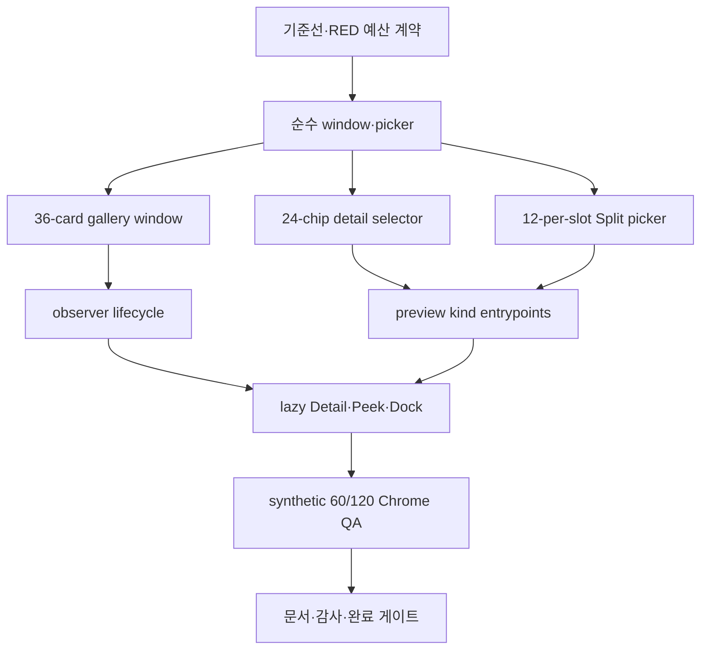

# Archived Implementation Plan: `render-scalability`

**Initiative:** `scalable-style-library`

**Module:** `render-scalability`

**Source specification:** `SPEC-render-scalability.md` (`COMPLETE`)

**Plan status:** 구현·검증 완료 (`COMPLETE`)

**승인일:** 2026-08-30

**Task list target:** `tasks/todo.md`

**Previous completed plan:** `tasks/archive/catalog-discovery-plan.md`

---

## 1. Overview

Core 36의 실측 기준선을 보존하고 synthetic 60/120으로 실패하는 DOM·bundle 계약을 먼저 만든다. 순수 render window와 bounded picker를 갤러리, 상세, Split에 차례로 연결한 뒤 component renderer와 상세 경로를 지연 chunk로 분리한다. 각 수직 조각은 표적 테스트와 실제 UI checkpoint를 통과한 뒤 다음 조각으로 진행한다.

## 2. Dependency Graph

## 3. Architecture Decisions

1. 전체 catalog 결과는 canonical model에 유지하고 DOM으로 전달하는 표현 창만 최대 36개로 제한한다.
2. 페이지는 local presentation state이며 discovery URL 계약을 확장하지 않는다.
3. detail/split 검색은 같은 순수 bounded picker를 사용하고 선택 ID는 제한 안에서 항상 한 번 포함한다.
4. native select options는 전체 접근 경로로 유지하되 고비용 thumbnail DOM만 제한한다.
5. thumbnail, motion, component registry 진입점을 분리하되 기존 `src/preview/index.js` 동기 API는 호환 facade로 유지한다.
6. literal `import()` loader를 중앙화해 Promise cache, loading, failure, retry를 한 계약으로 처리한다.
7. synthetic 데이터는 QA/테스트 경계 안에서만 만들며 실제 catalog를 변경하지 않는다.

## 4. Task Index

### Phase A — Measured pure contracts

1. 기준선과 synthetic 60/120 구조·bundle RED 계약을 고정한다.
2. 불변 render window와 bounded picker를 구현한다.

### Checkpoint A

- pure window/picker 표적 테스트 GREEN
- 36/60/120의 reachability와 DOM upper bound 계약 GREEN
- Core 36 catalog/preview 회귀 GREEN

### Phase B — Bounded visual DOM

3. 세 갤러리 보기에 공통 36-card 페이지 창을 연결한다.
4. 상세 선택기를 category + 최대 24칩으로 전환한다.
5. Split 선택기를 검색 + 슬롯당 최대 12썸네일로 전환한다.
6. observer를 rerender/unmount 때 정리하고 reduced-motion 계약을 강화한다.

### Checkpoint B

- Core 36 시각 회귀와 keyboard/focus/live status 정상
- synthetic 120 gallery/detail/split visual node 상한 준수
- detached observer 0

### Phase C — On-demand code and runtime proof

7. preview registry를 thumbnail/motion/component 진입점으로 분리한다.
8. Detail/Split을 최초 상태 진입 때 지연 로딩한다.
9. Peek·선택 확정 component renderer를 공유 loader에 연결한다.
10. initial bundle analyzer와 Chrome synthetic 60/120 QA를 구현한다.

### Checkpoint C

- initial synchronous JS gzip 88.98kB 이하, CSS gzip 33.00kB 이하
- lazy loading/error/retry와 기존 공개 preview API 회귀 GREEN
- Crostini Chrome interaction/DOM/motion/diagnostics 예산 통과

### Phase D — Handoff

11. module/master spec과 UX·ADR·사용자 문서를 동기화한다.
12. capability·운영·감사·교훈·작업 기록을 닫고 전체 검사를 수행한다.

## 5. Verification Matrix

| Gate | Command / Evidence |
| --- | --- |
| Pure scalability | `npm test -- tests/renderScalability.test.js` |
| Preview compatibility | `npm test -- tests/previewRegistry.test.js tests/previewIntegration.test.js` |
| Discovery regression | `npm test -- tests/catalogDiscovery.test.js` |
| Catalog/theme | `npm run validate:catalog && npm run check:themes` |
| Production bundle | `npm run build` + initial static asset analyzer |
| Browser | `npm run qa:scalability:chrome` — Core 36 + synthetic 60/120, 320/768/1024/1440px |
| Full gate | `npm run check` |
| Diff hygiene | `git diff --check`, secret/process/profile/scope audit |

## 6. Risks and Mitigations

| Risk | Impact | Mitigation |
| --- | --- | --- |
| page window가 canonical 결과를 잃음 | High | full `resultIds` 보존 + 모든 페이지 합집합/순서 테스트 |
| lazy import 경쟁으로 오래된 화면 mount | High | request token과 현재 state 재확인, 단일 cached Promise |
| loading 실패가 빈 화면을 만듦 | High | 명시적 status/error/retry, 기존 main 유지 |
| picker 검색이 선택을 숨김 | High | selected pinned 불변조건과 합성 edge test |
| observer 누적 | High | render cleanup 반환, disconnect/unobserve instrumentation test |
| code split이 오히려 bundle 증가 | Medium | initial static gzip 합계를 before/after 비교하고 budget gate 적용 |
| synthetic 데이터가 실제 60종으로 오해됨 | Medium | QA 전용 생성, catalog count 36 회귀 assertion, 문서 명시 |

## 7. Boundaries

- Always: measure→RED→GREEN, Core 36 호환, bounded DOM, keyboard/a11y, 실제 Chrome, 문서 동기화
- Ask first: 실제 catalog/ID/category 변경, dependency·server·asset 추가, Wave 2, Git·배포
- Never: Swiss/다른 스타일 fallback, 원격 code, 기본 Chrome profile, 테스트 skip, 실제 60/120 콘텐츠 위장

## 8. Open Questions

없음. 실측 기준선과 사용자의 승인으로 구현 경계와 완료 예산이 확정됐다.

## 9. Completion Record

- 완료일: 2026-08-31 (Asia/Seoul)
- Core 36 사용자 카탈로그는 그대로 유지했고 synthetic 60/120으로 모든 페이지·검색·picker 도달성을 증명했다.
- 최종 번들은 초기 JS `62.78kB` gzip, CSS `32.86kB` gzip이고 Chrome 151의 LCP는 `516ms`, CLS는 `0`이다.
- 전체 Node 테스트 `144/144`, Wave 1 Chrome 576상태, catalog discovery Chrome 9개 시나리오, render scalability Chrome의 Core/synthetic 행렬이 통과했다.
- 다음 미착수 게이트는 `style-pack-authoring`이며 실제 Wave 2 스타일 추가는 포함하지 않았다.
