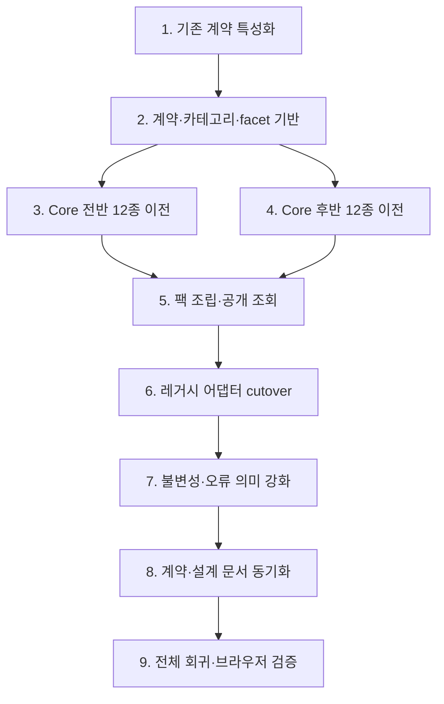

# Implementation Plan: `style-contract`

**Initiative:** `scalable-style-library`

**Module:** `style-contract`

**Source specification:** `SPEC-style-contract.md` (`IMPLEMENTED`)

**Plan status:** 완료 (`COMPLETE`)

**승인일:** 2026-08-30

**완료일:** 2026-08-30

**작성일:** 2026-08-30

**Task list target:** `tasks/todo.md`

---

## 1. Overview

기존 `src/data/categories.js`의 8개 카테고리와 24종 스타일을 새 `src/catalog/` 공개 계약으로 무손실 이전한다. 새 카탈로그는 스타일·카테고리·facet·팩·토큰·프리뷰 참조·출처를 결정론적으로 조회하며, 기존 UI는 호환 어댑터를 통해 현재 필드와 import 경로를 그대로 사용한다.

이 계획은 `style-contract`만 구현한다. 런타임 CSS 생성, 프리뷰 지연 로딩, facet UI, 36종 확장은 후속 모듈이다.

## 2. Scope

### Included

- 계약 상수, JSDoc 타입과 정렬·출판 상태 규칙
- 카테고리와 facet 정의
- 기존 24종을 포함하는 `core` 팩 manifest
- 정규 조회 API와 alias 해석
- 기존 `SubCategoryDesign` 형태의 호환 어댑터
- 기존 import 경로를 유지하는 점진적 cutover
- 불변성, 순서, ID, 토큰·프리뷰 참조 형태와 호환 회귀 테스트

### Excluded

- `themeTokens.css` 제거와 런타임 토큰 생성
- `THEME_TOKENS_MAP` 제거
- 목업 switch와 썸네일·모션 구현의 레지스트리화
- 새 facet 필터 UI와 Spectrum 개편
- 지연 로딩·가상화·성능 예산
- 신규 디자인 추가

토큰은 새 정규 레코드에 포함하지만, 기존 런타임 CSS와 내보내기 맵은 `theme-generation` 구현 전까지 호환 원천으로 남긴다. 이 일시적 중복은 parity 테스트로 감시한다.

## 3. Architecture Decisions

- 정규 데이터는 `src/catalog/`만 소유하고 `src/data/categories.js`는 기존 소비자를 위한 얇은 호환 진입점으로 전환한다.
- 내부 레코드와 공개 배열은 초기화 시 재귀 동결한다. 120종 규모에서 매 조회마다 전체 방어적 복사를 만드는 비용을 피하기 위해서다.
- 공개 조회의 기본값은 `legacy`와 `ready`만 노출한다. `includeUnpublished: true`를 명시한 개발 도구만 `draft/review`를 조회한다.
- 정렬은 숫자 `order` 후 정규 ID 오름차순으로 고정한다.
- 오래된 사용자 저장 ID는 `null`로 처리하지만, 카탈로그 내부의 구조·참조 누락은 후속 `catalog-validation`에서 오류로 승격한다.
- 기존 24종의 평면 UI 필드는 어댑터에서 생성한다. 새 소비자는 레거시 필드에 의존하지 않는다.

## 4. Dependency Graph



Tasks 3과 4는 파일 경계상 병렬화할 수 있지만 현재 작업은 순차 진행한다. 두 작업이 같은 정규 용어와 품질 기준을 사용해야 하므로 Task 2 승인 결과를 공통 기준으로 삼는다.

## 5. Task Index

상세 완료 조건과 검증 명령은 `tasks/todo.md`에 기록한다.

### Phase A: Contract Foundation

- [x] Task 1: 기존 24종 계약 특성화 테스트
- [x] Task 2: 계약 상수·카테고리·facet 정의

### Checkpoint A

- [x] 기존 데이터 동작을 바꾸지 않고 계약 기반 테스트와 전체 빌드가 통과한다.

### Phase B: Canonical Core Pack

- [x] Task 3: Core 전반 12종 정규 레코드 이전
- [x] Task 4: Core 후반 12종 정규 레코드 이전
- [x] Task 5: Core manifest와 공개 조회 API 조립

### Checkpoint B

- [x] 새 조회 API가 정확히 8개 카테고리와 24개 정규 스타일을 결정론적으로 반환한다.

### Phase C: Compatibility Cutover

- [x] Task 6: 레거시 어댑터와 기존 import 경로 cutover
- [x] Task 7: 불변성·출판 상태·경계 오류 의미 강화

### Checkpoint C

- [x] 기존 UI·저장 ID·인스펙터 생성 테스트가 새 카탈로그 경유 상태에서 통과한다.

### Phase D: Documentation and Runtime Proof

- [x] Task 8: 사양·설계·감사 문서 동기화
- [x] Task 9: 전체 자동 회귀와 Chrome 런타임 검증

### Final Checkpoint

- [x] `SPEC-style-contract.md`의 모든 성공 조건을 충족한다.
- [x] `npm run check`가 통과한다.
- [x] Grid, Detail, Split, 저장 복원과 내보내기가 기존과 동일하게 동작한다.
- [x] 사용자 검토 전 `catalog-validation` 구현으로 넘어가지 않는다.

## 6. Verification Strategy

### Automated

```bash
npm test -- tests/styleContract.test.js
npm test
npm run build
npm run check
```

### Runtime

ChromeOS Crostini Linux Chrome에서 다음 흐름을 확인한다.

1. Grid/Bento/Spectrum 전환과 24종 표시
2. 스타일 선택, 상세 진입, 카테고리·스타일 순환
3. 스플릿 비교 A/B 선택과 8대 아키타입 전환
4. 북마크·확정·최근 본 스타일을 저장한 뒤 새로고침 복원
5. 기존 alias ID가 정규 ID로 복원되는지 확인
6. CSS/HTML/Markdown/DTCG 출력의 선택 스타일 일치

### 완료 결과 (2026-08-30)

- `npm run check`: Node 테스트 25개 통과, Vite 프로덕션 빌드 통과
- Crostini Google Chrome: Grid/Bento/Spectrum, 8개 카테고리·24개 스타일, 상세 24탭, 8개 아키타입, 4개 인스펙터 탭과 3개 CSS 모드 확인
- Desktop/Mobile: 8개 아키타입 모두 렌더 루트가 `788px → 380px`로 전환되고 `desktop/mobile` 클래스가 일치함
- Split: 8개 아키타입 탭과 A/B 각 24개 스타일 선택지, 서로 다른 테마 렌더 확인
- 저장: 북마크를 저장·새로고침 복원한 뒤 UI로 원상 복구하고, alias 기반 북마크·확정·최근 목록 정규화는 격리 저장소 회귀 테스트로 확인
- 앱 오류 오버레이 없음. Chrome 프로필의 타 확장 프로그램 경고는 애플리케이션 오류와 분리해 판단함

### Definition of Done

각 Task는 해당 acceptance criteria 외에도 다음 조건을 충족해야 완료로 표시한다.

- 새 동작을 제거하면 실패하는 테스트가 존재한다.
- 기존 전체 테스트와 빌드가 통과한다.
- 동작을 실제 런타임에서 확인한다.
- 중복 로직, 디버그 출력, 죽은 코드와 무관한 리팩터링이 없다.
- 공개 계약과 현재 상태를 문서화한다.
- 기존 호환성과 안전한 되돌림 경로를 유지한다.

## 7. Risks and Mitigations

| Risk | Impact | Mitigation |
| --- | --- | --- |
| 24종 수동 데이터 이전 중 필드 누락 | High | 기존 데이터 특성화 테스트를 먼저 고정하고 두 묶음으로 이전한다. |
| alias 충돌 또는 저장 데이터 복원 실패 | High | 정규 ID·alias 공간을 함께 검사하고 기존 매핑 전체를 fixture로 고정한다. |
| 새 레코드와 레거시 UI 형태 불일치 | High | 어댑터 필드 parity 테스트 후 기존 import 경로만 교체한다. |
| 중첩 배열·객체가 외부에서 변형됨 | Medium | 초기화 시 재귀 동결하고 mutation 시도 회귀 테스트를 추가한다. |
| 토큰 원천이 일시적으로 중복됨 | Medium | 24종 토큰 parity 테스트를 유지하고 다음 `theme-generation`에서 제거한다. |
| 기존 작업 중인 Desktop/Mobile 변경과 문서 충돌 | Medium | 해당 diff를 보존하고 동일 문서 수정 시 현재 내용을 병합한다. |
| 새 모듈과 레거시 entrypoint 사이 순환 import | Medium | 의존 방향을 `catalog → legacyAdapter → data/categories entrypoint`로 단방향 유지한다. |

## 8. Rollback Strategy

- Task 6 전까지 새 카탈로그는 기존 UI의 실행 경로에 들어가지 않는다.
- Task 6은 기존 named export와 객체 형태를 그대로 제공하는 어댑터를 먼저 검증한 뒤 entrypoint를 전환한다.
- Checkpoint C가 실패하면 cutover를 완료로 표시하지 않고 기존 진입점 동작을 유지한 채 원인을 수정한다.
- 정규 ID, 로컬 저장 키, 내보내기 형식은 이 모듈에서 변경하지 않으므로 사용자 데이터 마이그레이션 롤백은 필요하지 않다.

## 9. Open Questions

구현을 막는 미확정 사항은 없다. 정확한 토큰 원천 제거 시점과 프리뷰 ID 참조 검증은 각각 `theme-generation`, `catalog-validation` 사양에서 다룬다.

## 10. Approval Gate

이 계획과 `tasks/todo.md`는 2026-08-30에 승인되었다. Task 1부터 순서대로 진행하며 각 Checkpoint 결과를 문서와 사용자에게 보고한다.
