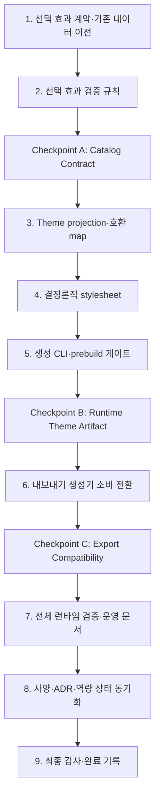

# Implementation Plan: `theme-generation`

**Initiative:** `scalable-style-library`

**Module:** `theme-generation`

**Source specification:** `SPEC-theme-generation.md` (`COMPLETE`)

**Plan status:** 승인·구현 완료 (`APPROVED / COMPLETE`)

**사양 승인일:** 2026-08-30

**계획 승인일:** 2026-08-30

**작성일:** 2026-08-30

**구현 완료일:** 2026-08-30

**Task list target:** `tasks/archive/theme-generation-todo.md`

**Previous completed plan:** `tasks/archive/catalog-validation-plan.md`

---

## 1. Overview

정규 카탈로그의 `StyleRecord.tokens`를 스타일별 13개 테마 값의 유일한 작성 원천으로 만들고, 런타임 `[data-theme]` CSS와 CSS/Markdown/DTCG 내보내기를 같은 동결 투영에서 생성한다. 기존 24종의 21개 alias, 세 컨테이너 blur 효과와 984개 내보내기 조합은 승인된 해시·브라우저 기준으로 보존한다.

계획은 계약과 검증을 먼저 확장하고, 순수 theme projection, 결정론적 stylesheet, 명시적 write/check CLI, 내보내기 소비 전환 순서로 진행한다. 마지막에 Crostini Google Chrome에서 실제 computed style과 상태 보존을 검증하고 문서·ADR·감사 기록을 동기화한다.

이번 계획은 승인된 `theme-generation` 사양만 구현한다. 아키타입 HTML, renderer/thumbnail/motion dispatch, 신규 스타일·카테고리·facet, 탐색 UI와 성능 분할은 변경하지 않는다.

## 2. Scope

### Included

- 스키마 v1 선택 필드 `themeEffects.backdropBlur`와 구조화된 오류 코드
- 13개 의미 토큰과 CSS custom property의 고정 매핑
- 모든 출판 상태를 포함하는 동결 `ThemeDefinition` 조회
- 정규 카탈로그에서 파생하는 `THEME_TOKENS_MAP` 호환 export
- root fallback, canonical/alias selector와 효과를 만드는 순수 CSS 직렬화
- 추적 대상 `themeTokens.css`의 명시적 생성 및 read-only stale 검사
- `prebuild`의 catalog 검증 → theme 최신성 검사 순서
- CSS/Markdown/DTCG 생성기의 정규 theme API 소비와 Swiss 폴백 제거
- 24종 호환 해시, 전체 자동 회귀와 Crostini Chrome 런타임 증명
- 사용자·구조·사양·ADR·감사·인수인계 문서 동기화

### Excluded

- 아키타입 템플릿과 UI 레이아웃 수정
- 프리뷰·썸네일·모션 레지스트리 구현
- DTCG 버전 또는 13개 토큰 집합 변경
- `defaultTweaks` 값이나 슬라이더 범위 변경
- 신규 디자인 데이터와 카테고리 추가
- 런타임 `<style>` 주입, CSS 분할 또는 지연 로딩
- 외부 의존성, 배포, 커밋과 푸시

## 3. Architecture Decisions

1. **Optional additive effect contract:** `themeEffects.backdropBlur`는 0 이상의 유한한 px 숫자이며 `defaultTweaks.backdropBlur`와 결합하지 않는다. 카탈로그 스키마 버전은 `1`을 유지한다.
2. **One-way dependency:** `catalog → theme → export/runtime consumers`만 허용한다. 카탈로그는 theme이나 UI를 import하지 않고 theme은 개별 팩 파일을 직접 import하지 않는다.
3. **Pure browser-safe core:** 토큰 투영과 CSS 직렬화는 DOM, 파일 시스템, `process`를 모르는 순수 ESM이다. Node I/O와 exit code는 CLI만 소유한다.
4. **Tracked generated CSS:** `src/styles/themeTokens.css`는 추적되는 생성 파일이다. `generate:themes`만 쓰고 `check:themes`와 일반 빌드는 비교만 한다.
5. **Stable compatibility projection:** 기존 `THEME_TOKENS_MAP` 이름과 canonical-ID keyed 형태는 정규 데이터로 파생해 재-export한다. 13개 속성과 세 unprefixed blur 효과의 순서를 보존한다.
6. **No silent fallback:** 정규 또는 alias 조회 실패는 `null`과 기존 미선택 산출물로 끝나며 Swiss/첫 스타일로 대체하지 않는다.
7. **Compatibility by evidence:** 생성 CSS는 selector·선언 의미 해시로, Live CSS/Markdown/DTCG는 승인된 전체 문자열 행렬 해시로, 최종 렌더는 Chrome computed style과 사용자 흐름으로 검증한다.

## 4. Planned Project Structure

```text
src/
├── catalog/
│   ├── contract.js
│   ├── packs/core/styles-foundations.js
│   ├── packs/core/styles-contemporary.js
│   └── validation/rules.js
├── theme/
│   ├── contract.js
│   ├── projection.js
│   ├── stylesheet.js
│   └── index.js
├── styles/themeTokens.css
└── utils/designSpecGenerator.js

scripts/generateThemeStyles.js
tests/themeGeneration.test.js
```

계획 중 단순화 검토에서 `contract.js`와 `projection.js`를 합치는 편이 명확하다면 파일 수를 줄일 수 있다. 공개 진입점, 의존 방향, 순수 직렬화와 CLI I/O 경계는 바꾸지 않는다.

## 5. Dependency Graph



모든 구현 Task가 중앙 계약이나 같은 `tests/themeGeneration.test.js`를 공유하므로 Task 1부터 9까지 순차 실행한다. 이 계획은 병렬 에이전트나 별도 worktree를 전제로 하지 않는다.

## 6. Task Index

상세 acceptance criteria, 검증 명령, 의존성과 예상 파일은 `tasks/todo.md`에 기록한다.

### Phase A: Catalog Contract and Guardrails

- [x] Task 1: 선택 효과 계약과 기존 세 스타일 이전
- [x] Task 2: 선택 효과 검증 규칙과 오류 계약

### Checkpoint A

- [x] 스키마 v1 하위 호환, 세 효과 값, 오류 코드와 기존 오류 0·경고 56 기준선이 증명된다.

### Phase B: Canonical Theme Generation

- [x] Task 3: 동결 theme projection과 호환 map
- [x] Task 4: 결정론적 runtime stylesheet 직렬화
- [x] Task 5: 생성/check CLI와 prebuild 게이트

### Checkpoint B

- [x] 정규 카탈로그만으로 기존 runtime CSS 의미가 생성되고 stale 파일이 빌드를 차단한다.
- [x] 내보내기 경로의 기존 수동 map은 Task 6 소비 전환 전까지 호환 기준선으로만 유지된다.

### Phase C: Export Integration

- [x] Task 6: CSS/Markdown/DTCG 생성기의 정규 theme 소비 전환

### Checkpoint C

- [x] 기존 24종의 Live CSS 576개, Markdown 384개, DTCG 24개와 호환 map 해시가 유지되고 무음 Swiss 폴백이 없다.
- [x] 정규 카탈로그 밖의 스타일별 토큰 값 literal 원천이 제거된다.

### Phase D: Runtime Proof and Handoff

- [x] Task 7: 전체 회귀·Crostini Chrome 검증과 운영 문서
- [x] Task 8: 사양·계약·ADR·역량 맵 완료 동기화
- [x] Task 9: 최종 감사와 완료 기록

### Final Checkpoint

- [x] `SPEC-theme-generation.md` 성공 조건 13개가 모두 증거와 함께 충족된다.
- [x] 전체 테스트, catalog 검증, theme 최신성 검사, Vite 빌드와 `npm run check`가 통과한다.
- [x] Chrome 151에서 canonical/alias computed token, 세 blur 효과, 상태 보존, Desktop/Mobile과 내보내기 회귀가 없다.
- [x] 다음 모듈로 넘어가기 전 사용자 검토 게이트에 도달한다.

각 Checkpoint는 승인된 계약이 바뀌지 않는 한 별도 중단 없이 다음 Task로 진행한다. 사양, 공개 API, 호환 기준선 또는 범위를 바꿔야 하면 구현을 멈추고 사양을 먼저 갱신해 사용자 승인을 받는다.

## 7. Verification Strategy

### Test-driven increments

각 Task는 새 동작을 제거하면 실패하는 최소 테스트를 먼저 추가하고 실패 원인을 확인한 뒤 구현한다. 호환 기준선과 새 구조 테스트를 분리해 “현재 출력이 같다”와 “중복 원천이 제거됐다”를 각각 증명한다.

### Automated

```bash
npm test -- tests/styleContract.test.js
npm test -- tests/catalogValidation.test.js
npm test -- tests/themeGeneration.test.js
npm test -- tests/designSpecGenerator.test.js
npm test
npm run validate:catalog
npm run check:themes
npm run build
npm run check
git diff --check
```

`npm run check:themes`는 생성 파일이 최신인 정상 경로에서 종료 코드 `0`을 요구한다. 테스트 fixture는 stale `1`, 잘못된 옵션·도구 오류 `2`도 별도로 증명한다.

### Compatibility matrix

- `THEME_TOKENS_MAP` 24종 SHA-256: `2e299391427ce9db7fa9b75cf55eeaea26abc9a54e921ef22cb6336f3126fdf5`
- 런타임 CSS 의미 SHA-256: `a4965a6dbbee982466ba1623e3a9309dde7fe204ccc4367eb9c18244f1b0d06d`
- Live CSS 576개 SHA-256: `b61766afb049fdba6d4c795db8263294aa72d6aa2201ba4e1aa720e14ee2e781`
- Live Markdown 384개 SHA-256: `e8b81f021fddf3268df1da306596d20d7059a6725261a8ee76ab9e319969c71a`
- DTCG 24개 SHA-256: `e2949344331f8783fc37198e2de12bc64d9fa00f22ad73cf0ee4f1cf03adfc04`

### Integration and runtime

1. 프로덕션 빌드의 prebuild가 catalog 검증 뒤 theme 최신성 검사를 실행하는지 확인한다.
2. 빌드 산출물과 import graph에서 CLI의 Node 전용 모듈이 브라우저에 포함되지 않는지 확인한다.
3. ChromeOS Crostini Linux Google Chrome에서 대표 카테고리 8종과 `glassmorphism`, `frutiger-aero`, `bento-grid`를 확인한다.
4. canonical과 alias selector의 13개 custom property, 세 computed blur 값 `20px/14px/16px`를 대조한다.
5. Detail/Split, 상태 유지, 8개 아키타입 Desktop/Mobile과 CSS/Markdown/DTCG 다운로드를 재검증한다.

### Definition of Done

각 Task는 개별 acceptance criteria 외에도 다음 기준을 충족해야 완료로 표시한다.

- 새 동작을 제거하면 실패하는 테스트와 오류 경로가 있다.
- 집중 테스트, 기존 전체 테스트와 관련 빌드가 통과한다.
- 입력을 변형하지 않고 기존 공개 계약과 사용자 동작을 회귀시키지 않는다.
- 중복 로직, 디버그 출력, 죽은 코드와 무관한 리팩터링이 없다.
- 공개 인터페이스, 생성 명령과 중요한 기술 결정이 실제 구현과 동기화된다.
- 보안·브라우저 import 경계와 rollback 경로를 검토하고 최종 사용자 검토를 받는다.

## 8. Risks and Mitigations

| Risk | Impact | Mitigation |
| --- | --- | --- |
| 효과 필드가 tweak 값과 합쳐져 bento blur가 달라짐 | High | 별도 계약·값 fixture와 computed style에서 `16px/12px` 차이를 고정한다. |
| 생성 CSS 포맷 변경을 시각 회귀로 오인 | High | byte가 아닌 selector·선언 의미 해시와 실제 computed style을 함께 사용한다. |
| 호환 map property 순서가 바뀌어 출력 해시가 달라짐 | High | `THEME_TOKEN_KEYS`와 명시 매핑 배열로 순서를 고정한다. |
| stale 검사 도입으로 일반 빌드가 갑자기 실패 | High | Task 4에서 현재 CSS 의미를 먼저 생성하고 Task 5에서 최신 파일·복구 명령을 연결한다. |
| CLI가 브라우저 그래프에 유입 | Medium | browser-safe theme core와 Node CLI를 단방향으로 분리하고 빌드 산출물을 검사한다. |
| 해시 테스트가 새 스타일 추가를 막음 | Medium | 전체 카탈로그가 아니라 기존 24종 고정 부분 집합만 호환 해시에 포함한다. |
| draft/review 포함으로 CSS가 커짐 | Medium | 현재 기능 요구대로 포함하되 실제 크기 예산과 분할은 `render-scalability`로 넘긴다. |
| 한 테스트 파일이 과도하게 커짐 | Medium | projection, stylesheet, CLI, export 행렬을 describe가 아닌 Node test 단위와 재사용 helper로 구분하고 단순화 검토한다. |

## 9. Rollback Strategy

- Task 4까지 새 theme 모듈은 기존 runtime CSS import와 내보내기 소비 경로를 바꾸지 않는다.
- Task 5의 CLI/prebuild 연결에 문제가 생기면 `check:themes` 연결만 제거해 마지막 통과 빌드를 복구할 수 있다. 생성 원천과 카탈로그 데이터는 보존한다.
- Task 6 소비 전환에 문제가 생기면 호환 re-export 경계를 마지막 통과 상태로 돌리되 정규 토큰과 기존 CSS를 동시에 임의 수정하지 않는다.
- `themeEffects`는 선택적 v1 필드이고 사용자 저장소나 외부 데이터 마이그레이션이 없다.
- Checkpoint 실패 시 해당 Task를 완료 처리하지 않고 마지막 통과 Checkpoint의 파일 범위로 원인을 제한한다. 기존의 무관한 dirty worktree 변경은 되돌리지 않는다.

## 10. Open Questions

구현을 막는 미확정 사항은 없다. 사양 승인으로 생성 CSS 추적, 효과/tweak 분리와 Swiss 폴백 제거가 확정되었다.

## 11. Completion Record

이 계획과 `tasks/todo.md`는 2026-08-30에 승인되었고 Tasks 1–9와 Checkpoints A–C, Final Checkpoint를 순차 완료했다. 공개 API·호환 기준선 변경 없이 구현했으며 다음 권장 모듈 `preview-registry`는 별도 사양과 사용자 승인 전까지 시작하지 않는다.
