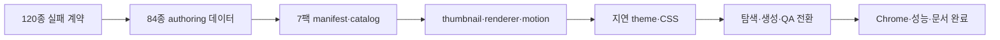

# Implementation Plan: `catalog-expansion-120`

**Initiative:** `scalable-style-library`

**Module:** `catalog-expansion`

**Source specification:** `SPEC-catalog-expansion-120.md` (`COMPLETE`)

**Plan status:** 구현 완료 (`COMPLETE`)

**승인일:** 2026-08-31

**완료일:** 2026-08-31

**Task list target:** `tasks/todo.md`

**Previous completed plan:** `tasks/archive/render-scalability-plan.md`

---

## 1. 목표

기존 Core 36의 ID·저장 상태·사용자 동작을 유지하면서 실제 카탈로그를 총 120종으로 확장한다. 신규 84종은 7개 내부 팩, 21개 시각 문법, 스타일별 고유 renderer·thumbnail·motion 참조로 제공한다. 초기 화면에는 기존 36종의 CSS만 두고 신규 상세 프리뷰 CSS는 상세 기능과 함께 지연 로드한다.

## 2. 구현 순서

각 단계는 내부 체크포인트로 검증하지만 사용자의 추가 승인을 기다리지 않고 전체 120종 완료까지 연속 진행한다.

## 3. 아키텍처 결정

1. 기존 36종 파일은 수정 최소화하고 신규 84종은 `src/catalog/packs/expansion/` 아래 7개 팩으로 분리한다.
2. 명시적 blueprint 데이터가 canonical `StyleRecord`와 preview definition의 공통 원본이다.
3. 21개 시각 문법을 네 변형씩 사용하되 스타일 이름·색·카피·참조 ID·변형 조합은 84종 모두 고유하게 만든다.
4. 신규 스타일은 모두 `ready` 품질이며 기존 36종의 legacy 경고 56개는 회귀 기준으로 보존한다.
5. gallery thumbnail은 초기 CSS를 늘리지 않는 독립 마크업·인라인 token 방식으로 렌더한다.
6. 신규 component renderer와 테마 CSS는 기존 lazy detail chunk에서만 불러온다.
7. 8개 category는 각 15종으로 균형을 맞추고 기존 category ID와 URL/localStorage 계약은 유지한다.

## 4. 내부 체크포인트

### A — 계약과 데이터

- 실제 catalog 120, 신규 84, category별 15를 실패 테스트로 고정한다.
- 기존 36 ID 순서와 preview 참조는 변경되지 않아야 한다.
- 7개 팩 manifest와 신규 source/a11y/contrast 계약을 고정한다.

### B — 프리뷰와 지연 스타일

- preview inventory는 renderer/thumbnail/motion 각각 120이고 fallback은 0이다.
- Desktop/Mobile 및 8 archetype에서 120종 전체가 고유 프리뷰를 렌더한다.
- 신규 theme/detail CSS가 초기 경로에 포함되지 않고 상세 진입 시 로드된다.

### C — 제품 통합과 검증

- 실제 120종에서 검색·facet·정렬·페이지·상세·Split·selection/export가 동작한다.
- 초기 JS gzip ≤ 88.98kB, CSS gzip ≤ 33.00kB를 유지한다.
- 320/768/1024/1440px Chrome, keyboard, reduced-motion, console/network, LCP/CLS/interaction 게이트를 통과한다.

## 5. 검증 명령

| 게이트 | 명령 |
| --- | --- |
| 120종 계약 | `npm test -- tests/catalogExpansion120.test.js` |
| catalog 품질 | `npm run validate:catalog` |
| theme 결정성 | `npm run check:themes` |
| preview 회귀 | `npm test -- tests/previewRegistry.test.js tests/previewIntegration.test.js` |
| 전체 자동 검사 | `npm run check` |
| 초기 bundle | `npm run analyze:bundle` |
| 실제 Chrome | `npm run qa:catalog120:chrome` |
| 변경 위생 | `git diff --check` |

## 6. 경계

- 포함: 총 120종, 7팩, 프리뷰 3종, 비동기 CSS, 탐색/생성/QA/문서 전환
- 제외: 새 dependency, 서버, 외부 런타임 asset, category ID 변경, 배포, Git commit/push/tag
- 중단 조건: 기존 ID 충돌, 초기 bundle 예산 초과, fallback 발생, 실제 Chrome 오류가 해결되지 않은 경우

## 7. 완료 조건

`SPEC-catalog-expansion-120.md`의 수량·품질·성능·브라우저·문서 성공 조건이 모두 증거와 함께 충족되고, 현재 plan/todo 및 capability 문서가 `COMPLETE`로 닫혀야 한다.

## 8. 완료 기록

- 실제 카탈로그 120종과 카테고리별 15종을 구현했다.
- 자동 테스트 152/152, Vite build, catalog/theme/bundle 게이트를 통과했다.
- Crostini Google Chrome에서 실제 120종, 1,920개 Desktop/Mobile 상태, 네 Web 탭과 반응형·접근성·진단 게이트를 통과했다.
- 초기 JS/CSS는 각각 `83.46kB`/`32.86kB` gzip으로 승인 예산 안에 있다.
- 완료 증거의 기준 문서는 `SPEC-catalog-expansion-120.md` 13절이다.
