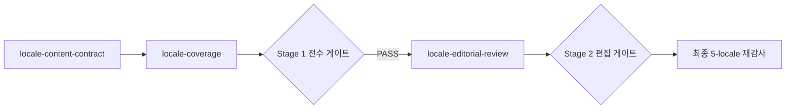

# 구현 계획: 5개 locale 전면 현지화와 문구 품질 감수

**상태:** `STAGE 2 Tasks 21–28 자동 작업 완료 — ED-011 사람 검토 대기` (2026-09-01)

**요청 범위:**

1. 모든 메뉴·카드·상태·ARIA·상세 설명·프리뷰·Inspector 사람용 문구가 선택 locale의 실제 콘텐츠를 사용하도록 완성한다.
2. 구조적 완전성을 먼저 통과한 뒤, 5개 언어의 어색한 표현·오역·용어 불일치를 별도 편집 단계에서 다듬는다.

**Task list target:** `tasks/todo.md`

## 1. 전제와 해석

1. 지원 locale은 기존 계약대로 `ko`, `en`, `ja`, `zh-CN`, `zh-TW`를 유지한다.
2. 영어 locale의 디자인명은 기존 영문 정식명 또는 국제적으로 통용되는 원명을 사용한다.
3. 한국어·일본어·중국어 간체·중국어 번체의 디자인명은 각 언어권에서 통용되는 번역명 또는 음역명으로 명시한다.
4. 브랜드명, 표준명, 약어(`Y2K`, `UI`, `CSS`, `DTCG` 등)는 언어별 glossary에서 승인한 경우에만 동일 표기를 허용한다. 기존의 포괄적인 `international-proper-name` fallback은 제거한다.
5. machine key인 style/category/facet ID, CSS selector·custom property, HTML ID·`data-*`, DTCG structural key와 파일명은 번역하지 않는다.
6. “자연스러운 번역”은 자동 테스트만으로 증명하지 않는다. 자동 검증, 용어 출처 대조, 편집 검토, locale별 검수표를 모두 통과해야 완료로 판정한다.

## 2. 현재 기준선과 확인된 구조적 결함

- locale별 UI 표면은 `copy` 296키와 `messages` 36키를 가진다.
- 120종 catalog의 사람용 필드는 locale당 1,924개 단위다.
  - 스타일명·요약: 240
  - palette 이름·용도: 960 (`480 × 2`)
  - 특징: 361
  - 장점: 242
  - 주의점: 121
- Stage 1 착수 당시 일본어·중국어 간체·중국어 번체 디자인명은 각각 `120/120`개가 영문명과 동일했고, 각 locale에 `international-proper-name` fallback 120건으로 기록됐다. Stage 1에서 locale별 명시 record로 이전했고 Task 21에서 120종 제목을 전수 감수했다.
- 비한국어 summary·palette·특징·장단점은 스타일별 번역 record가 아니라 locale 공통 템플릿에서 생성된다.
- Core/Wave 1/Expansion preview renderer에는 영어·한국어 visible/ARIA/status literal이 남아 있어 locale pack의 완전성만 검사해서는 전체 화면 언어를 보장할 수 없다.

따라서 이번 작업은 단순 문자열 교체가 아니라, locale별 명시 콘텐츠와 콘텐츠 출처를 검증하는 구조 개편으로 진행한다.

## 3. Capability map과 의존 순서

| Module id | 책임 | 의존성 |
| --- | --- | --- |
| `locale-content-contract` | 번역 대상 필드, invariant allowlist, locale pack schema, provenance와 실패 조건 정의 | 없음 |
| `locale-coverage` | 모든 UI/catalog/preview/artifact 사람용 문자열을 5개 locale의 명시 콘텐츠로 이전하고 전수 검증 | `locale-content-contract` |
| `locale-editorial-review` | 언어별 glossary·문체 기준으로 자연스러움, 용어, 의미 보존을 감수 | `locale-coverage` 완료 게이트 |



`locale-editorial-review`는 Stage 1이 완전히 통과하기 전에는 시작하지 않는다. 구조 수정과 문장 다듬기를 섞으면 누락과 표현 변경을 구분하기 어렵기 때문이다.

## 4. 제안하는 계약 변경

계획 승인 후 구현의 첫 작업으로 `spec.md` §5.10, `designs.md`, `DESIGN_DECISIONS.md`를 다음 기준으로 갱신한다.

1. 사용자에게 보이는 모든 문자열은 선택 locale pack에서 해석되어야 한다.
2. locale pack은 UI, catalog, preview, artifact metadata의 사람용 필드를 명시적으로 소유한다.
3. missing field, 다른 locale의 암묵 fallback, 공통 placeholder/template 생성 결과는 completeness 실패다.
4. locale 사이 동일 문자열은 machine/brand/acronym allowlist에 명시된 항목만 허용한다.
5. 각 콘텐츠 항목은 `translated`, `invariant-approved`, `editorially-reviewed` 상태를 구분한다.
6. 간체와 번체는 문자 변환 결과가 아니라 각 지역의 용어·문체를 가진 독립 locale로 관리한다.
7. UI에서 영문 보조명이 필요하더라도 모든 locale에 무조건 노출하지 않는다. 제품상 필요한 경우에만 별도 승인된 보조 표기 계약을 둔다.

## 5. 목표 구조

```text
src/i18n/
├── contract.js                 # locale ID, schema, invariant vocabulary
├── index.js                    # lazy load, validation, snapshot commit
├── validation/                 # coverage, provenance, script/duplicate 검사
└── locales/
    ├── ko/
    │   ├── ui.js
    │   ├── catalog-01-04.js
    │   ├── catalog-05-08.js
    │   ├── preview.js
    │   └── index.js
    ├── en/ ...
    ├── ja/ ...
    ├── zh-CN/ ...
    └── zh-TW/ ...
```

- locale마다 UI/catalog/preview copy를 물리적으로 분리한다.
- 120종 catalog는 8개 category를 두 묶음으로 나눠 파일과 검토 단위를 제한한다.
- snapshot 소비자는 이미 해석된 문자열만 받는다. renderer 내부에서 locale을 추측하거나 canonical 한국어·영어로 fallback하지 않는다.
- 초기 bundle 예산을 유지하도록 locale pack은 literal dynamic import 경계를 보존한다.

## 6. Stage 1 — 전면 언어 분리와 완전성

### Phase 1. 계약·인벤토리·RED 게이트

1. `spec.md` §5.10과 설계 문서에 위 계약을 먼저 반영한다.
2. visible text, ARIA, title, placeholder, status, toast, dialog, export metadata를 source와 runtime에서 수집하는 인벤토리 도구를 만든다.
3. 현재 false green을 재현하는 실패 테스트를 추가한다.
   - ja/zh 120개 카드명이 영문과 동일한 현상
   - generic template로 생성되는 style 설명
   - preview renderer의 고정 영어·한국어 literal
   - 다른 locale fallback과 동일 문자열의 무승인 재사용

### Phase 2. Locale content contract 구현

1. locale별 콘텐츠 schema와 field provenance를 도입한다.
2. 암묵 fallback을 제거하고 missing/placeholder/unapproved invariant를 hard failure로 만든다.
3. canonical machine ID와 localized display value를 별도 필드로 유지한다.
4. 5개 pack의 key·record·array 길이 parity를 검사한다.

### Phase 3. 5개 locale 명시 콘텐츠 이전

각 locale은 독립적으로 두 개 category wave를 완료한다.

- Wave A: category 01–04
- Wave B: category 05–08

각 wave는 다음을 모두 포함한다.

- 120종 중 해당 category의 디자인명과 요약
- palette 이름과 용도
- 특징, 장점, 주의점
- category/facet 표시명
- 카드·Detail·Split·Peek·Dock에서 사용하는 동일 display record

영어와 한국어도 canonical source에 암묵 의존하지 않고 locale 콘텐츠 계약에 맞춰 투영한다. 일본어·간체·번체는 독립 번역 record를 작성한다.

### Phase 4. UI·Preview·Inspector 소비 경계 이전

1. Header, Discovery, Gallery, Detail, Split, Peek, Dock, Audio, recovery의 모든 visible/ARIA/status 문자열을 locale snapshot에 연결한다.
2. Core, Wave 1, Expansion preview의 네 Web 탭과 8개 archetype 내부 문자열을 preview locale copy로 이전한다.
3. Inspector의 CSS comment, HTML visible/ARIA copy, Markdown prose, DTCG display metadata가 같은 snapshot을 사용하도록 유지한다.
4. 기계 키와 상호작용 selector는 byte-equivalent로 보존한다.

### Phase 5. Stage 1 전수 검증

다음 조건이 모두 통과해야 Stage 2로 이동한다.

- Node content matrix
  - `5 locale × 1,924 catalog field units` (locale당 120종 전체)
  - 각 locale에서 `120/120` style record와 하위 배열 길이 parity
  - `5 locale × 120 styles × 8 archetypes = 4,800` 렌더 상태
  - `5 locale × 120 styles × Web 4 tabs = 2,400` 렌더 상태
- 다른 언어 script, 암묵 fallback, generic placeholder, source literal: 승인 allowlist 외 `0`
- Gallery Chrome matrix: 5 locale에서 120개 카드명·설명·category 접근 가능
- Main/empty/filter/Detail/Split/Peek/Dock/lazy error/fatal error의 visible/ARIA 검사
- Inspector 네 pane의 human text는 locale별로 다르고 machine key set은 동일
- locale 전환 후 selection/tweak/runtime/tab/scroll/focus 보존
- Node 전체, catalog/theme, Vite build, bundle budget, Actual-120, Discovery, Pages recovery: 모두 통과

## 7. Stage 2 — 언어별 자연스러운 문구 감수

### Phase 6. 언어별 glossary와 문체 기준

각 locale에 다음을 먼저 확정한다.

- 디자인 사조·기법·재질·UI 용어의 표준 번역명
- 번역하지 않는 브랜드·약어·표준명
- 제목 대소문자, 숫자·단위, 구두점, 존댓말/문장 종결 규칙
- 버튼은 행동 중심, 설명은 정보 중심, 오류는 복구 중심이라는 tone 기준
- 공식 박물관·표준·제품 문서의 통용 명칭을 우선하는 출처 규칙

### Phase 7. Locale별 편집 검토

검토 순서는 의미 기준을 고정하기 위해 `ko → en → ja → zh-CN → zh-TW`로 한다.

- 한국어: 원문의 의미·용어·문체 기준 확정
- 영어: 관사, 단복수, title case, 번역투, 제품 UI 어조 검토
- 일본어: 통용 가타카나/한자 용어, 조사, です·ます체, 전각 구두점 검토
- 중국어 간체: 중국 본토 UI·디자인 용어와 자연스러운 간결체 검토
- 중국어 번체: 대만권 UI·디자인 용어와 번체 고유 어휘 검토

각 문자열은 의미 보존, 자연스러움, 용어 일관성, UI 길이, 접근성 이름의 다섯 기준으로 판정하고 locale별 issue ledger에 근거를 남긴다.

### Phase 8. 교차 언어 의미·레이아웃 재감사

1. 120종의 name/summary/palette/특징/장단점 의미가 locale 사이에서 빠지거나 추가되지 않았는지 field 단위로 비교한다.
2. 간체와 번체가 단순 문자 변환이 아니라 glossary에 맞는 서로 다른 용어를 쓰는지 검사한다.
3. 320/375/768/1024/1440px와 200% zoom에서 번역 길이로 인한 overflow·잘림·컨트롤 이동을 검사한다.
4. 대표 screenshot과 전체 machine-readable report를 저장한다.

200% 확대는 선행 Audit 11과 같은 조건인 물리 폭 1280px, CSS viewport 640px, `deviceScaleFactor: 2`로 재현한다. 320/375/768/1024/1440px는 100% CSS viewport에서 각각 별도로 검사한다. 자동 검사는 field 구조·지역어·machine key·reflow 회귀를 판정하며, 사람 검토 전에는 원어민 수준의 자연스러움을 완료로 선언하지 않는다.

## 8. 완료 판정

### Stage 1 완료

- 모든 사람용 콘텐츠가 5개 locale pack에 명시적으로 존재한다.
- 비영어 카드 디자인명 120개가 locale별 승인명으로 표시된다.
- unapproved fallback, placeholder, 다른 언어 누출, hardcoded visible literal이 0이다.
- 전체 Node/build/bundle/Chrome 매트릭스가 green이다.

### Stage 2 완료

- 5개 locale glossary와 style guide가 승인된다.
- 모든 콘텐츠 항목이 `editorially-reviewed` 상태를 가진다.
- locale별 감수 issue ledger의 미해결 High/Medium 항목이 0이다.
- 구조적 게이트를 다시 실행해 문구 수정으로 기능·레이아웃·machine key가 회귀하지 않는다.
- 최종적으로 사용자 또는 해당 언어 화자의 검토 결과를 기록한다. 자동 검사만으로 “원어민 수준”을 선언하지 않는다.

## 9. 위험과 완화

| 위험 | 영향 | 완화 |
| --- | --- | --- |
| 5 locale × 대량 콘텐츠로 누락 발생 | 높음 | schema/key parity/provenance와 category wave 체크포인트 |
| 공통 템플릿이 형식상 완전성만 통과 | 높음 | 스타일별 explicit record와 generic-template 금지 |
| 번역명이 검색·저장 ID를 변경 | 높음 | canonical ID와 display name 분리, machine-key equivalence |
| locale chunk가 초기 bundle에 합쳐짐 | 중간 | literal dynamic import와 bundle analyzer |
| 간체→번체 자동 변환으로 지역어 오류 | 높음 | 독립 pack·독립 glossary·교차 locale 동일성 경고 |
| 자연스러움을 자동 테스트가 과대평가 | 높음 | 편집 issue ledger와 사람 검토 checkpoint |
| 긴 번역으로 모바일 UI 회귀 | 중간 | 5 locale 다중 폭·200% Chrome reflow gate |

## 10. 승인 후 실행 원칙

- 계약 문서 → 실패 테스트 → locale별 작은 wave → checkpoint 순서로 진행한다.
- Stage 1 PASS 보고 전에는 Stage 2 문구 감수를 시작하지 않는다.
- 각 wave는 테스트·빌드 가능한 상태로 끝내고 별도 승인 전 커밋·푸시하지 않는다.
- 완료 보고에는 변경 파일, locale별 coverage 수치, fallback/누출 수, 테스트·Chrome 증거와 남은 감수 위험을 포함한다.

## 11. Stage 1 구현 결과

- locale별 catalog는 `src/i18n/locales/catalog/<locale>.js`의 명시적 120-record pack으로 구현했다. 계획의 category별 물리 분할 대신 locale별 단일 파일을 택해 import graph와 검증 경계를 단순화했으며, 각 파일은 lazy locale chunk에만 포함된다.
- renderer 원문의 기계 속성은 그대로 유지하고, 사용자 가시 텍스트·ARIA는 `src/preview/localizeMarkup.js`에서 같은 locale snapshot의 명시 콘텐츠로 투영한다. 런타임 toast도 snapshot copy를 사용한다.
- 전체 결과와 SHA-256은 `docs/multi_audit/11/locale_stage1_evidence.md`에 기록했다.
- Stage 2는 번역 정확성·자연스러움·지역별 용어를 다루는 편집 단계다. Checkpoint B 사용자 승인 전에는 시작하지 않는다.

## 12. Stage 2 착수 기록

- Checkpoint B는 2026-08-31 사용자 승인으로 통과했다.
- `docs/i18n/editorial_style_guide.md`, `docs/i18n/design_term_glossary.md`, `docs/i18n/editorial_issue_ledger.md`를 Task 21의 편집 기준선으로 추가했다.
- 우선 확인된 기계 번역 오염 명칭과 Mica 공식 locale 명칭, zh-TW design token 표기를 첫 RED→GREEN 회귀 테스트로 고정했다.
- Task 21에서 120종 디자인명을 5개 locale 순서로 검토했다. 93개 ID의 locale별 교정값을 회귀 테스트에 고정하고 27개 ID는 현 표기를 승인했다.
- Node 240/240, Vite 95 modules, bundle 예산, 5-locale Chrome 120-card·Detail/Inspector, actual-120, Discovery, Pages recovery가 통과해 Task 21을 완료했다.
- Task 22는 한국어 summary·특징·장점·주의점의 의미와 문체를 category wave로 감수한다.

## 13. Stage 2 Task 22 진행 기록

- Wave 1 `swiss` 카테고리 15종의 summary·특징·장점·주의점을 검토했다.
- 초기 3종의 불필요한 영문 병기와 명사형 번역투를 제거하고, 확장 12종에 남아 있던 category 공통 특징·장점·주의점 템플릿을 style별 문장으로 교체했다.
- 15개 summary 승인값, 완결문 종결, 특징·장점·주의점 서명 중복 0, 금지 번역투 0을 `tests/localeEditorialQuality.test.js`에 고정했다.
- 전체 Node 241/241, Vite 95 modules, bundle 예산, 5-locale Chrome 120-card·Inspector와 actual-120을 통과했다.
- Wave 2 `brutalism` 카테고리 15종의 summary·palette 이름/용도·특징·장점·주의점을 검토했다.
- 브라우저 기본 요소, 복사 질감, 스텐실, RGB 어긋남, 콘크리트 이음새 등 각 style의 실제 시각 문법으로 공통 번역 템플릿을 교체하고 palette 역할도 style별로 분리했다.
- 15개 summary 승인값, 완결문 종결, 본문·palette 서명 중복 0, 알려진 영문 번역투 0을 회귀 테스트에 고정했다.
- 편집 리뷰에서 `anti-design`의 반복 특징을 구체화했고, Crostini Web Audio gain 정착을 한 프레임으로 가정하던 actual-120 probe는 bounded wait로 안정화했다.
- 전체 Node 242/242, Vite 95 modules, bundle 예산, 5-locale Chrome 120-card·Inspector와 actual-120을 통과했다.
- Wave 3 `depth` 카테고리 15종의 summary·palette 이름/용도·특징·장점·주의점을 검토했다.
- 유리·뉴모피즘·아날로그 기기·종이 절단·아크릴·마이카·포일·금속·격자 메시·등각 투영·다각 면·연질 플라스틱·활판 인쇄의 재질과 깊이 표현을 style별로 분리했다.
- `Surface`, `Inset`, `Monochromatic`, `Dial`, `A11y`, `elevation`, `CTA` 등 번역투와 공통 palette·본문 템플릿을 제거했다.
- 15개 summary 승인값, 완결문 종결, 본문·palette 서명 중복 0을 회귀 테스트에 고정했다.
- 전체 Node 243/243, Vite 95 modules, bundle 예산, 5-locale Chrome 120-card·Inspector와 actual-120을 통과했다.
- Wave 4 `retro` 카테고리 15종의 summary·palette 이름/용도·특징·장점·주의점을 검토했다.
- 멤피스·신스웨이브·베이퍼웨이브·아르데코·사이키델릭·미드센추리·아토믹·팝아트·옵아트·스페이스 에이지·디스코·1970년대·1980년대·초기 컴퓨팅·펄프 만화의 시각 문법을 style별로 분리했다.
- `노스탤지어`, `퍼스펙티브`, `로파이`, `CTA`, `OS` 등 불필요한 혼합 표현과 공통 palette·본문 템플릿을 제거했다.
- 15개 summary 승인값, 완결문 종결, 본문·palette 서명 중복 0을 회귀 테스트에 고정했다.
- 전체 Node 244/244, Vite 95 modules, bundle 예산, 5-locale Chrome 120-card·Inspector와 actual-120을 통과했다.
- Wave 5 `editorial` 카테고리 15종의 summary·palette 이름/용도·특징·장점·주의점을 검토했다.
- 패션 화보·유기형 생활 화면·다크 글래스·아르누보·리소그래프·대판 신문·문예지·학술지·박물관 기록·포토북·식물 표본·와비사비 종이·콜라주·활자 포스터·고급 세리프 편집의 정보 위계와 재료 문법을 style별로 분리했다.
- `Surface`, CSS 문법, `OLED`, `SaaS`, `blob`, `UI`, `CTA`, `메타데이터`, `레이어` 등 불필요한 혼합 표현과 공통 palette·본문 템플릿을 제거했다.
- 15개 summary 승인값, 완결문 종결, 본문·palette 서명 중복 0을 회귀 테스트에 고정했다.
- 전체 Node 245/245, Vite 95 modules, bundle 예산, 5-locale Chrome 120-card·Inspector와 actual-120을 통과했다.
- Wave 6 `y2k` 카테고리 15종의 summary·palette 이름/용도·특징·장점·주의점을 검토했다.
- 크롬·프루티거 에어로·픽셀 오락실·초기 웹·개인 홈페이지·Aqua/Luna 데스크톱·Web 2.0·Flash 포털·개인 블로그·사이버 Y2K·픽셀 팬 페이지·Scene·McBling·2000년대 기술 낙관주의의 시대별 화면 문법을 style별로 분리했다.
- `메탈릭`, `홀로그래픽`, `쉬머`, `림 라이트`, `젤리/아쿠아`, `HP`, `HUD`, `CRT 브라운관 TV`, `게이미피케이션`, `CTA`, `VIP`, `ONLINE`, `모노스페이스`, `메타데이터`, `글로시` 등 불필요한 혼합 표현과 공통 palette·본문 템플릿을 제거했다.
- 15개 summary 승인값, 완결문 종결, 본문·palette 서명 중복 0을 회귀 테스트에 고정했다.
- 전체 Node 246/246, Vite 95 modules, bundle 예산, 5-locale Chrome 120-card·Inspector와 actual-120을 통과했다.
- Wave 7 `hypertech` 카테고리 15종의 summary·palette 이름/용도·특징·장점·주의점을 검토했다.
- 동적 타이포그래피·벤토 격자·애시드 테크노·메트로 타일·사이버펑크 전술 화면·SF 장치 화면·터미널·고밀도 대시보드·실시간 모니터·색수차·생성형 격자·생체 분석·공간형 글래스·AI 생성 도구·양자 제어의 정보 구조와 화면 문법을 style별로 분리했다.
- `Marquee`, `마퀴`, `액센트`, `트랜스폼`, `콘트라스트`, `림 라이트`, `서페이스`, `3D`, `타겟`, `모노스페이스`, `caret`, `KPI`, `데이터-잉크`, `모티프` 등 불필요한 혼합 표현과 공통 palette·본문 템플릿을 제거했다.
- 15개 summary 승인값, 완결문 종결, 본문·palette 서명 중복 0을 회귀 테스트에 고정했다.
- 전체 Node 247/247, Vite 95 modules, bundle 예산, 5-locale Chrome 120-card·Inspector와 actual-120을 통과했다.
- Wave 8 `soft3d` 카테고리 15종의 summary·palette 이름/용도·특징·장점·주의점을 검토했다.
- 점토·수공예 종이·솔라펑크·공기 주입 구조·장난감 블록·카와이·스티커·낙서·종이 공예·니트·드림코어·키드코어·생체 유기형·파스텔 그라데이션·만화형 대시보드의 재질과 형태 문법을 style별로 분리했다.
- `3D 입체`, `Inset Shadow`, `드롭 섀도`, `호버`, `바운스 인터랙션`, `Transform rotate`, `스크랩북 페이퍼`, `스탬프 도장`, `데코레이션`, `블로그/포트폴리오`, `베이스 색상`, `뱃지`, `라인 아트`, `클린에너지`, `CTA`, `모티프`, `마이크로카피`, `레이어`, `폼 사용성` 등 불필요한 혼합 표현과 공통 palette·본문 템플릿을 제거했다.
- 15개 summary 승인값, 완결문 종결, 본문·palette 서명 중복 0을 회귀 테스트에 고정했다.
- 전체 Node 248/248, Vite 95 modules, bundle 예산, 5-locale Chrome 120-card·Inspector와 actual-120을 통과해 Task 22 한국어 120/120을 완료했다.
- Stage 2의 다음 작업은 Task 23 영어 본문의 자연스러움·문법·UI tone 감수다.

## 14. Stage 2 Task 23 실행 기준

- 영어 120종은 `swiss` → `brutalism` → `depth` → `retro` → `editorial` → `y2k` → `hypertech` → `soft3d`의 8개 wave로 검증하되, 중간 승인 대기 없이 연속 구현한다.
- 5,365행 baseline catalog는 locale 구조·facet·category 계약을 유지한다. Stage 2 승인 본문은 같은 lazy locale chunk 안의 `enEditorial.js`에서 120개 style profile로 분리해 검토 가능한 편집 경계를 만든다.
- profile은 summary·고유 시각 특징·적합 용도·주의점을 소유한다. 적용기는 기존 characteristics·pros·cons 배열 길이와 palette ID·이름·색상값을 보존하고 사람용 문장만 교체한다.
- 각 wave는 기존 생성 문구 제거, 완결문 종결, 본문·palette 서명 중복 0을 집중 테스트로 통과해야 다음 wave로 이동한다.
- 8개 wave 후 전체 Node/build/bundle/audit, 5-locale Chrome, actual-120을 통과해야 Task 23을 완료한다. 자동 검증과 별개로 사람 검토 전에는 원어민 수준 완료를 선언하지 않는다.

## 15. Stage 2 Task 23 완료 기록

- 8개 카테고리의 영어 summary·palette 용도·특징·장점·주의점 120/120을 연속 감수했다.
- `applies … principles`, `defines a distinct … role`, `Works well for …`, `Supports a … product voice`, `Validate … against the target audience` 등 Stage 1 생성형 boilerplate를 제거했다.
- 각 style은 고유 summary·시각 특징·적합 용도·주의점을 갖고, category 문법도 style 이름과 결합해 특징·장점·주의점의 개별 문장 중복을 0으로 고정했다.
- `enEditorial.js`는 같은 영어 lazy locale chunk에서 승인 profile만 소유한다. 기존 array 길이와 palette ID·이름·색상값, style/category/facet ID, CSS/HTML/DTCG machine key는 보존한다.
- 첫 RED는 8개 category 모두 pros 서명 중복으로 실패했고, 120종 적용 후 8/8 GREEN을 확인했다. 5축 리뷰에서 개별 공통 문장 반복을 추가 발견해 문장 중복 검사 RED를 만든 뒤 다시 8/8 GREEN으로 교정했다.
- 최종 집중 matrix 41/41, 전체 Node 256/256, Vite 96 modules, 초기 bundle 예산, 5-locale Chrome 120-card·Inspector와 actual-120을 통과했다.
- 영어 lazy chunk는 고유 문구 증가로 34.32kB gzip이며 초기 JavaScript 88.34kB와 CSS 33.00kB 예산에는 변화가 없다.
- Stage 2의 다음 작업은 Task 24 일본어 본문의 통용 용어·조사·문체 감수다.

## 16. Stage 2 Task 24 실행 기준

- 일본어 120종을 `swiss` → `brutalism` → `depth` → `retro` → `editorial` → `y2k` → `hypertech` → `soft3d`의 8개 category wave로 나누되 중간 승인 없이 연속 구현한다.
- 승인된 일본어 디자인명, style/category/facet ID, palette ID와 색상값은 유지한다. summary·특징·장점·주의점·palette 표시명/용도만 일본어 편집 프로필에서 교체한다.
- 설명은 `です／ます`체와 전각 `、。`를 사용한다. 기계 번역식 한자 직역, 부자연스러운 조사, 공통 생성 문형, `配色1〜4` 표시명을 허용하지 않는다.
- 각 wave는 15종 record, 완결문 종결, 본문 개별 문장 중복 0, palette 서명 중복 0, 폐기 상투문 0을 집중 테스트로 통과해야 한다.
- 8개 wave 후 전체 Node/build/bundle/audit, 5-locale Chrome Detail/Inspector, actual-120, Discovery, Pages recovery를 재검증하고 Task 24 근거를 기록한다.

## 17. Stage 2 Task 24 완료 기록

- 8개 카테고리의 일본어 summary·palette 표시명/용도·특징·장점·주의점 120/120을 중간 승인 없이 연속 감수했다.
- `実用的なUIへ展開するデザインサンプル`, `原理を再解釈`, `系譜が構成を導`, `対象ユーザーに合わせて検証`, `配色1〜4` 등 Stage 1 생성형 상투문과 부자연스러운 조사를 제거했다.
- 일본어 전용 `jaEditorial.js`는 style별 고유 시각 특징·적합 용도·주의점을 소유한다. `applyEditorialReview.js`는 영어·일본어가 공유하는 배열 길이/ID 보존 규칙만 담당하고, 실제 문장과 palette 표시 규칙은 locale별로 분리한다.
- 120개 summary·characteristics·pros·cons의 전역 문장 중복 0, palette 480개의 숫자형 표시명 0, 일본어 종결 오류 0, style/palette ID·색상값·배열 길이 변경 0을 확인했다.
- 첫 RED는 8개 category 모두 `配色1〜4` 표시명으로 0/8 실패했고, 구현 후 8/8 GREEN을 확인했다. 과거 생성문 `デザイン` 전제 검색 테스트는 고유 일본어 제목 검색 계약으로 교체했다.
- 최종 Node 264/264, Vite 98 modules, 초기 bundle 예산, 5-locale Chrome, actual-120, Discovery, Pages recovery를 모두 통과했다.
- 일본어 lazy chunk는 36.33kB gzip이며 초기 JavaScript 88.36kB와 CSS 33.00kB 예산은 유지했다.
- Stage 2의 다음 작업은 Task 25 중국어 간체 본문의 본토 지역 용어·간결체 감수다. 자동 검증과 별개로 사람 검토 전에는 원어민 수준 완료를 선언하지 않는다.

## 18. Stage 2 Task 25 실행 기준

- 중국어 간체 120종을 `swiss` → `brutalism` → `depth` → `retro` → `editorial` → `y2k` → `hypertech` → `soft3d`의 8개 category wave로 나누되 중간 승인 없이 연속 구현한다.
- 승인된 간체 디자인명과 style/category/facet ID, palette ID·색상값은 유지한다. summary·특징·장점·주의점·palette 표시명/용도만 중국어 간체 편집 프로필에서 교체한다.
- 중국 본토의 UI·디자인 용어와 간결한 완결문, 전각 `，。`를 사용한다. 번체 지역어·문자, 공통 생성 문형, `配色1〜4` 표시명을 허용하지 않는다.
- 각 wave는 15종 record, 완결문 종결, 본문 개별 문장 중복 0, palette 서명 중복 0, 폐기 상투문·번체 UI 용어 0을 집중 테스트로 통과해야 한다.
- 8개 wave 후 전체 Node/build/bundle/audit, 5-locale Chrome Detail/Inspector, actual-120, Discovery, Pages recovery를 재검증하고 Task 25 근거를 기록한다.

## 19. Stage 2 Task 25 완료 기록

- 중국어 간체 120종을 8개 카테고리 wave로 나눠 중간 승인 없이 연속 감수했다. summary·palette 표시명/용도·특징·장점·주의점을 중국 본토 용어와 간결한 완결문으로 교체했다.
- `实用界面设计方案`, `谱系指导版式构成`, `结合目标用户验证`, `配色1〜4` 등 공통 생성 문형과 숫자형 palette 표시명을 제거했다.
- `zhCNEditorial.js`가 8개 category 규칙과 120개 style별 고유 profile을 소유하고, 공통 `applyEditorialReview.js`는 배열 길이와 machine ID·색상값 보존만 담당한다.
- 120개 summary·characteristics·pros·cons의 개별 문장 중복 0, palette 480개의 숫자형 표시명과 서명 중복 0, 폐기 상투문·번체 UI 용어·문장 종결 오류 0, style/palette ID·색상값·배열 길이 변경 0을 확인했다.
- 첫 RED는 8개 category 모두 `配色1〜4` 때문에 0/8 실패했다. 구현 중 용어 lint가 `使用者` 1건을 찾아 중국 본토 표기 `用户`로 교정한 뒤 8/8 GREEN을 확인했다.
- 최종 Node 272/272, Vite 99 modules, offline production audit 취약점 0, 초기 bundle 예산, 5-locale Chrome, actual-120, Discovery, Pages recovery를 모두 통과했다.
- 중국어 간체 lazy chunk는 33.97kB gzip이며 초기 JavaScript 88.36kB와 CSS 33.00kB 예산은 유지했다.
- Stage 2의 다음 작업은 Task 26 중국어 번체 본문의 대만권 용어·문체 감수다. 자동 검증과 별개로 사람 검토 전에는 원어민 수준 완료를 선언하지 않는다.

## 20. Stage 2 Task 26 실행 기준

- 중국어 번체 120종을 `swiss` → `brutalism` → `depth` → `retro` → `editorial` → `y2k` → `hypertech` → `soft3d`의 8개 category wave로 나누되 중간 승인 없이 연속 구현한다.
- 승인된 번체 디자인명과 style/category/facet ID, palette ID·색상값은 유지한다. summary·특징·장점·주의점·palette 표시명/용도만 중국어 번체 편집 프로필에서 교체한다.
- 대만권 UI·디자인 용어와 자연스러운 완결문, 전각 `，。`를 사용한다. 중국 본토 용어·간체자, 공통 생성 문형, `配色1〜4` 표시명을 허용하지 않는다.
- 각 wave는 15종 record, 완결문 종결, 본문 개별 문장 중복 0, palette 서명 중복 0, 폐기 상투문·본토 UI 용어 0을 집중 테스트로 통과해야 한다.
- 8개 wave 후 전체 Node/build/bundle/audit, 5-locale Chrome Detail/Inspector, actual-120, Discovery, Pages recovery를 재검증하고 Task 26 근거를 기록한다.

## 21. Stage 2 Task 26 완료 기록

- 중국어 번체 120종을 8개 카테고리 wave로 나눠 중간 승인 없이 연속 감수했다. summary·palette 표시명/용도·특징·장점·주의점을 대만권 용어와 자연스러운 완결문으로 교체했다.
- `實用介面設計方案`, `譜系引導版面構成`, `配合目標使用者驗證`, `配色1〜4` 등 공통 생성 문형과 숫자형 palette 표시명을 제거했다.
- `zhTWEditorial.js`가 8개 category 규칙과 120개 style별 고유 profile을 독립 소유한다. 공통 `applyEditorialReview.js`는 배열 길이와 machine ID·색상값 보존만 담당한다.
- 120개 summary·characteristics·pros·cons의 개별 문장 중복 0, palette 480개의 숫자형 표시명과 서명 중복 0, 폐기 상투문·본토 UI 용어·문장 종결 오류 0, style/palette ID·색상값·배열 길이 변경 0을 확인했다.
- 첫 RED는 8개 category 모두 `配色1〜4` 때문에 0/8 실패했다. 구현 후 제목에 남아 있던 본토 표기 `混凝土界面` 1건을 `混凝土介面`으로 교정한 뒤 8/8 GREEN을 확인했다.
- 최종 Node 280/280, Vite 100 modules, offline production audit 취약점 0, 초기 bundle 예산, 5-locale Chrome, actual-120, Discovery, Pages recovery를 모두 통과했다.
- 중국어 번체 lazy chunk는 33.81kB gzip이며 초기 JavaScript 88.37kB와 CSS 33.00kB 예산은 유지했다.
- Tasks 21–26으로 디자인명 5개 locale과 본문 5개 locale 각 120/120의 자동 편집·구조 검증을 완료했다. 다음 작업은 Task 27 교차 언어 의미·다중 폭·200% reflow 재감사이며, 사람 검토 전에는 원어민 수준 완료를 선언하지 않는다.

## 22. Stage 2 Task 27 완료 기록

- 5개 locale × 120종의 name/summary/palette/특징/장점/주의점 9,620개 사람용 단위를 대조했다. style ID, palette ID·색상값, 배열 길이, 빈 field의 drift는 0이다.
- 중국어 간체와 번체의 동일 summary·동일 전체 record는 각각 0이며, 본토와 대만의 독립 UI·디자인 용어가 각 pack에 존재함을 report에 기록했다.
- 320/375/768/1024/1440px와 물리 1280px/CSS 640px/DPR 2의 200% 조건을 5개 locale에서 실행해 Gallery·Detail 30상태를 검사했다.
- 첫 실행에서 320px Game CTA가 화면 밖으로 나간 5건을 발견했다. `.game-action-bar`의 내용 기반 줄바꿈으로 수정한 후 document overflow, clipped/unnamed control, runtime diagnostics와 issue가 모두 0이 됐다.
- 접근성 이름 판정을 실제 accessible-name 원천으로 엄격화한 뒤 다섯 tuner range가 값만 있고 연결된 label은 없는 문제를 발견했다. 고정 영문 병기를 제거하고 locale-owned `<label for>`를 연결한 뒤 30상태 unnamed control 0을 확인했다.
- Node 284/284, Vite 100 modules, 초기 bundle 88,365/88,980B JS 및 32,997/33,000B CSS gzip, actual-120 1,920상태·Web 480탭, Discovery 9시나리오·6폭, Pages fault 9종이 통과했다.
- 자동 의미·구조·레이아웃 재감사는 완료했지만 ED-011 사람 검토 전에는 원어민 수준 완료를 선언하지 않는다.

## 23. Stage 2 Task 28 완료 기록

- README, CHANGELOG, spec, designs, DESIGN_DECISIONS, 편집 issue ledger와 Task 27 증거를 최종 코드·수치에 맞춰 동기화했다.
- correctness/readability/architecture/security/performance 5축 검토에서 value를 접근성 이름으로 인정하던 게이트의 false-green을 제거했고, 그 결과 발견한 tuner label 누락까지 수정했다.
- `git diff --check`, 비밀 패턴 검사, sealed source report SHA-256 재검증, Node/build/bundle과 5-locale·actual-120·Discovery·Pages Chrome을 통과했다.
- 구현·문서·자동 증거의 차단 finding은 0이다. ED-011 사람 검토는 자동 완료 범위와 분리해 Open으로 유지한다.
